# 注意力头语义专门化指导多模态大语言模型的混合 ViT 注意力设计

**Semantic Head Specialization Guides Hybrid ViT Attention for Multimodal LLMs**

Chenhong He<sup>1,3</sup> · Lei Li<sup>2,3</sup> · Shicheng Li<sup>3</sup> · Hanglong Lv<sup>1,3</sup> · Lingpeng Kong<sup>2</sup> · Qi Liu<sup>2</sup> · Tong Yang<sup>1,†</sup> · Shuhuai Ren<sup>3,†</sup>

¹ 北京大学计算机学院，多媒体信息处理国家重点实验室  
² 香港大学计算机科学系  
³ 小米公司，LLM-Core 团队  
† 通讯作者

联系邮箱：heccc@stu.pku.edu.cn，nlp.lilei@gmail.com

## 译本说明

本译本依据用户指定的 [arXiv:2608.28383v1 PDF](https://arxiv.org/pdf/2608.28383v1) 及其 LaTeX 源文件制作，版本日期为 2026 年 8 月 28 日，核对日期为 2026 年 11 月 4 日。译文覆盖摘要、正文第 1–6 节、局限性、致谢，以及附录 A–K；**References 的 57 条文献保留英文原文，位置与原论文相同**。这是未经原作者审定的非官方中文译本。

14 幅图保留原图并附中文图注和图内标签对照；5 个编号公式使用高清原文裁图，并附可复制的 LaTeX 源码；行内公式采用 Unicode 数学符号与 HTML 上下标，以兼容 GitHub 和工蜂；28 张表重排为可编辑表格，表 21 的两个部分分别展示。数学符号、模型标识和实验数值按原文保留。原文存在的口径差异与待核实事项见[翻译与核对记录](translation-notes.zh.md)，不在译文中擅自修改。原论文采用 [CC BY 4.0](https://creativecommons.org/licenses/by/4.0/) 许可；本中文译文及图注同样按 CC BY 4.0 提供。

### 主要术语

| 原文 | 本译本用语 |
| --- | --- |
| Semantic Head Specialization (SHS) | 注意力头语义专门化 |
| SHS-Index | SHS-Index（专门化指标） |
| full attention / full self-attention | 全注意力／全自注意力 |
| chunk-window attention | 分块窗口注意力 |
| sliding-window attention (SWA) | 滑动窗口注意力 |
| received attention | 接收注意力 |
| attention mass | 注意力概率质量（注意力权重总量） |
| sink / sink bias | 汇聚槽／汇聚槽偏置 |
| token / patch / atomic block | 词元／图像块／原子块 |
| row-major / column-major serialization | 行优先／列优先序列化 |
| foreground / background | 前景／背景 |
| grounding | 指代表达定位 |
| FLOPs / TFLOP | 浮点运算次数／万亿次浮点运算 |
| primary checkpoint | 主要检查点 |
| AUROC | 受试者工作特征曲线下面积 |

## 摘要

混合注意力在前沿大语言模型（LLM）中占据主导地位，但多模态大语言模型中的视觉 Transformer（ViT）仍然缺乏令人满意的混合注意力设计；对于某些注意力模式为何表现更好，也尚未形成共识。为填补这一空白，我们研究了 ViT 的注意力头，发现它们会分化为专注于物体或背景的不同角色，这种模式在全注意力下最为明显。我们将其称为**注意力头语义专门化（Semantic Head Specialization，SHS）**。我们提出 SHS-Index 来量化这种专门化，证明它能够区分采用全注意力与分块窗口注意力的 ViT，并发现在我们的受控设计空间内，它与下游基准性能相关。随后，我们识别出影响 SHS 的三个结构因素：窗口交互、词元序列化和局部 softmax 分配，并将其作为混合注意力的设计原则。在这些因素的指导下，我们设计了 Ariadne Attention。该混合注意力在 20 项图像任务基准上的得分与全注意力相差约 0.5 分，注意力浮点运算量（FLOPs）却仅为后者的 1/6.5；在 896<sup>2</sup> 分辨率下，ViT 的端到端耗时降低了 13.5%。我们的发现表明，注意力头专门化是一种可测量的属性，可用于在多模态大语言模型规模下诊断 ViT 注意力，并指导有原则的混合注意力设计。

## 1 引言

随着视觉 Transformer（ViT）（[Dosovitskiy et al., 2021](#ref-dosovitskiy2021vit)） 向更高分辨率扩展，全自注意力的计算成本日益高昂，使高效注意力成为一个核心设计问题。混合注意力是一个自然的候选方案：GPT-OSS （[OpenAI, 2025](#ref-openai2025gptoss)） 和 Gemma 3 （[Gemma Team, 2025](#ref-gemmateam2025gemma3)） 等前沿大语言模型通过交错设置局部注意力层与全注意力层来降低成本。然而，在 ViT 中，现有混合方案的质量仍未达到全注意力的水平。Qwen2.5-VL （[Bai et al., 2025b](#ref-bai2025qwen25vl)） 等广泛使用的高效 ViT 设计依赖分块窗口的局部性，将词元划分到互不重叠的窗口中；而 Qwen3-VL （[Bai et al., 2025a](#ref-bai2025qwen3vl)） 等近期的高质量视觉语言模型（VLM）编码器则重新采用了全注意力。这一质量差距提出了一个具体问题：全注意力保留了什么，而当前采用分块窗口的混合 ViT 又丢失了什么？

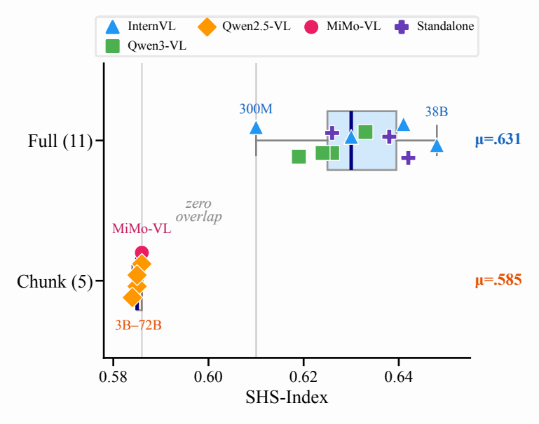

**图 1：SHS-Index 能够区分 ViT 的注意力设计。** 在 16 个开源视觉编码器和 VLM 中，SHS-Index 清晰地区分了采用全注意力与分块窗口注意力的 ViT。在 Qwen2.5-VL 中，将 LLM 的规模从 3B 改为 72B，SHS-Index 几乎保持不变，表明这一信号来自 ViT 的注意力设计。

**图内标签：** Full：全注意力；Chunk：分块窗口；Standalone：独立视觉编码器；zero overlap：无重叠；<i>μ</i>：均值。模型名称、参数量和 SHS-Index 按原图保留。

我们通过全注意力与分块窗口注意力的受控比较来研究这一问题。选择分块窗口，是因为它是当前 VLM 中实际采用的主要 ViT 混合注意力基线。我们在完全相同的条件下从头训练两个 ViT，确保二者唯一的差异是注意力算子：一个模型使用全注意力，另一个使用 Qwen 风格的分块窗口。随后，我们检查各个注意力头的注意力图，以了解这两种算子如何在模型内部组织视觉信息。注意力图呈现出鲜明的定性差异：在全注意力下，注意力头会分化为不同的语义角色，有些关注前景物体，有些关注背景；而在分块窗口下，注意力头则呈现出更为均一的网格状模式。我们将这一现象命名为**注意力头语义专门化（SHS）**。为使这一观察能够得到超越单幅热力图的量化衡量，我们提出 **SHS-Index**，这是一个基于受试者工作特征曲线下面积（AUROC）的指标，用于衡量每个注意力头区分前景词元与背景词元的程度。在 16 个开源视觉编码器和 VLM 中，SHS-Index 能够区分全注意力 ViT 与分块窗口 ViT，且二者的得分区间没有重叠，表明全注意力与分块窗口注意力之间的专门化差距并不局限于我们受控训练的这一对模型。在 Qwen2.5-VL 中，仅将 LLM 主干的规模从 3B 改为 72B，SHS-Index 的变化小于 0.002，支持了这一信号与 ViT 注意力设计而非 LLM 规模有关的判断（图 1）。这些结果说明，将 SHS-Index 用作 ViT 侧的注意力设计诊断指标是合理的。

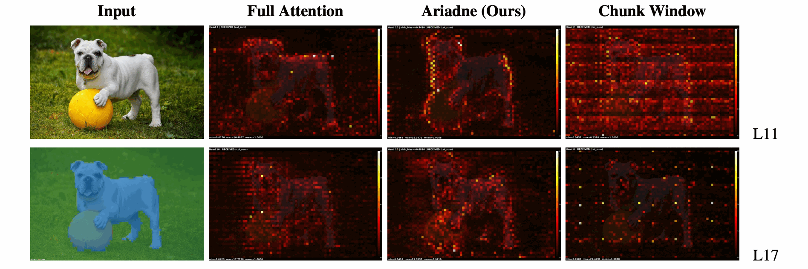

**图 2：ViT 注意力头中的注意力头语义专门化（SHS）。** 第一列：输入图像（上）与前景（蓝色）／背景（绿色）分割结果（下）；根据各个图像块内占主导的区域，将对应的 ViT 词元标记为前景或背景。第 2–4 列：三种注意力设计在两个 ViT 层（L11、L17）中，一个代表性注意力头的接收注意力热力图。在全注意力下，注意力头会形成专门化：明亮区域集中在前景物体上，显示出清晰的物体／背景区分。我们提出的 Ariadne 注意力保留了这种专门化。在分块窗口注意力（Qwen2.5-VL 风格）下，注意力头呈现出由窗口边界造成的网格状伪影，无法区分前景与背景。

**图内标签：** Input：输入；Full Attention：全注意力；Ariadne (Ours)：Ariadne（我们的方法）；Chunk Window：分块窗口；L11／L17：第 11／17 层。

接下来，我们使用 SHS-Index 来诊断分块窗口注意力为何会削弱专门化，以及更好的混合方案如何恢复这种专门化。我们关注窗口交互、词元序列化和局部 softmax 分配这三个结构因素，并衡量每个因素如何改变 SHS-Index。完成结构分析后，我们在 22 项下游基准上评估了经过充分训练的诊断配置。在作为主要评估点的 8k 检查点，SHS-Index 与校正后的 22 项任务平均分相关（Pearson <i>r</i> = 0.858，<i>p</i> = 0.006；精确置换检验 <i>p</i> = 0.008）。我们将这种关系理解为跨架构的证据，而非因果关系或单次训练过程内的预测指标。在这些经验证的因素指导下，我们设计了 **Ariadne Attention**[^ariadne-name]，这是一种依据 SHS 设计的混合注意力，结合了滑动窗口、逐头汇聚槽偏置（sink bias），以及按行／按列交替的序列化方式。在 20 项图像任务基准上，Ariadne 达到 40.40 分，全注意力为 40.92 分；与此同时，在 896<sup>2</sup> 分辨率下，前者的注意力 FLOPs 降至后者的 1/6.5，ViT 端到端耗时降低了 13.5%（附录 I）。这些结果确立了注意力头专门化作为一种连接注意力设计与 ViT 质量的可测量属性，为有原则的混合 ViT 注意力设计开辟了路径。

我们的贡献如下：

1. 我们发现了注意力头语义专门化（SHS），即 ViT 注意力头分化为专注于物体或背景的不同角色的现象；并提出 SHS-Index 这一诊断指标，在 16 个开源视觉编码器和 VLM 中区分了不同注意力家族。
2. 我们通过有针对性的结构比较，识别出影响 SHS 的三个架构因素：窗口交互、词元序列化和局部 softmax 分配。
3. 我们证明，在主要检查点上，SHS-Index 与受控架构之间的基准性能相关，并据此设计了 Ariadne Attention。在 20 项图像任务上，其得分与全注意力相差约 0.5 分，而注意力 FLOPs 仅为后者的 1/6.5。

[^ariadne-name]: 名字取自希腊神话中的阿里阿德涅之线：正如这根线引导忒修斯穿越迷宫，滑动窗口注意力也在词元序列中勾勒出一条连续的路径。

## 2 ViT 注意力中的注意力头语义专门化

为了比较采用全注意力与分块窗口注意力的 ViT 在注意力行为和下游质量方面的差异，我们首先在受控的全注意力与分块窗口比较中，研究各个注意力头的注意力模式（第 2.1 节）。我们使用 **SHS-Index** 来量化这一现象（第 2.2 节），并分析这种专门化差距是否属于架构层面的属性，而不仅仅是 LLM 规模带来的附带影响。

### 2.1 全注意力与分块窗口注意力的模式比较

我们旨在理解不同的 ViT 注意力算子如何塑造逐头注意力模式。我们不以下游得分为起点，而是检查两种特定算子所产生的注意力图：**全注意力**允许每个词元关注所有其他词元；**分块窗口注意力**则使用互不重叠的分块，将每个词元的关注范围限制在其所在分块内。为了比较这两种算子，我们从注意力计算本身出发。对于一个包含 <i>N</i> 个视觉词元的序列及其注意力头 <i>h</i>，令 𝒩(<i>i</i>) 表示查询 <i>i</i> 所关注的词元集合，并定义 ℐ(<i>a</i>, <i>b</i>) = {<i>a</i>, <i>a</i> + 1, …, <i>b</i>} 为从 <i>a</i> 到 <i>b</i> 的词元索引集合。对于全注意力，𝒩(<i>i</i>) = ℐ(1, <i>N</i>)。对于分块大小为 <i>C</i>（例如，<i>C</i> ≪ <i>N</i>）的分块注意力，𝒩(<i>i</i>) = ℐ(<i>b</i><sub><i>i</i></sub><i>C</i> + 1, min(<i>N</i>, (<i>b</i><sub><i>i</i></sub> + 1)<i>C</i>))，其中 <i>b</i><sub><i>i</i></sub> = ⌊(<i>i</i> − 1)/<i>C</i>⌋。在注意力头 <i>h</i> 中，从查询 <i>i</i> 到键 <i>j</i> 的注意力权重为：

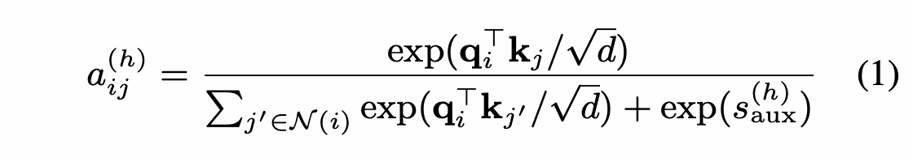

<details>
<summary>公式（1）的 LaTeX 源码</summary>

```latex
a^{(h)}_{ij}
=\frac{\exp(\mathbf{q}_i^\top\mathbf{k}_j/\sqrt{d})}
{\sum_{j'\in\mathcal{N}(i)}\exp(\mathbf{q}_i^\top\mathbf{k}_{j'}/\sqrt{d})+\exp(s^{(h)}_{\mathrm{aux}})}
\tag{1}
```

</details>

其中，<b>q</b><sub><i>i</i></sub> 和 <b>k</b><sub><i>j</i></sub> 分别是词元 <i>i</i> 和 <i>j</i> 的查询向量与键向量，<i>d</i> 是每个注意力头的维度，<i>s</i><sub>aux</sub><sup>(<i>h</i>)</sup> 是逐头可学习的汇聚槽偏置 （[Xiao et al., 2024](#ref-xiao2024streamingllm)；[Darcet et al., 2024](#ref-darcet2024vision)）（不使用汇聚槽时设为 −∞）。我们使用<strong>接收注意力（received attention）</strong>作为每个词元的重要性度量：它表示该词元从所有能够看到它的查询中收集到的注意力总量。词元 <i>j</i> 的接收注意力为：

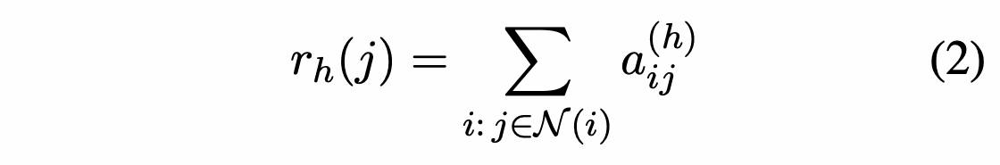

<details>
<summary>公式（2）的 LaTeX 源码</summary>

```latex
r_h(j)=\sum_{i:\,j\in\mathcal{N}(i)}a^{(h)}_{ij}
\tag{2}
```

</details>

直观地说，<i>r</i><sub><i>h</i></sub>(<i>j</i>) 表示词元 <i>j</i> 在注意力头 <i>h</i> 中的重要性，即所有能够看到它的查询所投出的总票数。

公平的比较不能将注意力类型的影响与层深度或训练条件的影响混在一起。因此，我们训练了一对相互匹配的 32 层 ViT 编码器。其中一个模型在所有层中都使用全自注意力。另一个采用 Qwen2.5-VL 风格：第 7、15、23 和 31 层使用全注意力，其余 28 层用分块窗口注意力替代全注意力 （[Bai et al., 2025b](#ref-bai2025qwen25vl)）（架构细节见附录 A.1）。随后，我们在 COCO val2017 图像 （[Lin et al., 2014](#ref-lin2014microsoft)） 上可视化了逐头接收注意力图。结果显示，这两个模型之间存在显著差异。在全注意力下（图 2，第 2 列），注意力头产生的不仅是外观不同的注意力图，它们还会组织成一致的语义角色。有些注意力头向前景物体分配较高的接收注意力，明亮区域与狗和球的位置相吻合；另一些则向背景区域分配较高的接收注意力。我们将这一现象称为**注意力头语义专门化（SHS）**：注意力头通过区分图像中的语义区域形成专门化，在这里最明显地体现为面向物体和面向背景的不同角色。

分块窗口基线的 SHS 则弱得多（图 2，第 4 列）。其热力图呈现出由窗口边界造成的网格状伪影，不同注意力头在定性上看起来相似，未形成清晰的语义角色。这一对比表明，全注意力与分块窗口注意力之间的质量差距，不仅反映在下游基准得分上，还反映在注意力头如何在内部组织，以及如何让各个词元获得面向前景或面向背景的角色。

SHS 也并非单幅图像造成的假象。同一个注意力头在所有用于分析的图像中，都保持着一致的前景或背景偏好（逐图像热力图见附录 D；跨迭代汇总的物体主导情况见附录 E）。这表明，SHS 是训练后模型的一种稳定属性，而非取决于输入刺激的可视化效应。该模式还可以推广到多种视觉场景，包括单物体、多物体、复杂背景，以及前景实体重叠或杂乱的场景，并始终保持物体／背景注意力头专门化（附录 D）。

### 2.2 量化注意力头专门化

上述热力图表明，一个发生专门化的注意力头，应当始终偏好图像中某一类语义区域：物体词元或背景词元。因此，我们将 SHS 转化为一个前景与背景的区分问题。在这一量化分析中，我们使用 COCO 分割掩码，根据每个图像块中占主导的区域，将对应的视觉词元标记为前景或背景（细节见附录 C）。给定接收注意力得分 <i>r</i><sub><i>h</i></sub>(<i>j</i>)（公式 2），专注于前景的注意力头应当给予前景词元比背景词元更高的得分，而专注于背景的注意力头则应当始终表现相反。

对于每个注意力头 <i>h</i> 和每幅图像，我们计算使用接收注意力 <i>r</i><sub><i>h</i></sub>(<i>j</i>) 将前景词元排在背景词元之前时的 AUROC：

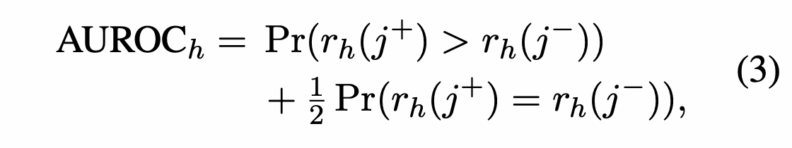

<details>
<summary>公式（3）的 LaTeX 源码</summary>

```latex
\begin{aligned}
\text{AUROC}_h={}&\Pr\bigl(r_h(j^+)>r_h(j^-)\bigr)\\
&+\tfrac{1}{2}\Pr\bigl(r_h(j^+)=r_h(j^-)\bigr),
\end{aligned}
\tag{3}
```

</details>

其中，<i>j</i><sup>+</sup> 和 <i>j</i><sup>−</sup> 分别表示前景词元与背景词元。AUROC 接近 1 或 0，分别表明该注意力头面向前景或面向背景；接近 0.5 则表明没有区分能力。由于任一方向（前景／背景，FG／BG）都代表专门化，我们将注意力头层面的得分定义为：

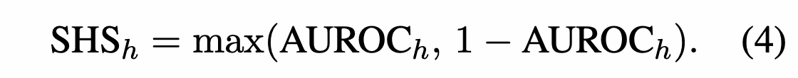

<details>
<summary>公式（4）的 LaTeX 源码</summary>

```latex
\text{SHS}_h=\max\bigl(\text{AUROC}_h,\,1-\text{AUROC}_h\bigr).
\tag{4}
```

</details>

其取值范围从 0.5（没有区分）到 1（高度专门化）。最终的 **SHS-Index** 是该得分在图像、层和注意力头上的平均值：

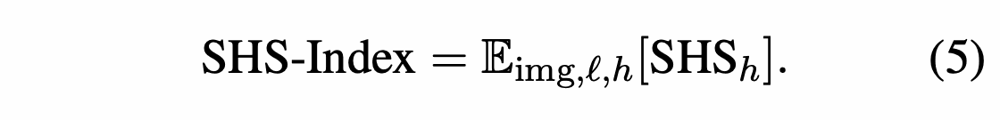

<details>
<summary>公式（5）的 LaTeX 源码</summary>

```latex
\text{SHS-Index}=\mathbb{E}_{\mathrm{img},\ell,h}[\text{SHS}_h].
\tag{5}
```

</details>

在我们受控比较的全注意力／分块窗口模型对中，全注意力的 SHS-Index 为 .606，分块窗口为 .577，从量化角度印证了热力图中观察到的专门化差距。

**SHS-Index 能够区分开源模型中的注意力家族。** 上述受控模型对表明，在训练条件匹配时，SHS-Index 能够捕捉全注意力与分块窗口注意力之间的专门化差距。接下来，我们考察同一信号是否也出现在现有 VLM 中，而不仅仅存在于我们的受控模型中。在 16 个开源视觉编码器和 VLM 中，SHS-Index 清晰地区分了 11 个全注意力编码器（平均 SHS ≈ 0.631）和 5 个分块窗口 ViT（平均 SHS = 0.585），未观察到二者之间的重叠（图 1；完整数据见附录 E）。此外，相同的 Qwen2.5-VL ViT 在搭配规模为 3B–72B 的 LLM 主干时，SHS-Index 的变化小于 0.002，表明 SHS-Index 由 ViT 注意力设计而非语言模型规模决定。因此，开源模型分析支持将 SHS 用作架构层面的诊断指标。由于这些异构模型的数据、训练方案和语言模型主干不同，我们不使用它们进行基准相关性分析。

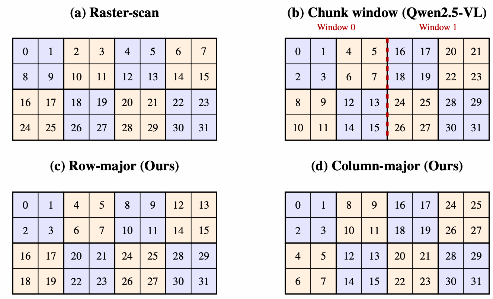

**图 3：4 × 8 图像块网格（2 × 4 个原子块）上的词元排列。** 数字表示词元在一维序列中的位置；粗边框划分出由 2 × 2 个图像块组成的原子块。（a）光栅扫描。（b）Qwen2.5-VL 分块窗口：原子块被划入互不重叠的窗口（红色虚线）；词元 15 与词元 16 在空间上相邻，但位于不同窗口中。（c）行优先：为 SWA 将所有原子块按从左到右、从上到下的顺序序列化。（d）列优先：将原子块按从上到下、从左到右的顺序序列化。Ariadne 在不同层之间交替采用（c）和（d）（第 4.1 节）。

**图内标签：** Raster-scan：光栅扫描；Chunk window：分块窗口；Row-major：行优先；Column-major：列优先；Ours：我们的方法；Window 0／1：窗口 0／1。

## 3 SHS 差距的结构性来源

上述证据显示出明显的 SHS 差距：全注意力的注意力头专门化程度远强于分块窗口注意力。接下来，我们考察哪些结构选择造成了这一差距，旨在将它们转化为更好的混合注意力设计原则。我们通过仅改变注意力的受控比较，依次研究窗口交互、词元序列化和局部 softmax 分配这三个因素。与第 2.1 节相同，所有比较均固定 32 层 ViT、数据、训练方案及作为锚点的全注意力层；唯一改变的是其余 28 层的注意力结构。

**因素 1：窗口隔离限制了空间范围。** 分块窗口注意力与全注意力最直接的差别在于空间覆盖范围。在全注意力中，每个词元都能够从整幅图像收集信息。在分块窗口注意力中，图像词元被划入互不重叠的分块，因此局部层只能在各分块内部混合信息。如果 SHS 要求注意力头跨区域比较物体与背景信息，那么第一个问题就是：放宽这种分块层面的隔离是否能够改善 SHS？为回答这一问题，我们保留 Qwen2.5-VL 原始的二维原子块布局，即先将图像块组成局部的 2 × 2 原子块，再按分块窗口排列（图 3b）；仅将注意力算子从分块窗口注意力改为滑动窗口注意力（sliding-window attention，SWA）（[Jiang et al., 2023](#ref-jiang2023mistral)）。这里，SWA 表示一种以词元为单位的局部注意力模式：对于窗口 (<i>l</i>, <i>r</i>)，查询 <i>i</i> 关注的集合为 𝒩<sub>SWA</sub>(<i>i</i>) = ℐ(max(1, <i>i</i> − <i>l</i>), min(<i>N</i>, <i>i</i> + <i>r</i>))，即由其前后词元构成的窗口，而非固定分块。与固定分块不同，这些窗口会跨越分块边界并相互重叠，因此词元不再被限制在原来的分块内；随着层的叠加，信息可以通过连续的窗口传播到空间上远得多的区域。在这一受控改变下，SHS-Index 从 .577（chunk-2D）提升至 .588（SWA-2D）。注意力距离提供了直接的物理层面检验：采用 [Dosovitskiy et al.（2021）](#ref-dosovitskiy2021vit)的注意力距离定义，<i>D</i> = 𝔼<sub><i>h</i>, <i>i</i></sub>[∑<sub><i>j</i></sub><i>a</i><sub><i>i</i><i>j</i></sub><sup>(<i>h</i>)</sup>‖<i>p</i><sub><i>i</i></sub> − <i>p</i><sub><i>j</i></sub>‖<sub>2</sub>]，其中 <i>p</i><sub><i>i</i></sub> 是词元 <i>i</i> 在图像中的二维位置，平均跨度从 <i>D</i> = 10.69 增至 <i>D</i> = 11.80。**这表明，窗口隔离是 SHS 差距的一个来源：分块窗口限制了空间范围，而更好的混合 ViT 应当允许词元交互自由地跨越窗口边界，以传播空间上下文。**

**因素 2：序列化顺序决定专门化质量。** SWA 增加了跨窗口交互，但它仍然作用于一维词元序列。因此，将 SWA 应用于图像词元时，需要选择如何把二维图像块网格序列化为这一序列。上述 SWA-2D 变体保留了 Qwen2.5-VL 的分块窗口排序：先将相邻图像块组成局部原子块，再将同一分块中的原子块在一维序列中相邻排列。当注意力在每个分块内部单独计算时，这一排序方式是合适的；但当滑动窗口沿序列移动时，它就会产生问题。如图 4a 所示，在这种二维布局下，当 SWA 滑过分块边界时，序列中的相邻位置可能突然跳到图像中的远处区域，使单个局部注意力窗口混合了空间上相近与相远的词元。因此，我们考察 SWA 是否应使用能够保留空间连续性的序列化方式。为此，我们保持 SWA 算子不变，并引入 *SWA-1D*：一种行优先的一维序列化方式，将原子块按从左到右、从上到下的顺序展平，使序列中的连续位置能够更好地对应图像中的相邻区域（图 3b–c）。在这一受控改变下，SHS-Index 从 .588（SWA-2D）提升至 .600（SWA-1D）。**这表明，序列化顺序是 SHS 差距的第二个来源：当在原始二维布局上使用滑动窗口注意力时，词元序列化应当保留空间上连贯的邻域。**

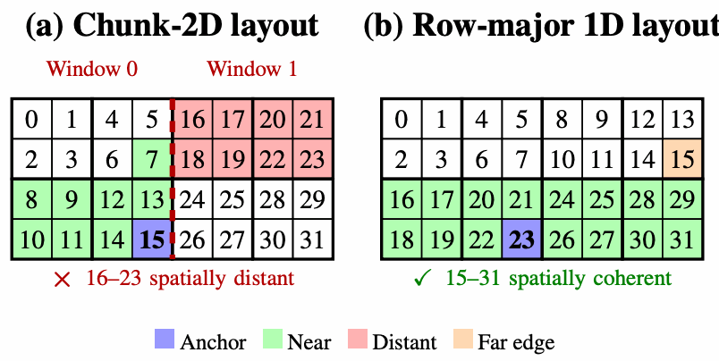

**图 4：二维词元排序为何与 SWA 不兼容。** 数字表示词元在一维序列中的位置。（a）Chunk-2D：邻居词元 16–23（红色）映射到窗口 1 的顶部，在空间上远离锚点（蓝色）。（b）行优先一维布局：几乎所有邻居词元（绿色）都落在周围各行中，形成一个连贯的邻域。

**图内标签：** Chunk-2D layout：分块二维布局；Row-major 1D layout：行优先一维布局；spatially distant：空间上相距较远；spatially coherent：空间上连贯；Anchor／Near／Distant／Far edge：锚点／近邻／远处／远端边缘。

**因素 3：Softmax 会向背景分配注意力。** 即便增加了跨窗口交互并改进了序列化方式，局部注意力仍然只允许每个查询关注词元的一个子集。在这一子集中，标准注意力使用 softmax 对得分进行归一化 （[Vaswani et al., 2017](#ref-vaswani2017attention)），强制可用键上的注意力权重耗尽该查询的全部概率质量。当局部窗口包含大量信息量不足的背景词元时，这一约束可能会向注意力头本来更愿意忽略的词元分配不可忽略的注意力。因此，我们考察显式设置一个吸收多余概率质量的通道是否有利于局部注意力。参照 GPT-OSS （[OpenAI, 2025](#ref-openai2025gptoss)） 等近期的高效注意力设计，我们加入逐头可学习的汇聚槽偏置 <i>s</i><sub>aux</sub><sup>(<i>h</i>)</sup>：如式（1）所定义，它在分母中贡献一个额外项，但不对应任何图像词元。因此，它充当一个可吸收注意力概率质量的虚拟汇聚槽，避免这些注意力被迫分配给前景或背景词元。SHS 方面的证据并非完全一致，但具有启发性。加入汇聚槽会使 SWA-1D 的 SHS 略有下降（.600 → .598），我们明确报告了这一点。然而，同样的干预在其他受控设置中提高了 SHS：chunk-2D（.577 → .579）、SWA-2D（.588 → .597）和全注意力（.606 → .611）。分配分析进一步显示了汇聚槽的预期作用：在 SWA 模型中，94%–97% 的注意力头从背景转移到汇聚槽的注意力多于从前景转移的注意力（附录 F）。**这表明，局部 softmax 分配是 SHS 差距的第三个来源：局部注意力中的 softmax 可能将注意力浪费在信息量不足的词元上，而显式汇聚槽提供了一个有用的吸收通道；不过，它对 SHS 的影响取决于周围的注意力结构，SWA-1D 是一个例外。**

将这些受控干预放在一起，可以简明地展示注意力结构如何影响 SHS-Index（图 5；完整配置见表 3）。由于各变体只在注意力结构上存在差异，SHS-Index 的分布差异直接反映了这些结构选择如何影响注意力头专门化。这使 SHS-Index 自然成为连接机制与设计的桥梁：在证明注意力结构能够塑造这一信号之后，我们检验在受控配置之间，同一信号是否与下游质量相一致。

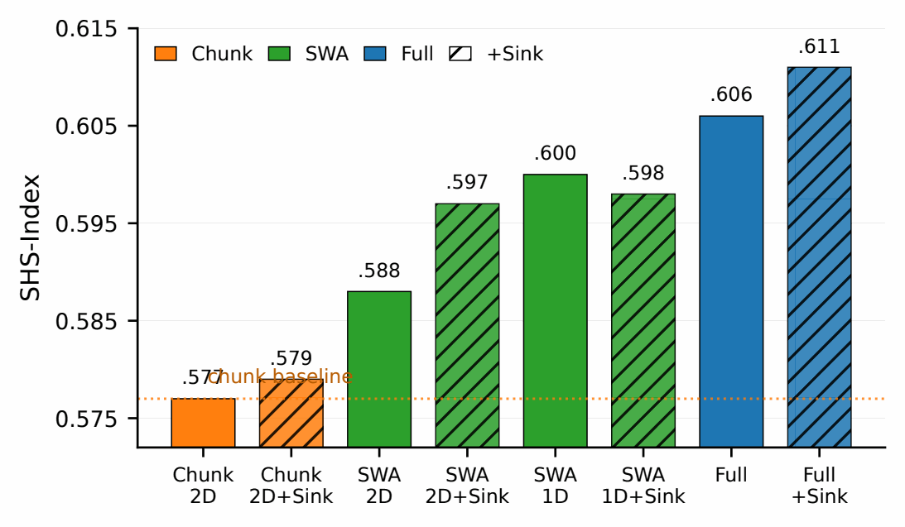

**图 5：不同结构配置的 SHS-Index。** 各受控变体采用相同的主干和训练方案，仅在局部注意力结构上有所不同。在上述经验证的结构改变下，SHS-Index 有所提升；其中 Full+Sink 是 SHS 最高的诊断点，chunk-2D 则最低。

**图内标签：** Chunk：分块窗口；SWA：滑动窗口注意力；Full：全注意力；+Sink：加入汇聚槽；chunk baseline：分块窗口基线；1D／2D：一维／二维布局。

**在受控设计空间内，SHS-Index 与基准性能相关。** 我们在 22 项下游基准上评估经过充分训练的诊断配置，其中包括 AI2D、OCRBench 等 20 项图像任务，以及 Video-MME 等 2 项视频任务。修正 MMBench-EN 中的输出格式异常问题后，在 8k 检查点，SHS-Index 与 22 项基准任务的平均分相关（Pearson <i>r</i> = 0.858，<i>p</i> = 0.006；精确置换检验 <i>p</i> = 0.008；见图 6；完整稳健性分析见附录 G）。自助法（bootstrap）95% 区间为 [0.51, 0.98]。这是在充分训练的检查点上观察到的跨架构信号，而非因果关系或单次训练过程内的预测指标。在这一受控设置下，它有助于比较注意力设计，但对于依赖精确几何关系或计数的任务类别，其解释能力仍然有限。完整的 SHS-Index 变化轨迹见附录 E（表 12）；架构比较中使用的完整基准变化轨迹见附录 B（表 5 和表 6 分别报告 20 项图像任务和 22 项任务的平均分）。关于注意力头集体作用的证据见附录 H。


## 4 SHS 指导的 Ariadne Attention 设计

上一节识别了塑造 SHS 的结构因素，并通过受控比较表明，SHS-Index 与下游基准性能相关。现在，我们利用这些发现设计一种混合注意力模式。以经过验证的组件——滑动窗口注意力、一维序列化和汇聚槽偏置——为基础，我们交替采用行优先与列优先序列化，进一步增强词元在图像不同维度上的交互。由此得到的混合注意力 **Ariadne Attention** 是对 SHS 框架的验证，而非声称提出了一种新的基本注意力算子。

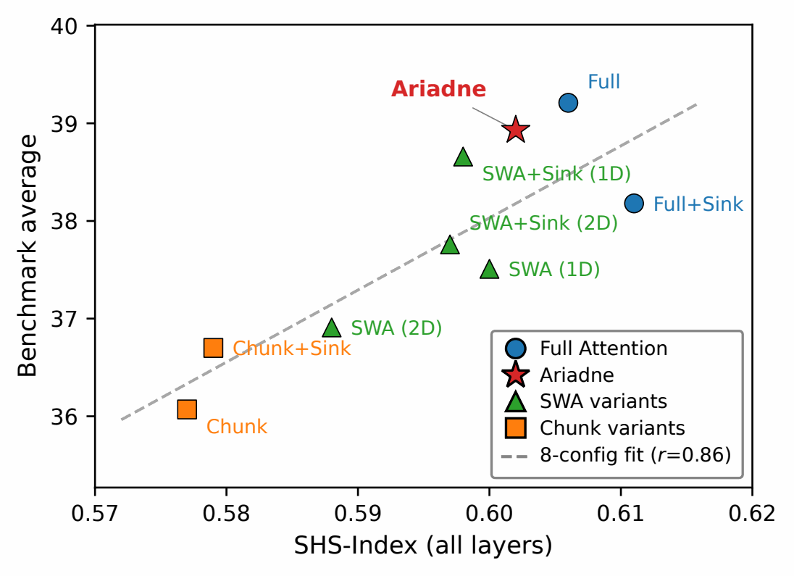

**图 6：SHS-Index 与基准性能。** 在八种诊断配置中，SHS-Index 与校正后的 22 项任务平均得分相关（<i>r</i> = 0.858，<i>p</i> = 0.006；虚线表示对八种配置进行线性拟合的结果）。Ariadne 作为后续设计得到的一个数据点展示，未用于确定主要拟合关系。

**图内标签：** Benchmark average：基准平均分；SHS-Index (all layers)：全部层的 SHS-Index；SWA variants／Chunk variants：SWA 变体／分块窗口变体；8-config fit：八种配置的拟合线。

### 4.1 Ariadne Attention

现在，我们将 SHS 分析所提示的设计具体实现出来。Ariadne 以受控研究中能够改善或稳定 SHS 的三个组件为起点：使用滑动窗口注意力（SWA）缓解分块之间的隔离，使用具有空间连贯性的一维序列化使局部窗口在图像上具有合理含义，并使用每个注意力头独立的汇聚槽偏置吸收多余的 softmax 概率质量。SWA 将互不重叠的分块窗口替换为按词元定义的重叠邻域，使相邻窗口无需恢复全注意力就能交换信息。汇聚槽偏置使用 FlashAttention-3 原生的 `s_aux` 项（[Shah et al., 2024](#ref-shah2024flashattention3)），作为不增加词元的吸收器，起到与注意力汇聚槽／寄存器词元（[Xiao et al., 2024](#ref-xiao2024streamingllm)；[Darcet et al., 2024](#ref-darcet2024vision)）相同的作用，同时不引入额外的视觉词元。

剩下的设计问题是：如何为 SWA 序列化二维图像词元。单一的行优先顺序保留了水平方向的连续性，但跨列的信息传播不够直接。因此，Ariadne 沿网络深度交替采用行优先与列优先序列化，使局部窗口能够通过连续的多层连接图像的两个维度。具体而言，每个八层模块包含 4 层行优先 SWA + 汇聚槽、3 层列优先 SWA + 汇聚槽，以及 1 层全注意力锚定层；将该模块重复四次，便构成 32 层 ViT（图 7）。4∶3 的比例是一项实用层面的改进，并非主要贡献：一个八层模块已能沿图像的两个轴传播信息，因此相近的比例应具有类似的感受野覆盖范围。我们采用按组排列的 RRRR-CCC 顺序，是因为逐层采用 RCRC 交替顺序，会要求每层都执行一次受内存带宽限制的词元重排，而 RRRR-CCC 只需在行优先与列优先之间的切换处执行重排。我们将 SWA 每一侧的窗口设为 <i>w</i> = 64（上下文总计 128 个词元），与 GPT-OSS（[OpenAI, 2025](#ref-openai2025gptoss)）一致；对 <i>w</i> ∈ {32, 64, 128} 的消融实验同样选出该值作为最佳设置（SHS = .602，22 项任务得分 = 38.93；附录 A）。

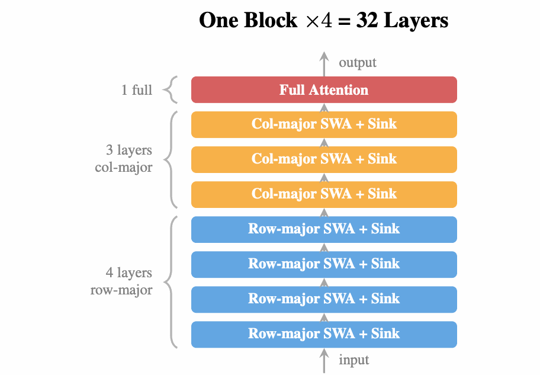

**图 7：Ariadne Attention 的 4-row-3-col 模块架构。** 每个模块包含 4 层行优先 SWA + 汇聚槽、3 层列优先 SWA + 汇聚槽，以及 1 层全注意力；重复四次后构成 32 层 ViT。

**图内标签：** One Block × 4 = 32 Layers：一个模块重复 4 次，共 32 层；Row-major／Col-major SWA + Sink：行优先／列优先 SWA + 汇聚槽；Full Attention：全注意力；input／output：输入／输出；1 full：1 层全注意力。

### 4.2 主要结果

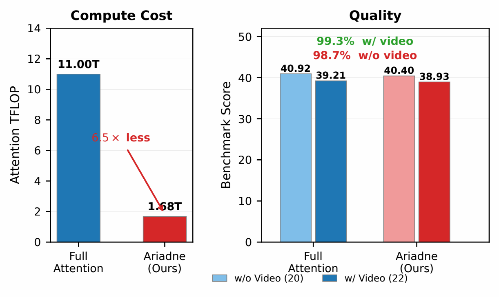

**图 8：在 896<sup>2</sup> 分辨率下，注意力计算量与图像任务性能的关系。** Ariadne（红色星形标记）是一种由 SHS 指导的混合注意力，在注意力浮点运算次数降至全注意力的约 1/6.5 的情况下，与全注意力的得分差距约为 0.5 分。

**图内标签：** Compute Cost：计算成本；Quality：性能；Attention TFLOP：注意力浮点运算次数（万亿次）；Benchmark Score：基准得分；w/ video (22)：含视频的 22 项任务；w/o video (20)：不含视频的 20 项任务；6.5× less：约为原来的 1/6.5。

| 配置 | 图像任务（20 项） | 视频任务（2 项） |
| --- | ---: | ---: |
| 全注意力 | **40.92** | 22.1 |
| 分块窗口注意力 | 37.35 | 23.3 |
| Ariadne Attention | 40.40 | **24.3** |

**表 1：在 8k 主要检查点上，分别报告图像任务与视频任务经校正后的基准平均得分。** Ariadne 在图像任务上与全注意力相差 0.52 分；两项视频任务单独报告，不合并进主要结果的汇总表述。

我们首先考察，由 SHS 指导的设计是否缩小了与全注意力之间的性能差距。Ariadne 在 20 项图像任务基准上的得分为 40.40，全注意力为 40.92，两者相差 0.52 分；在两项视频任务上，Ariadne 达到 24.3 分（表 1；图 8）。相对于分块窗口注意力，Ariadne 将经校正的 20 项图像任务平均得分提高了 +3.05 分，表明这种混合注意力既恢复了全注意力的大部分综合图像性能，也优于分块窗口基线。

最大的提升出现在最受分块窗口隔离限制的任务上，即需要在相距较远的区域中寻找证据，或将精细的局部细节与更广泛的上下文结合起来的任务。在感知基准上，相对于分块窗口注意力，Ariadne 在 CV-Bench 上提高了 +6.1 分，在 VLMs-are-Blind 上提高了 +7.2 分。在高分辨率视觉搜索任务上，V* 提高了 +11.0 分，这与行／列序列化和滑动窗口能够改善整幅图像内证据传播的作用一致。OCR 和文档类任务也呈现相同模式：DocVQA 提高了 +9.8 分，InfoVQA 提高了 +7.7 分，OCRBench 提高了 +8.9 分，反映出这些任务需要跨越相距较远的区域，将局部文本证据与页面级版面上下文联系起来。

其余任务层面的差异同样具有启示意义。指代表达定位任务的变化很小（RefCOCO +0.2，RefCOCO+ ±0.0，RefCOCOg +1.1），说明这些基准对 Ariadne 所针对的跨区域整合不太敏感，主要由局部短语与区域之间的匹配决定。图表和计数任务的表现略有下降（ChartXiv-RQ −1.6，ChartQA −1.2，PixMo-Count −1.9），表明精确的几何推理与实例级计数可能需要当前行／列序列化之外的其他结构保留机制。总体而言，Ariadne 的优势在需要整合跨区域证据的任务上最为突出，而对几何或计数高度敏感的任务，则为未来的混合注意力设计指出了一个互补方向。全部 22 项任务的逐项结果见附录 B（表 7）。

### 4.3 效率

最后，我们测试实际内核耗时，而不仅仅考察注意力的渐近复杂度。汇聚槽偏置不增加计算开销：FlashAttention-3 将 `s_aux` 实现为在 softmax 分母中加入一个标量（[Shah et al., 2024](#ref-shah2024flashattention3)）。在 896<sup>2</sup> 分辨率下，Ariadne 的端到端 ViT 前向传播耗时为 106.8 ms，全注意力为 123.5 ms（−13.5%）；在 1792<sup>2</sup> 分辨率下，随着二次计算成本占据主导，节省幅度扩大至 −39.4%。在 896<sup>2</sup> 分辨率下，SWA 也比分块窗口注意力更快（注意力内核耗时分别为 6.7 ms 和 17.5 ms），因为 FlashAttention-3 的连续 SWA 内核比变长（varlen）接口优化得更好（图 9）。因此，Ariadne 改善了实测的性能与计算量权衡前沿；附录 I 报告了七种分辨率下的耗时，并区分了注意力浮点运算次数与端到端模块耗时。

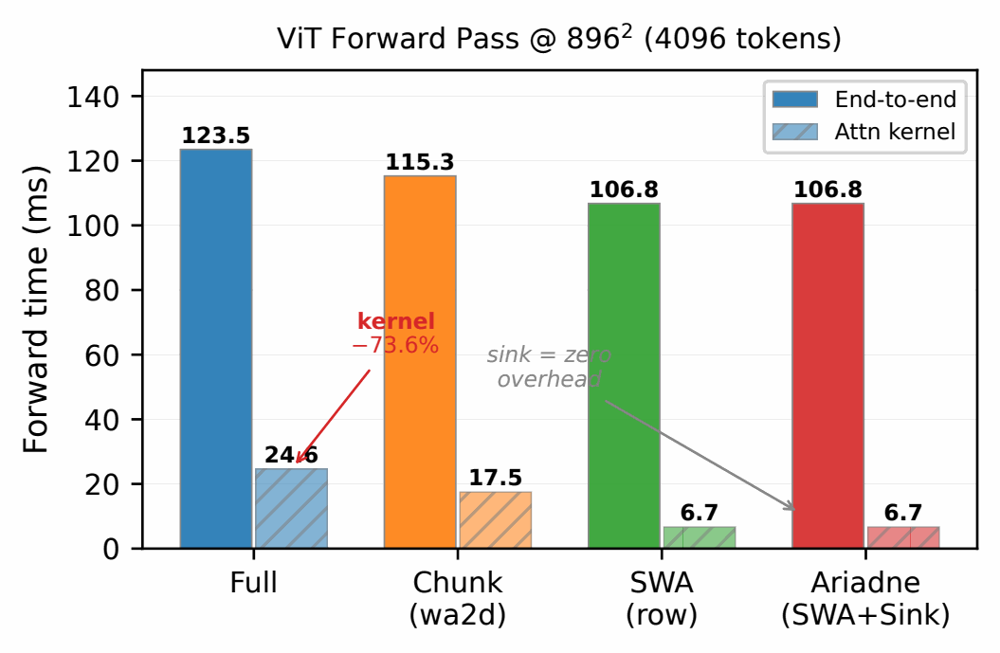

**图 9：在 896<sup>2</sup> 分辨率下（4,096 个词元）的 ViT 前向传播耗时。** 实心柱表示端到端模块耗时，斜线柱仅表示注意力内核耗时。在更新后的扩展实验中，Ariadne 的端到端耗时为 106.8 ms，全注意力为 123.5 ms；两者的注意力内核耗时分别为 6.7 ms 和 24.6 ms。

**图内标签：** ViT Forward Pass：ViT 前向传播；Forward time (ms)：前向传播耗时（毫秒）；End-to-end：端到端；Attn kernel：注意力内核；sink = zero overhead：汇聚槽零额外开销。

## 5 相关工作

**注意力头的行为。** 既有工作在自然语言处理（NLP）中识别出了专门承担句法和位置角色的注意力头（[Voita et al., 2019](#ref-voita2019analyzing)；[Michel et al., 2019](#ref-michel2019sixteen)）。在视觉领域，自监督 ViT 会形成能够分割物体的 CLS 注意力图（[Caron et al., 2021](#ref-caron2021emerging)），而 CLIP 和生成式多模态 Transformer 则呈现出在语义上可解释的注意力头角色（[Gandelsman et al., 2023](#ref-gandelsman2023clip)；[Basile et al., 2025](#ref-basile2025headpursuit)）。我们通过 SHS-Index 将这一研究方向扩展到有监督的多模态 ViT；SHS-Index 是一种连续且不区分偏好方向的前景／背景度量。我们的结果是在一个固定且经过充分训练的检查点上观察到的跨架构相关性，并非声称专门化程度能单调地预测每一项任务的性能。

**视觉 Transformer 中的混合注意力。** 高效 ViT 包括移位窗口（[Liu et al., 2021](#ref-liu2021swin)）、轴向／条带设计（[Ho et al., 2019](#ref-ho2019axial)；[Wang et al., 2020](#ref-wang2020axialdeeplab)；[Huang et al., 2019](#ref-huang2019ccnet)；[Dong et al., 2021](#ref-dong2021cswin)），以及 Twins、Focal、NAT 和 MaxViT 等局部／混合主干网络（[Chu et al., 2021](#ref-chu2021twins)；[Yang et al., 2021](#ref-yang2021focal)；[Hassani et al., 2022](#ref-hassani2022nat)；[Tu et al., 2022](#ref-tu2022maxvit)）。视觉状态空间模型进一步表明，从二维到一维的扫描顺序很重要（[Liu et al., 2024b](#ref-liu2024vmamba)；[Zhu et al., 2024](#ref-zhu2024vim)）。InternVL 2.5 和 Qwen3-VL 使用全注意力，而 Qwen2.5-VL 使用分块窗口（[Chen et al., 2024](#ref-chen2024internvl25)；[Bai et al., 2025a](#ref-bai2025qwen3vl)；[Bai et al., 2025b](#ref-bai2025qwen25vl)）。我们在受控的多模态大语言模型流程中研究这一权衡。Ariadne 在功能上与轴向／条带注意力相关，但采用了重叠窗口，以及按组进行行／列切换的调度方式，以提高融合内核的效率；核心贡献是 SHS，而非一种新的基本算子。其汇聚槽偏置也与 ViT 寄存器和大语言模型的注意力汇聚槽相关（[Darcet et al., 2024](#ref-darcet2024vision)；[Xiao et al., 2024](#ref-xiao2024streamingllm)）。

## 6 结论

本文研究了在多模态大语言模型中，混合 ViT 注意力为何落后于全注意力。我们发现了注意力头语义专门化（SHS）现象：全注意力中的注意力头分化为专注于物体和专注于背景的角色，而分块窗口注意力头的这种区分较弱。SHS-Index 量化了这一行为，在 16 个开源视觉编码器与视觉语言模型中区分了全注意力和分块窗口这两类设计，并揭示了三个结构因素：窗口交互、词元序列化以及局部 softmax 分配。在 8k 检查点上，它与经校正的 22 项任务平均得分相关（<i>r</i> = .858），最优性能对应的是中等程度的专门化，而不是随专门化程度单调变化。在这些因素的指导下，Ariadne 在 20 项图像任务上达到 40.40 分，全注意力为 40.92 分；在 896<sup>2</sup> 分辨率下，其注意力浮点运算次数降至全注意力的约 1/6.5，端到端 ViT 耗时减少了 13.5%。因此，在这一研究范围内，SHS-Index 是一种简洁的诊断指标，可用于比较和设计混合 ViT 注意力。

## 局限性

**受控研究的规模。** 全部九种架构使用相同的训练配置（随机初始化的 ViT、Qwen2-0.5B、10k 步训练），仅使用一个随机种子，并在单个主要检查点上进行评估。校正后的 MMBench-EN 评估仅覆盖 8k 主要检查点；10k 敏感性分析对应的各行保留了原始评估结果，并已明确标注。受控设计隔离了注意力算子的影响，但这一量化相关性尚未在更大的语言主干模型、多个随机种子，或与每一种轴向／条带基线从头训练的比较中得到检验。开源模型分析目前覆盖了大约五个相互独立的全注意力 ViT 模型谱系，并支持这种结构性区分在更大规模上的存在，但并未确立这些异构模型之间的基准性能相关性。

## 致谢

本工作得到国家重点研发计划项目（项目编号：2024YFB2906603）的支持，并得到国家自然科学基金（NSFC，项目编号：62372009）的部分支持。


## References

<a id="ref-bai2025qwen3vl"></a>

Shuai Bai, Yuxuan Cai, Ruizhe Chen, Keqin Chen, Xionghui Chen, Zesen Cheng, Lianghao Deng, Wei Ding, Chang Gao, Chunjiang Ge, et al. 2025a. [Qwen3-VL technical report](https://arxiv.org/abs/2511.21631). *ArXiv preprint*, abs/2511.21631.

<a id="ref-bai2025qwen25vl"></a>

Shuai Bai, Keqin Chen, Xuejing Liu, Jialin Wang, Wenbin Ge, Sibo Song, Kai Dang, Peng Wang, Shijie Wang, Jun Tang, et al. 2025b. [Qwen2.5-VL technical report](https://arxiv.org/abs/2502.13923). *ArXiv preprint*, abs/2502.13923.

<a id="ref-barbero2025why"></a>

Federico Barbero, Álvaro Arroyo, Xiangming Gu, Christos Perivolaropoulos, Michael Bronstein, Petar Veličković, and Razvan Pascanu. 2025. [Why do LLMs attend to the first token?](https://arxiv.org/abs/2504.02732) *ArXiv preprint*, abs/2504.02732.

<a id="ref-basile2025headpursuit"></a>

Lorenzo Basile, Valentino Maiorca, Diego Doimo, Francesco Locatello, and Alberto Cazzaniga. 2025. [Head pursuit: Probing attention specialization in multimodal transformers](https://arxiv.org/abs/2510.21518). *ArXiv preprint*, abs/2510.21518.

<a id="ref-caron2021emerging"></a>

Mathilde Caron, Hugo Touvron, Ishan Misra, Hervé Jégou, Julien Mairal, Piotr Bojanowski, and Armand Joulin. 2021. [Emerging properties in self-supervised vision transformers](https://doi.org/10.1109/ICCV48922.2021.00951). In *2021 IEEE/CVF International Conference on Computer Vision, ICCV 2021, Montreal, QC, Canada, October 10-17, 2021*, pages 9630–9640. IEEE.

<a id="ref-chen2024internvl25"></a>

Zhe Chen, Weiyun Wang, Yue Cao, Yangzhou Liu, Zhangwei Gao, Erfei Cui, Jinguo Zhu, Shenglong Ye, Hao Tian, et al. 2024. [Expanding performance boundaries of open-source multimodal models with model, data, and test-time scaling](https://arxiv.org/abs/2412.05271). *ArXiv preprint*, abs/2412.05271.

<a id="ref-chu2021twins"></a>

Xiangxiang Chu, Zhi Tian, Yuqing Wang, Bo Zhang, Haibing Ren, Xiaolin Wei, Huaxia Xia, and Chunhua Shen. 2021. [Twins: Revisiting the design of spatial attention in vision transformers](https://arxiv.org/abs/2104.13840). *ArXiv preprint*, abs/2104.13840.

<a id="ref-dao2023flashattention2"></a>

Tri Dao. 2024. [Flashattention-2: Faster attention with better parallelism and work partitioning](https://openreview.net/forum?id=mZn2Xyh9Ec). In *The Twelfth International Conference on Learning Representations, ICLR 2024, Vienna, Austria, May 7-11, 2024*. OpenReview.net.

<a id="ref-dao2022flashattention"></a>

Tri Dao, Daniel Y. Fu, Stefano Ermon, Atri Rudra, and Christopher Ré. 2022. [Flashattention: Fast and memory-efficient exact attention with io-awareness](http://papers.nips.cc/paper_files/paper/2022/hash/67d57c32e20fd0a7a302cb81d36e40d5-Abstract-Conference.html). In *Advances in Neural Information Processing Systems 35: Annual Conference on Neural Information Processing Systems 2022, NeurIPS 2022, New Orleans, LA, USA, November 28 - December 9, 2022*.

<a id="ref-darcet2024vision"></a>

Timothée Darcet, Maxime Oquab, Julien Mairal, and Piotr Bojanowski. 2024. [Vision transformers need registers](https://openreview.net/forum?id=2dnO3LLiJ1). In *The Twelfth International Conference on Learning Representations, ICLR 2024, Vienna, Austria, May 7-11, 2024*. OpenReview.net.

<a id="ref-deitke2024molmo"></a>

Matt Deitke, Christopher Clark, Sangho Lee, Rohun Tripathi, Yue Yang, Jae Sung Park, Mohammadreza Salehi, Niklas Muennighoff, Kyle Lo, Luca Soldaini, et al. 2024. [Molmo and PixMo: Open weights and open data for state-of-the-art vision-language models](https://arxiv.org/abs/2409.17146). *ArXiv preprint*, abs/2409.17146.

<a id="ref-dong2021cswin"></a>

Xiaoyi Dong, Jianmin Bao, Dongdong Chen, Weiming Zhang, Nenghai Yu, Lu Yuan, Dong Chen, and Baining Guo. 2021. [CSWin transformer: A general vision transformer backbone with cross-shaped windows](https://arxiv.org/abs/2107.00652). *ArXiv preprint*, abs/2107.00652.

<a id="ref-dosovitskiy2021vit"></a>

Alexey Dosovitskiy, Lucas Beyer, Alexander Kolesnikov, Dirk Weissenborn, Xiaohua Zhai, Thomas Unterthiner, Mostafa Dehghani, Matthias Minderer, Georg Heigold, Sylvain Gelly, Jakob Uszkoreit, and Neil Houlsby. 2021. [An image is worth 16x16 words: Transformers for image recognition at scale](https://openreview.net/forum?id=YicbFdNTTy). In *9th International Conference on Learning Representations, ICLR 2021, Virtual Event, Austria, May 3-7, 2021*. OpenReview.net.

<a id="ref-fu2024videomme"></a>

Chaoyou Fu, Yuhan Dai, Yongdong Luo, Lei Li, Shuhuai Ren, Renrui Zhang, Zihan Wang, Chenyu Zhou, Yunhang Shen, Mengdan Zhang, Peixian Chen, Yanwei Li, Shaohui Lin, Sirui Zhao, Ke Li, Tong Xu, Xiawu Zheng, Enhong Chen, Caifeng Shan, et al. 2025. [Video-MME: The first-ever comprehensive evaluation benchmark of multi-modal LLMs in video analysis](https://doi.org/10.1109/CVPR52734.2025.02245). In *IEEE/CVF Conference on Computer Vision and Pattern Recognition (CVPR)*, pages 24108–24118.

<a id="ref-fu2024blink"></a>

Xingyu Fu, Yushi Hu, Bangzheng Li, Yu Feng, Haoyu Wang, Xudong Lin, Dan Roth, Noah A. Smith, Wei-Chiu Ma, and Ranjay Krishna. 2024. [BLINK: Multimodal large language models can see but not perceive](https://doi.org/10.1007/978-3-031-73337-6_9). In *Computer Vision – ECCV 2024*, pages 148–166. Springer.

<a id="ref-gandelsman2023clip"></a>

Yossi Gandelsman, Alexei A. Efros, and Jacob Steinhardt. 2023. [Interpreting CLIP’s image representation via text-based decomposition](https://arxiv.org/abs/2310.05916). *ArXiv preprint*, abs/2310.05916.

<a id="ref-gemmateam2025gemma3"></a>

Gemma Team. 2025. [Gemma 3 technical report](https://arxiv.org/abs/2503.19786). *ArXiv preprint*, abs/2503.19786.

<a id="ref-gu2025attention"></a>

Xiangming Gu, Tianyu Pang, Chao Du, Qian Liu, Fengzhuo Zhang, Cunxiao Du, Ye Wang, and Min Lin. 2025. [When attention sink emerges in language models: An empirical view](https://openreview.net/forum?id=78Nn4QJTEN). In *The Thirteenth International Conference on Learning Representations (ICLR)*.

<a id="ref-guo2024active"></a>

Tianyu Guo, Druv Pai, Yu Bai, Jiantao Jiao, Michael I. Jordan, and Song Mei. 2024. [Active-dormant attention heads: Mechanistically demystifying extreme-token phenomena in LLMs](https://arxiv.org/abs/2410.13835). *ArXiv preprint*, abs/2410.13835.

<a id="ref-hassani2022nat"></a>

Ali Hassani, Steven Walton, Jiachen Li, Shen Li, and Humphrey Shi. 2022. [Neighborhood attention transformer](https://arxiv.org/abs/2204.07143). *ArXiv preprint*, abs/2204.07143.

<a id="ref-ho2019axial"></a>

Jonathan Ho, Nal Kalchbrenner, Dirk Weissenborn, and Tim Salimans. 2019. [Axial attention in multidimensional transformers](https://arxiv.org/abs/1912.12180). *ArXiv preprint*, abs/1912.12180.

<a id="ref-hu2025videommmu"></a>

Kairui Hu, Penghao Wu, Fanyi Pu, Wang Xiao, Yuanhan Zhang, Xiang Yue, Bo Li, and Ziwei Liu. 2025. [Video-MMMU: Evaluating knowledge acquisition from multi-discipline professional videos](https://arxiv.org/abs/2501.13826). *ArXiv preprint*, abs/2501.13826.

<a id="ref-huang2019ccnet"></a>

Zilong Huang, Xinggang Wang, Yunchao Wei, Lichao Huang, Humphrey Shi, Wenyu Liu, and Thomas S. Huang. 2019. [CCNet: Criss-cross attention for semantic segmentation](https://arxiv.org/abs/1811.11721). *ArXiv preprint*, abs/1811.11721.

<a id="ref-jiang2023mistral"></a>

Albert Q Jiang, Alexandre Sablayrolles, Arthur Mensch, Chris Bamford, Devendra Singh Chaplot, Diego de las Casas, Florian Bressand, Gianna Lengyel, Guillaume Lample, Lucile Saulnier, et al. 2023. [Mistral 7b](https://arxiv.org/abs/2310.06825). *ArXiv preprint*, abs/2310.06825.

<a id="ref-jiang2024mantis"></a>

Dongfu Jiang, Xuan He, Huaye Zeng, Cong Wei, Max Ku, Qian Liu, and Wenhu Chen. 2024. [MANTIS: Interleaved multi-image instruction tuning](https://openreview.net/forum?id=skLtdUVaJa). *Transactions on Machine Learning Research (TMLR)*.

<a id="ref-kembhavi2016ai2d"></a>

Aniruddha Kembhavi, Mike Salvato, Eric Kolve, Minjoon Seo, Hannaneh Hajishirzi, and Ali Farhadi. 2016. [A diagram is worth a dozen images](https://doi.org/10.1007/978-3-319-46493-0_15). In *European Conference on Computer Vision (ECCV)*.

<a id="ref-lin2014microsoft"></a>

Tsung-Yi Lin, Michael Maire, Serge Belongie, James Hays, Pietro Perona, Deva Ramanan, Piotr Dollár, and C. Lawrence Zitnick. 2014. [Microsoft COCO: Common objects in context](https://doi.org/10.1007/978-3-319-10602-1_48). In *European Conference on Computer Vision (ECCV)*, pages 740–755.

<a id="ref-liu2023mmbench"></a>

Yuan Liu, Haodong Duan, Yuanhan Zhang, Bo Li, Songyang Zhang, Wangbo Zhao, Yike Yuan, Jiaqi Wang, Conghui He, Ziwei Liu, Kai Chen, and Dahua Lin. 2024a. [MMBench: Is your multi-modal model an all-around player?](https://doi.org/10.1007/978-3-031-72658-3_13) In *Computer Vision – ECCV 2024*, pages 216–233. Springer.

<a id="ref-liu2024vmamba"></a>

Yue Liu, Yunjie Tian, Yuzhong Zhao, Hongtian Yu, Lingxi Xie, Yaowei Wang, Qixiang Ye, Jianbin Jiao, and Yunfan Liu. 2024b. [VMamba: Visual state space model](https://arxiv.org/abs/2401.10166). *ArXiv preprint*, abs/2401.10166.

<a id="ref-liu2023ocrbench"></a>

Yuliang Liu, Zhang Li, Mingxin Huang, Biao Yang, Wenwen Yu, Chunyuan Li, Xu-Cheng Yin, Cheng-Lin Liu, Lianwen Jin, and Xiang Bai. 2024c. [OCRBench: On the hidden mystery of OCR in large multimodal models](https://doi.org/10.1007/s11432-024-4235-6). *Science China Information Sciences*, 67.

<a id="ref-liu2021swin"></a>

Ze Liu, Yutong Lin, Yue Cao, Han Hu, Yixuan Wei, Zheng Zhang, Stephen Lin, and Baining Guo. 2021. [Swin transformer: Hierarchical vision transformer using shifted windows](https://doi.org/10.1109/ICCV48922.2021.00986). In *2021 IEEE/CVF International Conference on Computer Vision, ICCV 2021, Montreal, QC, Canada, October 10-17, 2021*, pages 9992–10002. IEEE.

<a id="ref-masry2022chartqa"></a>

Ahmed Masry, Xuan Long Do, Jia Qing Tan, Shafiq Joty, and Enamul Hoque. 2022. [ChartQA: A benchmark for question answering about charts with visual and logical reasoning](https://doi.org/10.18653/v1/2022.findings-acl.177). In *Findings of the Association for Computational Linguistics: ACL 2022*, pages 2263–2279, Dublin, Ireland. Association for Computational Linguistics.

<a id="ref-mathew2021infographicvqa"></a>

Minesh Mathew, Viraj Bagal, Rubèn Pérez Tito, Dimosthenis Karatzas, Ernest Valveny, and C. V. Jawahar. 2022. [InfographicVQA](https://doi.org/10.1109/WACV51458.2022.00264). In *IEEE/CVF Winter Conference on Applications of Computer Vision (WACV)*.

<a id="ref-mathew2020docvqa"></a>

Minesh Mathew, Dimosthenis Karatzas, and C. V. Jawahar. 2021. [DocVQA: A dataset for VQA on document images](https://doi.org/10.1109/WACV48630.2021.00225). In *2021 IEEE Winter Conference on Applications of Computer Vision (WACV)*, pages 2199–2208.

<a id="ref-michel2019sixteen"></a>

Paul Michel, Omer Levy, and Graham Neubig. 2019. [Are sixteen heads really better than one?](https://proceedings.neurips.cc/paper/2019/hash/2c601ad9d2ff9bc8b282670cdd54f69f-Abstract.html) In *Advances in Neural Information Processing Systems 32: Annual Conference on Neural Information Processing Systems 2019, NeurIPS 2019, December 8-14, 2019, Vancouver, BC, Canada*, pages 14014–14024.

<a id="ref-openai2025gptoss"></a>

OpenAI. 2025. [gpt-oss-120b & gpt-oss-20b model card](https://arxiv.org/abs/2508.10925). *ArXiv preprint*, abs/2508.10925.

<a id="ref-oquab2023dinov2"></a>

Maxime Oquab, Timothee Darcet, Theo Moutakanni, Huy Vo, Marc Szafraniec, Vasil Khalidov, Pierre Fernandez, Daniel Haziza, Francisco Massa, Alaaeldin El-Nouby, Mahmoud Assran, Nicolas Ballas, Wojciech Galuba, Russell Howes, Po-Yao Huang, Shang-Wen Li, Ishan Misra, Michael Rabbat, Vasu Sharma, et al. 2023. [DINOv2: Learning robust visual features without supervision](https://arxiv.org/abs/2304.07193). *ArXiv preprint*, abs/2304.07193.

<a id="ref-rahmanzadehgervi2024vlmsblind"></a>

Pooyan Rahmanzadehgervi, Logan Bolton, Mohammad Reza Taesiri, and Anh Totti Nguyen. 2024. [Vision language models are blind](https://doi.org/10.1007/978-981-96-0917-8_17). In *Computer Vision – ACCV 2024*, pages 293–309. Springer.

<a id="ref-shah2024flashattention3"></a>

Jay Shah, Ganesh Bikshandi, Ying Zhang, Vijay Thakkar, Pradeep Ramani, and Tri Dao. 2024. [Flashattention-3: Fast and accurate attention with asynchrony and low-precision](http://papers.nips.cc/paper_files/paper/2024/hash/7ede97c3e082c6df10a8d6103a2eebd2-Abstract-Conference.html). In *Advances in Neural Information Processing Systems 38: Annual Conference on Neural Information Processing Systems 2024, NeurIPS 2024, Vancouver, BC, Canada, December 10 - 15, 2024*.

<a id="ref-simeoni2025dinov3"></a>

Oriane Simeoni, Huy V. Vo, Maximilian Seitzer, Federico Baldassarre, Maxime Oquab, Cijo Jose, Vasil Khalidov, Marc Szafraniec, Seungeun Yi, Michael Ramamonjisoa, Francisco Massa, Daniel Haziza, Luca Wehrstedt, Jianyuan Wang, Timothee Darcet, Theo Moutakanni, Leonel Sentana, Claire Roberts, Andrea Vedaldi, et al. 2025. [DINOv3](https://arxiv.org/abs/2508.10104). *ArXiv preprint*, abs/2508.10104.

<a id="ref-tong2024cambrian"></a>

Shengbang Tong, Ellis Brown, Penghao Wu, Sanghyun Woo, Manoj Middepogu, Sai Charitha Akula, Jihan Yang, Shusheng Yang, Adithya Iyer, Xichen Pan, Austin Wang, Rob Fergus, Yann LeCun, and Saining Xie. 2024. [Cambrian-1: A fully open, vision-centric exploration of multimodal LLMs](https://doi.org/10.52202/079017-2771). In *Advances in Neural Information Processing Systems*, volume 37, pages 87310–87356. Curran Associates, Inc.

<a id="ref-tschannen2025siglip2"></a>

Michael Tschannen, Alexey Gritsenko, Xiao Wang, Muhammad Ferjad Naeem, Ibrahim Alabdulmohsin, Nikhil Parthasarathy, Talfan Evans, Lucas Beyer, Ye Xia, Basil Mustafa, Olivier Henaff, Jeremiah Harmsen, Andreas Steiner, and Xiaohua Zhai. 2025. [SigLIP 2: Multilingual vision-language encoders with improved semantic understanding, localization, and dense features](https://arxiv.org/abs/2502.14786). *ArXiv preprint*, abs/2502.14786.

<a id="ref-tu2022maxvit"></a>

Zhengzhong Tu, Hossein Talebi, Han Zhang, Feng Yang, Peyman Milanfar, Alan Bovik, and Yinxiao Li. 2022. [MaxViT: Multi-axis vision transformer](https://arxiv.org/abs/2204.01697). *ArXiv preprint*, abs/2204.01697.

<a id="ref-vaswani2017attention"></a>

Ashish Vaswani, Noam Shazeer, Niki Parmar, Jakob Uszkoreit, Llion Jones, Aidan N. Gomez, Lukasz Kaiser, and Illia Polosukhin. 2017. [Attention is all you need](https://proceedings.neurips.cc/paper/2017/hash/3f5ee243547dee91fbd053c1c4a845aa-Abstract.html). In *Advances in Neural Information Processing Systems 30: Annual Conference on Neural Information Processing Systems 2017, December 4-9, 2017, Long Beach, CA, USA*, pages 5998–6008.

<a id="ref-voita2019analyzing"></a>

Elena Voita, David Talbot, Fedor Moiseev, Rico Sennrich, and Ivan Titov. 2019. [Analyzing multi-head self-attention: Specialized heads do the heavy lifting, the rest can be pruned](https://doi.org/10.18653/v1/P19-1580). In *Proceedings of the 57th Annual Meeting of the Association for Computational Linguistics*, pages 5797–5808, Florence, Italy. Association for Computational Linguistics.

<a id="ref-wang2020axialdeeplab"></a>

Huiyu Wang, Yukun Zhu, Bradley Green, Hartwig Adam, Alan Yuille, and Liang-Chieh Chen. 2020. [Axial-deeplab: Stand-alone axial-attention for panoptic segmentation](https://arxiv.org/abs/2003.07853). *ArXiv preprint*, abs/2003.07853.

<a id="ref-wang2024charxiv"></a>

Zirui Wang, Mengzhou Xia, Luxi He, Howard Chen, Yitao Liu, Richard Zhu, Kaiqu Liang, Xindi Wu, Haotian Liu, Sadhika Malladi, Alexis Chevalier, Sanjeev Arora, and Danqi Chen. 2024. [Charxiv: Charting gaps in realistic chart understanding in multimodal llms](http://papers.nips.cc/paper_files/paper/2024/hash/cdf6f8e9fd9aeaf79b6024caec24f15b-Abstract-Datasets_and_Benchmarks_Track.html). In *Advances in Neural Information Processing Systems 38: Annual Conference on Neural Information Processing Systems 2024, NeurIPS 2024, Vancouver, BC, Canada, December 10 - 15, 2024*.

<a id="ref-wu2023vstar"></a>

Penghao Wu and Saining Xie. 2024. [V\*: Guided visual search as a core mechanism in multimodal llms](https://doi.org/10.1109/CVPR52733.2024.01243). In *IEEE/CVF Conference on Computer Vision and Pattern Recognition, CVPR 2024, Seattle, WA, USA, June 16-22, 2024*, pages 13084–13094. IEEE.

<a id="ref-xiao2024streamingllm"></a>

Guangxuan Xiao, Yuandong Tian, Beidi Chen, Song Han, and Mike Lewis. 2024. [Efficient streaming language models with attention sinks](https://openreview.net/forum?id=NG7sS51zVF). In *The Twelfth International Conference on Learning Representations, ICLR 2024, Vienna, Austria, May 7-11, 2024*. OpenReview.net.

<a id="ref-mimo2026v2flash"></a>

Xiaomi LLM-Core Team. 2026. [Mimo-v2-flash technical report](https://arxiv.org/abs/2601.02780). *ArXiv preprint*, abs/2601.02780.

<a id="ref-yang2024qwen2"></a>

An Yang, Baosong Yang, Binyuan Hui, Bo Zheng, Bowen Yu, Chang Zhou, Chengpeng Li, Chengyuan Li, Dayiheng Liu, Fei Huang, et al. 2024. [Qwen2 technical report](https://arxiv.org/abs/2407.10671). *ArXiv preprint*, abs/2407.10671.

<a id="ref-yang2021focal"></a>

Jianwei Yang, Chunyuan Li, Pengchuan Zhang, Xiyang Dai, Bin Xiao, Lu Yuan, and Jianfeng Gao. 2021. [Focal self-attention for local-global interactions in vision transformers](https://arxiv.org/abs/2107.00641). *ArXiv preprint*, abs/2107.00641.

<a id="ref-yu2016refcoco"></a>

Licheng Yu, Patrick Poirson, Shan Yang, Alexander C. Berg, and Tamara L. Berg. 2016. [Modeling context in referring expressions](https://doi.org/10.1007/978-3-319-46475-6_5). In *European Conference on Computer Vision (ECCV)*.

<a id="ref-yue2023mmmu"></a>

Xiang Yue, Yuansheng Ni, Tianyu Zheng, Kai Zhang, Ruoqi Liu, Ge Zhang, Samuel Stevens, Dongfu Jiang, Weiming Ren, Yuxuan Sun, Cong Wei, Botao Yu, Ruibin Yuan, Renliang Sun, Ming Yin, Boyuan Zheng, Zhenzhu Yang, Yibo Liu, Wenhao Huang, et al. 2024. [MMMU: A massive multi-discipline multimodal understanding and reasoning benchmark for expert AGI](https://doi.org/10.1109/CVPR52733.2024.00913). In *IEEE/CVF Conference on Computer Vision and Pattern Recognition, CVPR 2024, Seattle, WA, USA, June 16-22, 2024*, pages 9556–9567. IEEE.

<a id="ref-zhang2024mmerealworld"></a>

Yi-Fan Zhang, Huanyu Zhang, Haochen Tian, Chaoyou Fu, Shuangqing Zhang, Junfei Wu, Feng Li, Kun Wang, Qingsong Wen, Zhang Zhang, Liang Wang, Rong Jin, and Tieniu Tan. 2025. [MME-RealWorld: Could your multimodal LLM challenge high-resolution real-world scenarios that are difficult for humans?](https://openreview.net/forum?id=FQrCnWDEsR) In *The Thirteenth International Conference on Learning Representations (ICLR)*.

<a id="ref-zhu2024vim"></a>

Lianghui Zhu, Bencheng Liao, Qian Zhang, Xinlong Wang, Wenyu Liu, and Xinggang Wang. 2024. [Vision mamba: Efficient visual representation learning with bidirectional state space model](https://arxiv.org/abs/2401.09417). *ArXiv preprint*, abs/2401.09417.

<a id="ref-zohar2024apollo"></a>

Orr Zohar, Xiaohan Wang, Yann Dubois, Nikhil Mehta, Tong Xiao, Philippe Hansen-Estruch, Licheng Yu, Xiaofang Wang, Felix Juefei-Xu, Ning Zhang, Serena Yeung-Levy, and Xide Xia. 2024. [Apollo: An exploration of video understanding in large multimodal models](https://arxiv.org/abs/2412.10360). *ArXiv preprint*, abs/2412.10360.


## 附录 A 模型架构与配置

### A.1 ViT 架构

全部九个模型都使用遵循 Qwen2.5-VL（[Bai et al., 2025b](#ref-bai2025qwen25vl)）设计的 32 层 ViT 编码器。在这 32 层中，4 层（以 0 为起始索引的位置 7、15、23、31）使用全自注意力，其余 28 层使用所研究的局部注意力算子。ViT 提取互不重叠的 14 × 14 图像块，并将每组空间相邻的 2 × 2 图像块组成一个包含 4 个子词元的原子块，作为分块窗口分组和一维序列化的基本单元。架构超参数列于表 2。

| 参数 | 取值 |
| --- | --- |
| 层数 | 32 |
| 全注意力层 | 位置 7、15、23、31 |
| 局部注意力层 | 28 |
| 隐藏维度 | 1,280 |
| MLP 维度 | 3,456 |
| 注意力头数 | 16 |
| 每头维度 | 80 |
| 图像块大小 | 14 × 14 |
| 原子块大小 | 2 × 2 个图像块（4 个子词元） |
| 位置编码 | 二维 RoPE |
| 初始化 | 随机初始化 |

**表 2：全部九种配置共享的 ViT 编码器超参数。**

### A.2 九种模型配置

表 3 列出了本文探索的全部九种注意力配置。它们覆盖三个设计维度：词元布局（二维或一维）、注意力类型（分块窗口、滑动窗口或全注意力），以及汇聚槽偏置（有或无）。

| 简称 | 布局 | 注意力 | 汇聚槽 | 窗口大小 | SHS-Index | 性能（20 项图像任务） |
| --- | --- | --- | --- | --- | ---: | ---: |
| `wa2d` | 二维 | 分块窗口 | 无 | 64 个词元 | .577 | 37.35 |
| `wa2d_sink` | 二维 | 分块窗口 | 有 | 64 个词元 | .579 | 37.94 |
| `swa2d` | 二维 | SWA | 无 | 128 个词元 | .588 | 38.09 |
| `swa2d_sink` | 二维 | SWA | 有 | 128 个词元 | .597 | 39.13 |
| `swa_row` | 一维，行优先 | SWA | 无 | 128 个词元 | .600 | 38.80 |
| `swa_sink_row` | 一维，行优先 | SWA | 有 | 128 个词元 | .598 | 40.14 |
| `swa_sink_4r3c` | 一维，行优先 + 列优先 | SWA | 有 | 128 个词元 | .602 | 40.40 |
| `full` | 不适用 | 全注意力 | 无 | 全局 | .606 | 40.92 |
| `full_sink` | 不适用 | 全注意力 | 有 | 全局 | .611 | 39.95 |

**表 3：完整的模型配置。** 全部模型共享相同的 ViT 架构（32 层、16 个注意力头、<i>d</i><sub><i>h</i></sub> = 80）和训练设置（表 8），只有局部注意力算子不同。Bench 表示 20 项图像任务的宏平均得分。

### A.3 注意力设计空间

**分块窗口注意力。** 将原子块组成 4 × 4 原子块的窗口（每个窗口含 <i>W</i> = 64 个词元），类似于 Swin Transformer（[Liu et al., 2021](#ref-liu2021swin)）的移位窗口机制。每个窗口内独立计算自注意力。不同窗口中的词元只能通过那 4 层全注意力交换信息。

**滑动窗口注意力（SWA）。** 每个词元关注一维序列中其左右两侧分别包含 (<i>w</i><sub><i>L</i></sub>, <i>w</i><sub><i>R</i></sub>) 个词元的窗口，这一机制由 Mistral（[Jiang et al., 2023](#ref-jiang2023mistral)）推广。我们使用 <i>w</i><sub><i>L</i></sub> = <i>w</i><sub><i>R</i></sub> = 64（上下文总计 128 个词元）。与分块窗口不同，SWA 的窗口相互重叠，支持跨窗口的信息流动。其实现采用 FlashAttention-3（[Shah et al., 2024](#ref-shah2024flashattention3)）的变长接口。

**汇聚槽偏置。** 为每个注意力头向 softmax 分母加入一个可学习标量 <i>s</i><sub>aux</sub><sup>(<i>h</i>)</sup>，使其充当虚拟汇聚槽词元，吸收多余的注意力概率质量（[Xiao et al., 2024](#ref-xiao2024streamingllm)；[Darcet et al., 2024](#ref-darcet2024vision)）。FlashAttention-3 的 `s_aux` 参数原生支持这一机制，不增加额外成本。

**词元序列化。** 对于采用一维布局的模型，将原子块序列化为展平的序列。行优先：从左到右，再从上到下；列优先：从上到下，再从左到右。Ariadne 配置在每个包含 7 个局部层的模块内，交替使用一组 4 个行优先层和一组 3 个列优先层（4-row-3-col 模式）。示意见图 3。

### A.4 窗口大小消融实验

表 4 比较了 Ariadne 配置下的三种窗口大小。

| 窗口 | 上下文 | SHS | 20 项图像任务 | 22 项任务 |
| --- | --- | ---: | ---: | ---: |
| <i>w</i> = 32 | 64 个词元 | .597 | 38.11 | 36.95 |
| <i>w</i> = 64 | 128 个词元 | **.602** | **40.40** | **38.93** |
| <i>w</i> = 128 | 256 个词元 | .595 | 38.65 | 37.27 |

**表 4：主要检查点上的窗口大小消融实验（Ariadne，`swa_sink_4r3c`）。** 按 20 项图像任务和 22 项任务两种平均得分衡量，<i>w</i> = 64 都是最优选择，与 GPT-OSS（[OpenAI, 2025](#ref-openai2025gptoss)）和 MiMo-V2-Flash（[Xiaomi LLM-Core Team, 2026](#ref-mimo2026v2flash)）使用的窗口大小一致。

## 附录 B 完整基准结果

本附录报告全部迭代阶段的完整基准数值（表 5 和表 6 分别给出 20 项图像任务与 22 项任务的平均得分），以及三个关键模型在主要检查点上的逐项任务结果（表 7）。

### B.1 不同迭代阶段的基准结果

表 5 报告了各检查点上的基准宏平均得分（20 项图像任务，不含视频），表 6 则报告了 SHS 与性能相关性分析所使用的对应 22 项任务结果（第 3 节）。在这两种指标下，训练后期检查点上的排名都保持稳定，这也是我们选择主要检查点的依据；可视化结果见图 10。

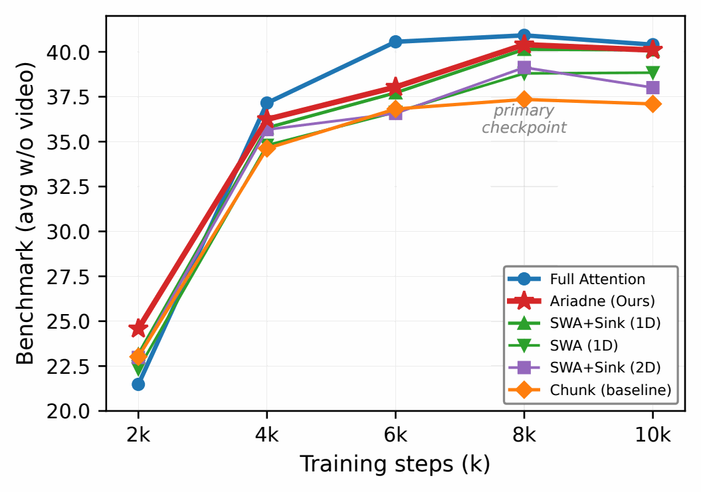

**图 10：六个关键模型在训练过程中的基准得分轨迹。** 训练后期各检查点上的架构排名保持稳定，而 SWA + 汇聚槽（二维）在后期开始出现过拟合。

**图内标签：** Training steps (k)：训练步数（千步）；Benchmark (avg w/o video)：基准平均分（不含视频）；primary checkpoint：主要检查点；baseline：基线。

### B.2 关键模型的逐项任务结果

表 7 按全部 22 项单独任务，列出了三个关键模型（Full、Ariadne、Chunk）的基准结果。Ariadne 在以视觉为核心的任务上弥补了大部分差距，而指代表达定位任务的表现基本相当。

| 迭代步数 | `full_s`† | `full` | `4r3c` | `sink_r` | `swa_r` | `s2d_s` | `swa2d` | `w_s` | `wa2d` |
| --- | ---: | ---: | ---: | ---: | ---: | ---: | ---: | ---: | ---: |
| 2k | 22.25 | 21.48 | 24.58 | 23.15 | 22.34 | 22.98 | 22.67 | 23.22 | 23.02 |
| 4k | 34.44 | 37.15 | 36.24 | 35.77 | 34.80 | 35.67 | 33.30 | 35.48 | 34.62 |
| 6k | 37.70 | 40.56 | 38.04 | 37.72 | 36.64 | 36.57 | 37.64 | 38.19 | 36.82 |
| 8k | 39.95 | 40.92 | 40.40 | 40.14 | 38.80 | 39.13 | 38.09 | 37.94 | 37.35 |
| 10k | 39.94 | 40.40 | 40.10 | 40.11 | 38.84 | 38.01 | 35.21 | 38.27 | 37.10 |

**表 5：不同训练迭代阶段的基准得分（不含视频的平均得分，20 项任务）。** 8k 主要检查点使用校正后的 MMBench-EN 得分；由于重新评估仅在 8k 上进行，10k 行保留了原始评估结果。† `full_sink` 在 2k–6k 的结果仅基于通用任务（10 项）。

| 迭代步数 | `full_s`† | `full` | `4r3c` | `sink_r` | `swa_r` | `s2d_s` | `swa2d` | `w_s` | `wa2d` |
| --- | ---: | ---: | ---: | ---: | ---: | ---: | ---: | ---: | ---: |
| 2k | 22.25 | 21.42 | 24.41 | 23.04 | 22.35 | 22.85 | 22.58 | 23.13 | 22.92 |
| 4k | 33.25 | 35.77 | 35.16 | 34.67 | 33.73 | 34.67 | 32.41 | 34.49 | 33.61 |
| 6k | 36.26 | 38.93 | 36.85 | 36.53 | 35.55 | 35.45 | 36.54 | 37.01 | 35.62 |
| 8k | 38.18 | 39.21 | 38.93 | 38.66 | 37.51 | 37.76 | 36.91 | 36.70 | 36.07 |
| 10k | 38.20 | 38.73 | 38.66 | 38.63 | 37.61 | 36.84 | 34.27 | 37.02 | 35.91 |

**表 6：不同训练迭代阶段的基准得分（含视频的平均得分，22 项任务）。** 包括 Video-MME 和 Video-MMMU。8k 主要检查点使用校正后的 MMBench-EN 得分，10k 行保留了原始评估结果。† `full_sink` 在 2k–6k 的结果仅基于通用任务（10 项）。

| 类别 | 任务 | Full | Chunk | Ariadne | Δ |
| --- | --- | ---: | ---: | ---: | ---: |
| 通用 | AI2D | 37.2 | 35.3 | **37.5** | +2.3 |
| 通用 | BLINK | 37.0 | **39.4** | 38.3 | −1.1 |
| 通用 | CV-Bench | 47.7 | 43.4 | **49.5** | +6.1 |
| 通用 | MMMU | 29.1 | 28.7 | **30.2** | +1.5 |
| 通用 | MMBench-EN | 36.34 | 36.94 | **38.57** | +1.63 |
| 通用 | MMBench-CN | 30.8 | 27.2 | **29.9** | +2.7 |
| 通用 | Mantis | 16.1 | 15.2 | **22.1** | +6.9 |
| 通用 | MME-RW-CN | 26.8 | 27.2 | **27.5** | +0.3 |
| 通用 | V* | 48.7 | 28.8 | **39.8** | +11.0 |
| 通用 | VLMs-are-Blind | 31.5 | 28.2 | **35.4** | +7.2 |
| OCR | ChartXiv-RQ | 19.1 | **21.0** | 19.4 | −1.6 |
| OCR | ChartXiv-DQ | 52.1 | **50.2** | 49.7 | −0.5 |
| OCR | DocVQA | 53.5 | 39.8 | **49.5** | +9.8 |
| OCR | InfoVQA | 32.4 | 23.6 | **31.3** | +7.7 |
| OCR | ChartQA | 19.4 | **18.8** | 17.7 | −1.2 |
| OCR | OCRBench | 68.0 | 54.7 | **63.6** | +8.9 |
| 指代表达定位 | RefCOCO | 76.2 | 75.0 | **75.2** | +0.2 |
| 指代表达定位 | RefCOCO+ | 63.4 | **62.8** | 62.8 | ±0.0 |
| 指代表达定位 | RefCOCOg | 67.7 | 68.5 | **69.5** | +1.1 |
| 计数 | PixMo-Count | 25.1 | **22.3** | 20.4 | −1.9 |
| 视频 | Video-MME | 27.5 | 30.9 | **32.3** | +1.4 |
| 视频 | Video-MMMU | 16.7 | 15.8 | **16.2** | +0.4 |
| **平均** | | **39.21** | 36.07 | **38.93** | +2.86 |

**表 7：三个关键模型在 8k 主要检查点上的逐项基准结果。** MMBench-EN 采用校正后的输出解析方式重新评估。Δ = Ariadne − Chunk。粗体表示 Chunk 与 Ariadne 两者中的最佳结果。Ariadne 在以视觉为核心的任务上弥补了全注意力与混合注意力之间的大部分差距（V* +11.0，DocVQA +9.8，OCRBench +8.9）；依赖滑动窗口内局部空间推理的指代表达定位任务则表现基本相当。

## 附录 C 实验设置细节

### C.1 训练配置

表 8 总结了全部九个模型共享的训练设置；它们仅在注意力算子上有所不同。

| 参数 | 取值 |
| --- | --- |
| ViT 编码器 | 随机初始化，32 层 |
| 大语言模型主干 | Qwen2-0.5B（[Yang et al., 2024](#ref-yang2024qwen2)） |
| 投影器 | 随机初始化 |
| ViT／大语言模型学习率 | 5 × 10<sup>−4</sup>／1 × 10<sup>−5</sup> |
| 学习率调度 | 1k 步预热后保持恒定 |
| 全局批次大小 | 2,048 |
| 最大序列长度 | 32,768 个词元 |
| 序列打包 | 是（[Chen et al., 2024](#ref-chen2024internvl25)） |
| 训练步数 | 10,000 |
| 数值精度 | bfloat16 |
| 计算预算 | 约 100k GPU 小时（NVIDIA Hopper） |
| 框架 | 基于 Megatron（内部实现） |
| 推理 | SGLang 0.4（修改版） |

**表 8：全部九个模型共享的训练配置。**

**训练数据。** 我们使用 **Cambrian-10M**（[Tong et al., 2024](#ref-tong2024cambrian)）进行训练。这是一个公开的多模态指令微调数据集，包含约 1,000 万个样本，覆盖 OCR、通用视觉语言理解、数学、代码、科学及多轮对话。我们直接使用其发布的类别均衡混合数据，未做修改。

**设计依据。** 我们有意选择了较小的大语言模型后端。正如 [Tong et al., 2024](#ref-tong2024cambrian) 所指出的，强大的语言模型可能充当捷径，补偿视觉表示的不足，掩盖视觉编码器设计之间的真实差异。较弱的大语言模型则迫使 ViT 学习更好的表示，使架构差异更为明显。[Zohar et al., 2024](#ref-zohar2024apollo) 关于规模扩展一致性的发现，进一步支持了这一设计依据。

### C.2 基准套件

我们在覆盖五个能力维度的 22 项任务上进行评估（表 9）。主要指标是 20 项图像任务的宏平均得分（“Avg w/o video”，不含视频的平均得分）；此外，我们还报告包含视频任务的 22 项任务平均得分（“Avg w/ video”，含视频的平均得分）。

| 类别 | 任务 | 数量 |
| --- | --- | ---: |
| 通用 | AI2D、BLINK、CV-Bench、MMMU、MMBench-EN/CN、Mantis、MME-RealWorld-CN、V*、VLMs-are-Blind | 10 |
| OCR | ChartXiv-RQ/DQ、DocVQA、InfoVQA、ChartQA、OCRBench | 6 |
| 指代表达定位 | RefCOCO、RefCOCO+、RefCOCOg | 3 |
| 计数 | PixMo-Count | 1 |
| 视频 | Video-MME、Video-MMMU | 2 |

**表 9：基准套件，包含 20 项图像任务和 2 项视频任务。** 视频任务不计入主要指标“Avg w/o video”，但计入“Avg w/ video”。引用：通用任务（[Kembhavi et al., 2016](#ref-kembhavi2016ai2d)；[Fu et al., 2024](#ref-fu2024blink)；[Tong et al., 2024](#ref-tong2024cambrian)；[Yue et al., 2024](#ref-yue2023mmmu)；[Liu et al., 2024a](#ref-liu2023mmbench)；[Jiang et al., 2024](#ref-jiang2024mantis)；[Zhang et al., 2025](#ref-zhang2024mmerealworld)；[Wu and Xie, 2024](#ref-wu2023vstar)；[Rahmanzadehgervi et al., 2024](#ref-rahmanzadehgervi2024vlmsblind)）；OCR（[Wang et al., 2024](#ref-wang2024charxiv)；[Mathew et al., 2021](#ref-mathew2020docvqa)；[Mathew et al., 2022](#ref-mathew2021infographicvqa)；[Masry et al., 2022](#ref-masry2022chartqa)；[Liu et al., 2024c](#ref-liu2023ocrbench)）；指代表达定位（[Yu et al., 2016](#ref-yu2016refcoco)）；计数（[Deitke et al., 2024](#ref-deitke2024molmo)）；视频（[Fu et al., 2025](#ref-fu2024videomme)；[Hu et al., 2025](#ref-hu2025videommmu)）。

### C.3 分析数据

逐注意力头分析使用从 COCO val2017 中抽样的图像，并配套提供可区分显著物体与背景的前景／背景分割。根据每个 ViT 词元所对应图像块中占主导的区域，将该词元标记为前景或背景；跨越分界线的图像块（边界图像块）不纳入分析。


## 附录 D 补充注意力热力图

本附录提供图 2 中狗的图像之外的更多接收注意力热力图。图 11 展示狗的图像对应的逐头箱线图；图 12 将另外四幅图像（`bird`、`two_cats`、`coco_537964`、`coco_043816`）紧凑地排列为 2 × 2 网格，每幅图像均比较全注意力、Ariadne 和分块窗口注意力在 L11 与 L17 层的结果。

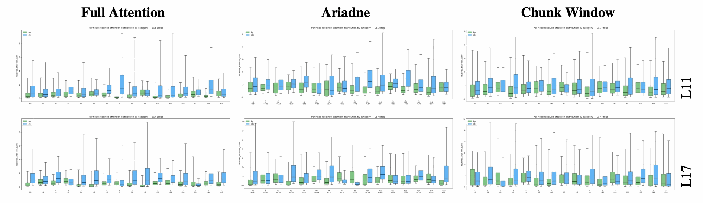

**图 11：与图 2 对应的逐头接收注意力箱线图。** 每个子图展示全部 16 个注意力头的分布，并区分前景（蓝色）与背景（绿色）。全注意力和 Ariadne 呈现出清晰的物体／背景分离；分块窗口注意力的分布较为一致，表明其专门化受到抑制。

**图内标签：** Full Attention：全注意力；Chunk Window：分块窗口；foreground／background 或 FG／BG：前景／背景；各注意力头编号及 L11／L17 按原图保留。

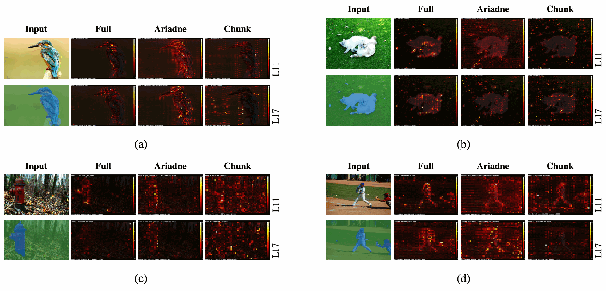

**图 12：四幅图像的补充接收注意力热力图，布局与图 2 相同。** 每组图的第一列为输入图像（上）和前景掩码（下）；第 2–4 列为 L11 与 L17 层中一个代表性注意力头的热力图（层编号标在右侧）。全注意力和 Ariadne 始终呈现出清晰的物体／背景分化；分块窗口注意力在所有图像上都表现出受抑制的专门化。

**图内标签：** Input：输入；Full：全注意力；Chunk：分块窗口；L11／L17：第 11／17 层；子图 (a)–(d) 按原图保留。

## 附录 E SHS 补充数据

### E.1 开源视觉编码器和 VLM 的 SHS-Index

表 10 报告了 16 个开源视觉编码器和 VLM 的 SHS-Index，涵盖约五个相互独立的全注意力模型谱系、三种训练范式、多种注意力设计，以及从 300M 参数的独立 ViT 到 72B 参数 VLM 的模型规模。额外纳入的独立编码器为 SigLIP2、DINOv2 和 DINOv3（[Tschannen et al., 2025](#ref-tschannen2025siglip2)；[Oquab et al., 2023](#ref-oquab2023dinov2)；[Simeoni et al., 2025](#ref-simeoni2025dinov3)）。计算 SHS 时，使用与受控实验相同的分析图像和前景／背景掩码。这些异构模型仅用于检验全注意力与分块窗口注意力之间的结构性分离，不用于分析与基准得分的相关性。

| 编号 | 模型 | 模型系列 | 注意力 | ViT 规格 | SHS-all | SHS-core |
| --- | --- | --- | --- | --- | --- | --- |
| 1 | InternVL3.5-38B | InternVL | 全注意力 | 6B（45 层，3200 维，25 头） | **.648** | .627 |
| 2 | InternVL3.5-8B | InternVL | 全注意力 | 300M（24 层，1024 维，16 头） | .641 | **.651** |
| 3 | Qwen3-VL-32B | Qwen3-VL | 全注意力 | SigLIP2-SO-400M | .633 | .644 |
| 4 | InternVL3-8B | InternVL | 全注意力 | 300M（24 层，1024 维，16 头） | .630 | .649 |
| 5 | Qwen3-VL-8B | Qwen3-VL | 全注意力 | SigLIP2-SO-400M | .626 | .639 |
| 6 | Qwen3-VL-4B | Qwen3-VL | 全注意力 | SigLIP2-Large（300M） | .624 | .639 |
| 7 | Qwen3-VL-2B | Qwen3-VL | 全注意力 | SigLIP2-Large（300M） | .619 | .636 |
| 8 | InternViT-300M | InternVL | 全注意力 | 300M（24 层，1024 维，16 头） | .610 | .625 |
| 9 | SigLIP2-so400m | SigLIP2 | 全注意力 | 400M | .638 | .646 |
| 10 | DINOv2-L | DINOv2 | 全注意力 | ViT-L | .626 | .603 |
| 11 | DINOv3-L | DINOv3 | 全注意力 | ViT-L | .642 | .627 |
| 12 | MiMo-VL-7B | MiMo | 分块窗口 + 全注意力 | 675M（32 层，1280 维，16 头） | .586 | .587 |
| 13 | Qwen2.5-VL-3B | Qwen2.5-VL | 分块窗口 + 全注意力 | 675M（32 层，1280 维，16 头） | .586 | .586 |
| 14 | Qwen2.5-VL-7B | Qwen2.5-VL | 分块窗口 + 全注意力 | 675M（32 层，1280 维，16 头） | .585 | .584 |
| 15 | Qwen2.5-VL-72B | Qwen2.5-VL | 分块窗口 + 全注意力 | 675M（32 层，1280 维，16 头） | .585 | .585 |
| 16 | Qwen2.5-VL-32B | Qwen2.5-VL | 分块窗口 + 全注意力 | 675M（32 层，1280 维，16 头） | .584 | .584 |

**表 10：16 个开源视觉编码器和 VLM 的 SHS-Index。** 全注意力组（平均 SHS ≈ 0.631）与分块窗口组（平均 SHS = 0.585）完全不重叠：全注意力组的最低分为 .610，高于分块窗口组的最高分 .586。Qwen3-VL 的 8B／32B 变体使用 SigLIP2-SO-400M，2B／4B 变体使用 SigLIP2-Large（300M）；Qwen2.5-VL 在 3B–72B 的 LLM 规模范围内使用相同的 ViT（SHS 变化 &lt; 0.002）。DINOv2 和 DINOv3 未与语言模型共同训练，为这种分离并非 VLM 训练所特有提供了额外验证。

### E.2 跨领域稳健性

为检验 SHS 信号是否依赖 COCO 分析集，我们在 PASCAL VOC、OpenImages 和一个图表／文档风格的图像集上重新计算 SHS。对于图表，前景由简单灰度阈值识别出的线条、条形、文字和坐标轴组成；浅色区域视为背景。在每个领域，全注意力／分块窗口注意力的相对排序都得到保持，与基准得分的相关性也仍然显著。下表中的 Pearson 相关系数基于全部八种诊断配置计算；为方便阅读，仅展示代表性模型行。

| 模型 | COCO | VOC | OpenImages | 图表 |
| --- | --- | --- | --- | --- |
| Full+Sink | .611 | .615 | .618 | .634 |
| Full | .606 | .609 | .614 | .627 |
| SWA+Sink (1D) | .598 | .596 | .608 | .625 |
| SWA+Sink (2D) | .597 | .600 | .598 | .626 |
| Chunk | .577 | .583 | .575 | .613 |
| **Pearson <i>r</i>（相对于 22 项任务平均分）** | **.87** | **.80** | **.88** | **.75** |
| **<i>p</i>** | **.005** | **.016** | **.004** | **.031** |

**表 11：SHS-Index 的跨领域稳健性。** 相关性使用 8k 检查点的全部八种诊断配置计算；表中的五个模型行具有代表性。模型排序在不同领域间保持高度稳定（跨领域排序的 Spearman <i>ρ</i> = 0.97）。

### E.3 各训练迭代检查点的 SHS 指标

本节给出全部九种受控架构在各训练迭代检查点上的 SHS 指标。图 13 和图 14 可视化了表 12、表 13 和表 14 中的变化趋势。训练期间 SHS-Index 的绝对值变化不大，而高／低 SHS 组的分离在 4k 时就已稳定；从 8k 到 10k，每个模型的变化最多为 .003。物体主导注意力头的比例呈现类似的下降趋势，反映出注意力头逐渐分化为物体角色和背景角色。

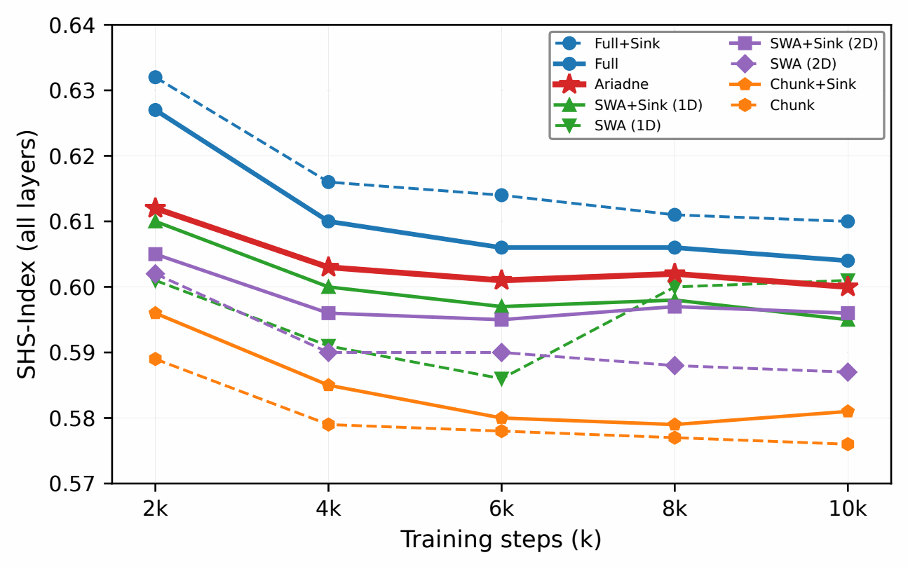

**图 13：SHS-Index 随迭代次数的变化。** 高／低 SHS 组的分离从 4k 开始趋于稳定。

**图内标签：** Training steps (k)：训练步数（千步）；SHS-Index (all layers)：全部层的 SHS-Index；Full：全注意力；Chunk：分块窗口；+Sink：加入汇聚槽。

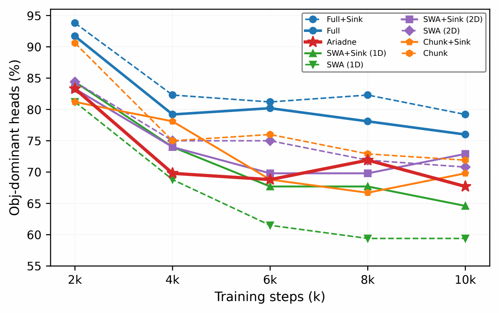

**图 14：物体主导注意力头随迭代次数的变化。** 不带汇聚槽的 SWA-1D 的物体主导注意力头比例最低，而全注意力始终最高。

**图内标签：** Training steps (k)：训练步数（千步）；Obj-dominant heads (%)：物体主导注意力头比例（%）；其他模型图例与图 13 相同。

### E.4 SHS-Index 随迭代次数的变化（全部层）

表 12 报告了各检查点的全层 SHS-Index。附录 G.2 中识别出的高／低 SHS 组分离从 4k 起即可观察到；可视化结果见图 13。

| 迭代次数 | full_s | full | 4r3c | sink_r | swa_r | s2d_s | swa2d | w_s | wa2d |
| --- | --- | --- | --- | --- | --- | --- | --- | --- | --- |
| 2k | .632 | .627 | .612 | .610 | .601 | .605 | .602 | .596 | .589 |
| 4k | .616 | .610 | .603 | .600 | .591 | .596 | .590 | .585 | .579 |
| 6k | .614 | .606 | .601 | .597 | .586 | .595 | .590 | .580 | .578 |
| 8k | .611 | .606 | .602 | .598 | .600 | .597 | .588 | .579 | .577 |
| 10k | .610 | .604 | .600 | .595 | .601 | .596 | .587 | .581 | .576 |

**表 12：全部九种受控架构的 SHS-Index（全部 32 层的平均值）随训练迭代次数的变化。** 这是全文使用的主要聚合方式（见表 16、第 3 节中的 Pearson 相关性以及图 6）。列标题使用缩写：`full_s` = `full_sink`，`sink_r` = `swa_sink_row`，`swa_r` = `swa_row`，`s2d_s` = `swa2d_sink`，`w_s` = `wa2d_sink`。

### E.5 SHS-Index 随迭代次数的变化（核心层 L9–21）

表 13 将计算范围限制在注意力头专门化最强的核心层 L9–21。与全部层的平均值相比，高／低 SHS 组之间的差距更大。

| 迭代次数 | full_s | full | 4r3c | sink_r | swa_r | s2d_s | swa2d | w_s | wa2d |
| --- | --- | --- | --- | --- | --- | --- | --- | --- | --- |
| 2k | .651 | .644 | .612 | .615 | .604 | .605 | .606 | .597 | .586 |
| 4k | .636 | .629 | .602 | .603 | .593 | .598 | .596 | .583 | .577 |
| 6k | .635 | .624 | .604 | .600 | .588 | .597 | .599 | .578 | .576 |
| 8k | .632 | .623 | .604 | .599 | .603 | .601 | .592 | .580 | .576 |
| 10k | .630 | .622 | .605 | .594 | .601 | .598 | .593 | .580 | .574 |

**表 13：SHS-Index（核心层 L9–21）随训练迭代次数的变化。**

### E.6 物体主导注意力头比例随迭代次数的变化

表 14 跟踪被归类为物体主导的注意力头比例（在各分析图像上进行多数表决，范围为核心层 L9–21）。全注意力模型的物体主导注意力头比例（obj%）始终最高；不带汇聚槽的 SWA 1D 则逐渐降至最低，这与附录 F 中将汇聚槽视为背景抑制器的分析一致。可视化结果见图 14。

| 迭代次数 | full_s | full | 4r3c | sink_r | swa_r | s2d_s | swa2d | w_s | wa2d |
| --- | --- | --- | --- | --- | --- | --- | --- | --- | --- |
| 2k | 93.8 | 91.7 | 83.3 | 84.4 | 81.2 | 83.3 | 84.4 | 81.2 | 90.6 |
| 4k | 82.3 | 79.2 | 69.8 | 74.0 | 68.8 | 74.0 | 75.0 | 78.1 | 75.0 |
| 6k | 81.2 | 80.2 | 68.8 | 67.7 | 61.5 | 69.8 | 75.0 | 68.8 | 76.0 |
| 8k | 82.3 | 78.1 | 71.9 | 67.7 | 59.4 | 69.8 | 71.9 | 66.7 | 72.9 |
| 10k | 79.2 | 76.0 | 67.7 | 64.6 | 59.4 | 72.9 | 70.8 | 69.8 | 71.9 |

**表 14：物体主导注意力头的百分比（核心层 L9–21，在各分析图像上进行多数表决）。**

### E.7 平均 rcv_auroc_obj 随迭代次数的变化

表 15 报告物体类别的逐头 AUROC 均值（在应用 SHS-Index 中与方向无关的 max 运算之前）。这一原始指标证实，全注意力模型形成了最强的前景区分能力，而分块窗口模型在每个检查点上始终最弱。

| 迭代次数 | full_s | full | 4r3c | sink_r | swa_r | s2d_s | swa2d | w_s | wa2d |
| --- | --- | --- | --- | --- | --- | --- | --- | --- | --- |
| 2k | .618 | .608 | .566 | .576 | .552 | .567 | .570 | .566 | .557 |
| 4k | .596 | .584 | .546 | .554 | .533 | .547 | .548 | .545 | .543 |
| 6k | .589 | .574 | .545 | .540 | .524 | .539 | .546 | .529 | .537 |
| 8k | .587 | .574 | .545 | .543 | .522 | .540 | .539 | .531 | .534 |
| 10k | .581 | .566 | .543 | .532 | .519 | .537 | .537 | .530 | .531 |

**表 15：平均 rcv_auroc_obj（核心层 L9–21）随训练迭代次数的变化。**

## 附录 F 机制分析细节

### F.1 SHS、熵与距离的比较

**定义。** *注意力熵*：<i>H</i> = −∑<sub><i>j</i></sub><i>a</i><sub><i>j</i></sub> log <i>a</i><sub><i>j</i></sub>，用于衡量一个注意力头的注意力分布有多尖锐或分散。*注意力距离*：每个查询与其关注的键之间按注意力权重计算的平均空间距离，用于衡量每个词元“看”得多远。表 16 同时报告了全部九个模型在主要检查点上的这三个指标及基准得分。

| 模型 | 布局 | 注意力 | 汇聚槽 | SHS | 熵 | 距离 | 基准得分 |
| --- | --- | --- | --- | --- | --- | --- | --- |
| full | 不适用 | 全注意力 | 无 | .606 | 4.584 | 14.922 | 40.92 |
| full_sink | 不适用 | 全注意力 | 有 | .611 | 4.350 | 14.824 | 39.95 |
| 4r3c | 1D 行列 | SWA | 有 | .602 | 2.768 | 13.950 | 40.40 |
| swa_sink_row | 1D 行 | SWA | 有 | .598 | 2.969 | 12.002 | 40.14 |
| swa_row | 1D 行 | SWA | 无 | .600 | 3.010 | 11.713 | 38.80 |
| swa2d_sink | 2D | SWA | 有 | .597 | 2.975 | 12.802 | 39.13 |
| swa2d | 2D | SWA | 无 | .588 | 2.914 | 11.802 | 38.09 |
| wa2d_sink | 2D | 分块窗口 | 有 | .579 | 2.428 | 11.146 | 37.94 |
| wa2d | 2D | 分块窗口 | 无 | .577 | 2.476 | 10.690 | 37.35 |

**表 16：全部九个模型在主要检查点上的 SHS、熵和距离。** SHS-Index 为全部 32 层的平均值（与表 12 一致；第 3 节的 Pearson 相关性也采用相同约定）。熵和距离仅在 28 个非全注意力层上计算，因为四个全注意力层在全部九种架构中相同，并且会主导这些距离／熵的平均值。

**跨模型指标与基准得分的 Spearman 相关性（<i>N</i> = 8，排除 full_sink）。** 表 17 比较了三个指标与基准表现的相关性。

| 指标 | <i>ρ</i> | <i>p</i> |
| --- | --- | --- |
| **SHS** | **+0.857** | **0.007** |
| 距离 | +0.833 | 0.010 |
| 熵 | +0.524 | 0.183 |

**表 17：跨模型指标与基准得分的 Spearman <i>ρ</i>（<i>N</i> = 8）。** SHS 的相关性最强；熵的相关性不显著。

**两两差值。** 表 18 分别考察各项架构改动，以展示哪些指标能反映基准得分的提升。

| 改动 | ΔSHS | Δ熵 | Δ距离 | Δ基准得分 |
| --- | --- | --- | --- | --- |
| +Sink（Chunk 2D） | +.002 | −0.05 | +0.46 | +0.59 |
| +Sink（SWA 2D） | +.009 | +0.06 | +1.00 | +1.04 |
| +Sink（SWA 1D） | −.002 | −0.04 | +0.29 | +1.34 |
| +Sink（Full） | +.005 | −0.23 | −0.10 | −0.97 |
| Chunk → SWA（2D） | +.011 | +0.44 | +1.11 | +0.74 |
| Chunk → SWA（2D+s） | +.018 | +0.55 | +1.66 | +1.78 |
| **2D → 1D（SWA）** | **+.012** | **+0.10** | **−0.09** | **+0.71** |
| 2D → 1D（SWA+s） | +.001 | −0.01 | −0.80 | +1.01 |
| +RowCol | +.004 | −0.20 | +1.95 | +0.26 |

**表 18：经过修正的 8k 检查点上，各项架构改动的两两差值。** 从 2D 转为 1D 会提升基准得分，但单项局部改动并不总让 SHS 和基准得分同向变化；这种关系是一种整体的跨架构规律，而不是适用于每次干预的单调规则。（ΔSHS 使用全部 32 层的平均值，与表 16 一致；Δ熵／距离使用非全注意力层。）

### F.2 汇聚槽的 2 × 2 分析

我们分析了五个带汇聚槽的模型中，汇聚槽偏置（与注意力汇聚槽现象 （[Xiao et al., 2024](#ref-xiao2024streamingllm)） 和寄存器词元 （[Darcet et al., 2024](#ref-darcet2024vision)） 有关）如何以不同程度吸收背景词元和物体词元的注意力（表 19）。汇聚槽的注意力夺取比例定义为：steal(cat) = absorbed&#95;sum(cat)/(rcv&#95;sum(cat) + absorbed&#95;sum(cat))，在主要检查点的核心层 L9–L21 上计算。

| 模型 | 背景夺取比例 | 物体夺取比例 | Δ | 背景 &gt; 物体 |
| --- | --- | --- | --- | --- |
| full_sink | 0.38% | 0.23% | +0.14% | 97.9% |
| swa_sink_row | 4.61% | 2.86% | +1.74% | 96.9% |
| swa_sink_4r3c | 3.79% | 2.52% | +1.26% | 93.8% |
| swa2d_sink | 2.84% | 1.68% | +1.16% | 96.9% |
| wa2d_sink | 4.32% | 3.69% | +0.64% | 78.1% |

**表 19：汇聚槽注意力夺取分析（主要检查点，核心层 L9–21，全部注意力头）。** 背景／物体夺取比例（bg/obj stl.）表示接收注意力中被重定向到汇聚槽的比例。在 SWA 模型中，94%–97% 的注意力头从背景夺取的注意力多于从物体夺取的注意力，即汇聚槽起到*背景抑制器*的作用。在 `wa2d_sink` 中，这一方向性比例降至 78%，解释了为什么分块窗口注意力加入汇聚槽后未能奏效。

### F.3 2D 不兼容假说

在 2D 块布局下，每逢窗口边界，滑动窗口在 1D 序列中的左右邻居都会映射到图像中空间上不相连的区域。这迫使每个注意力头在同一窗口内关注一组混合了空间邻近和空间远离词元的集合，从而削弱了实现有意义的物体／背景区分所需的空间连贯性。

证据（表 18）：从 2D 转为 1D 带来最大的单步基准得分提升（无汇聚槽时为 +1.94，有汇聚槽时为 +1.22），但熵和距离基本不变（ΔEntropy = +0.10，ΔDistance = −0.09）。只有 SHS 上升（+0.013），这表明提升来自空间连贯性促成了更有意义的注意力头专门化，而不是注意力分布尖锐程度或感受野大小发生了变化。

## 附录 G SHS 与基准得分的相关性细节

### G.1 统计方法

我们的主要分析是在八种诊断配置之间，计算 SHS-Index 与 22 项任务基准平均分的 Pearson 相关性（第 3 节）。我们分别报告引入 Ariadne *之前*（仅八种诊断配置）和将其纳入*之后*（全部九种受控架构），在主要检查点与最终检查点上的相关性；为完整起见，也报告相应的 20 项图像任务结果。作为稳健性检验，我们还对 SHS-Index 应用 <i>K</i>-means 聚类（<i>k</i> = 2），随后对所得分组进行 Mann-Whitney <i>U</i> 检验（第 G.2 节）；两种分析得到一致的定性结论。

### G.2 稳健性：K-means 聚类和 Mann-Whitney <i>U</i> 检验

作为非参数稳健性检验，对 SHS-Index 进行 <i>K</i>-means 聚类（<i>k</i> = 2），可自动将八种诊断配置分为高 SHS 组（五个模型：`full`、`full_sink`、`swa_sink_row`、`swa_row`、`swa2d_sink`；SHS ≥ 0.597）和低 SHS 组（三个模型：`swa2d`、`wa2d_sink`、`wa2d`；SHS ≤ 0.588）。加入 Ariadne 后，低 SHS 组保持不变，高 SHS 组扩展至六个模型。在两种设置中，经过修正的主要检查点上，两组的*基准得分均完全不重叠*：高 SHS 组中得分最低的模型（38.80）仍高于低 SHS 组中得分最高的模型（38.09）。对 20 项图像任务平均分进行 Mann-Whitney <i>U</i> 检验，证实了其显著性（表 20）。

| 设置 | 高 SHS 组 | 低 SHS 组 | <i>p</i>（<i>U</i> 检验） | <i>d</i> |
| --- | --- | --- | --- | --- |
| 八种诊断配置，8k | 38.80–40.92 | 37.35–38.09 | **.018** | 3.65 |
| 全部九种配置，8k | 38.80–40.92 | 37.35–38.09 | **.012** | **3.91** |
| 全部九种配置，10k | 38.01–40.40 | 35.21–38.27 | **.024** | 2.37 |

**表 20：稳健性检验。** 对 SHS-Index 进行 <i>K</i>-means 聚类（<i>k</i> = 2），将受控配置分为高 SHS 组和低 SHS 组（表中显示基准得分范围）。对 20 项图像任务平均分进行 Mann-Whitney <i>U</i> 检验，确认两组存在显著分离。Cohen's <i>d</i> 使用未加权的合并标准差。九模型分组在 10k 时仍然显著。

## 附录 H SHS 集体属性实验

### H.1 注意力头消融

我们遵循 [Michel et al.（2019）](#ref-michel2019sixteen) 的注意力头重要性分析方法，将指定注意力头的 V 输出替换为其在校准集上的均值（均值消融），以检验单个高 SHS 或低 SHS 注意力头是否更重要。对于每个模型，我们选取核心层 AUROC 最高的八个头和最低的八个头，分别进行消融，并比较基准得分的下降幅度。

**高 SHS 与低 SHS 注意力头，以及全部 16 个头的消融。** 表 21 汇总了在 `full` 模型上进行的这两项实验。上半部分表明，消融八个高 SHS 头与消融八个低 SHS 头造成的基准得分下降相同（平均差值 Δ = −0.18）；无论专门化方向如何，单个注意力头都可以相互替代。下半部分表明，同时消融核心层的全部 16 个头，会导致依赖视觉的任务成绩大幅下降，证实 SHS 是一种集体属性。

**表 21，A 部分：高 SHS 的八个头与低 SHS 的八个头（23 项任务的平均值）。**

| 条件 | 相对基线的 Δ | 说明 |
| --- | --- | --- |
| 移除八个高 SHS 头 | −1.25 | |
| 移除八个低 SHS 头 | −1.07 | |
| 高 SHS − 低 SHS | −0.18 | 23 项任务中有 14 项高 SHS 消融结果低于低 SHS 消融结果 |

**表 21，B 部分：移除全部 16 个头。**

| 任务 | 基线 | Δ |
| --- | --- | --- |
| V* | 48.69 | −13.1 |
| OCRBench | 68.00 | −16.7 |
| DocVQA | 53.46 | −13.8 |
| MMMU | 29.11 | +0.1 |

**表 21：full 模型核心层上的注意力头消融。** **A 部分**：移除八个高 SHS 头与八个低 SHS 头之间的差异可忽略不计；单个注意力头可以相互替代。**B 部分**：移除全部 16 个头会使依赖视觉的任务表现崩溃；以推理为主的 MMMU 不受影响。集体的专门化模式不可或缺。注意力头消融使用的评测套件（23 项任务）是 22 项任务主基准的超集，其中将子分数（如 MME-cognition 与 MME-perception）分别报告，以进行更细粒度的逐任务分析。

**跨模型一致性。** 表 22 将高／低 SHS 头的比较分析扩展至三种架构。

| 模型 | 任务数 | 平均值（高 SHS − 低 SHS） |
| --- | --- | --- |
| full | 23 | −0.18 |
| wa2d | 23 | +0.20 |
| swa_sink_row | 25 | −0.27 |

**表 22：不同模型中高／低 SHS 注意力头的消融。** 没有模型表现出显著差异。不同模型的任务数量略有差异（23–25 项），因为在该检查点上，各评测套件单独报告的子分数不同；“高／低 SHS 头之间没有差距”的结论对这一选择保持稳健。

### H.2 QK 权重范数与 SHS

我们计算每个注意力头的 Q 和 K 权重矩阵的 Frobenius 范数，并分析其与逐头 SHS（AUROC）的相关性。表 23 给出各模型中 QK 范数乘积与逐头 AUROC 之间的 Spearman <i>ρ</i>。

| 模型 | Q | K | V | O | Q × K |
| --- | --- | --- | --- | --- | --- |
| full | +.09 | +.11 | −.06 | +.05 | +.10 |
| 4r3c | +.15 | +.16 | +.01 | +.05 | +.16 |
| sink_row | +.00 | +.02 | −.03 | +.13 | +.01 |
| swa_row | +.14 | +.14 | +.06 | +.16 | +.14 |
| s2d_sink | +.33 | +.32 | +.05 | +.19 | +.33 |
| swa2d | +.19 | +.20 | +.01 | +.12 | +.20 |
| w_sink | +.12 | +.12 | −.10 | +.07 | +.12 |
| wa2d | +.27 | +.28 | −.01 | +.14 | +.28 |
| **均值** | **+.16** | **+.17** | **−.01** | **+.11** | **+.17** |

**表 23：逐头权重 Frobenius 范数与 SHS 之间的 Spearman <i>ρ</i>。** Q／K 表现出较弱的正相关（八个模型均为正）；V 没有相关性（均值为 −.01）。

### H.3 QK 均衡实验

我们人为将全部注意力头的 QK 范数统一到各层的最大值，然后重新计算 SHS。如果 QK 范数是 SHS 的成因，那么均衡操作应当提高 SHS。结果却相反：在测试的全部五个模型中，SHS 都下降了（表 24）。

| 模型 | 基线 SHS | 均衡后的 SHS | Δ |
| --- | --- | --- | --- |
| full | .6237 | .6178 | −0.0059 |
| 4r3c | .6044 | .6001 | −0.0044 |
| swa_sink_row | .5993 | .5958 | −0.0035 |
| swa_row | .6036 | .5997 | −0.0038 |
| wa2d | .5763 | .5751 | −0.0013 |

**表 24：QK 均衡。** 全部五个模型的 SHS 均下降。QK 与 SHS 的正相关是注意力头专门化的结果，而不是其成因。

## 附录 I 效率分析

表 25 报告了六种代表性分辨率下 ViT 前向传播的耗时。全部计时均在 NVIDIA Hopper GPU 上完成，使用 FlashAttention-3（[Shah et al., 2024](#ref-shah2024flashattention3)），设置 `s_aux=yes`，精度为 bfloat16，每批四张图像（变长连续批处理），预热 10 次，测量迭代 10 次。ViT 采用 32 层、隐藏维度 1280、16 个注意力头、每头维度 80、MLP 维度 3456。全注意力层位于 [7, 15, 23, 31]。TFLOP 统计理论注意力 FLOPs（<i>Q</i><i>K</i><sup>⊤</sup> + softmax⋅<i>V</i>，一次乘加计为两次运算）。`attn_op` 仅指 FlashAttention 内核（不包括 QKV／投影线性层；`wa2d` 包含重排开销）。`e2e` 指完整 Transformer 块（归一化 + QKV + RoPE + 注意力 + 投影 + 归一化 + MLP）。

| 分辨率 | 词元数 | Full FLOP | Full op | Full e2e | wa2d（Chunk）FLOP | wa2d op | wa2d e2e | SWA-row FLOP | SWA-row op | SWA-row e2e | SWA-sink-row FLOP | SWA-sink-row op | SWA-sink-row e2e |
| --- | --- | --- | --- | --- | --- | --- | --- | --- | --- | --- | --- | --- | --- |
| 224<sup>2</sup> | 256 | 0.04 | 1.2 | 22.1 | 0.01 | 2.8 | 24.4 | 0.02 | 1.2 | 22.1 | 0.02 | 1.2 | 22.3 |
| 448<sup>2</sup> | 1024 | 0.69 | 2.2 | 32.1 | 0.12 | 4.5 | 32.9 | 0.16 | 1.4 | 31.4 | 0.16 | 1.4 | 31.3 |
| 672<sup>2</sup> | 2304 | 3.48 | 7.6 | 68.7 | 0.52 | 9.7 | 68.4 | 0.60 | 2.9 | 64.6 | 0.60 | 2.9 | 64.6 |
| **896<sup>2</sup>** | **4096** | **11.0** | **23.9** | **124.4** | 1.52 | 17.5 | 115.3 | 1.68 | 6.2 | 109.0 | **1.68** | **6.3** | **109.0** |
| 1120<sup>2</sup> | 6400 | 26.8 | 55.2 | 211.2 | 3.59 | 28.8 | 178.1 | 3.83 | 12.1 | 168.5 | 3.83 | 12.0 | 168.6 |
| **1344<sup>2</sup>** | **9216** | **55.7** | **110.3** | **330.0** | 7.30 | 44.3 | 255.5 | 7.64 | 21.2 | 242.2 | **7.64** | **21.1** | **242.9** |

**表 25：代表性分辨率下，四种注意力算子的 ViT 性能剖析。** FLOP = 注意力 TFLOP；op = FlashAttention 内核耗时（毫秒）；e2e = 完整块耗时（毫秒）。SWA-sink-row ≡ SWA-row：在这次测试中，汇聚槽带来的额外开销为*零*（FA3 原生支持 `s_aux`）。更新后的 Full 与 Ariadne 扩展性测试见表 26。

| 分辨率 | 词元数 | Full 注意力计算量 | Ariadne 注意力计算量 | Full e2e | Ariadne e2e | e2e 节省 |
| --- | --- | --- | --- | --- | --- | --- |
| 448<sup>2</sup> | 1,024 | 0.69T | 0.16T | 31.3 | 30.6 | −2.2% |
| 672<sup>2</sup> | 2,304 | 3.48T | 0.60T | 66.9 | 62.8 | −6.1% |
| 896<sup>2</sup> | 4,096 | 11.0T | 1.68T | 123.5 | 106.8 | −13.5% |
| 1120<sup>2</sup> | 6,400 | 26.8T | 3.83T | 210.1 | 166.1 | −20.9% |
| 1344<sup>2</sup> | 9,216 | 55.7T | 7.64T | 327.5 | 240.0 | −26.7% |
| 1568<sup>2</sup> | 12,544 | 103.1T | 13.8T | 500.2 | 331.0 | −33.8% |
| 1792<sup>2</sup> | 16,384 | 175.9T | 23.2T | 726.2 | 440.0 | −39.4% |

**表 26：在 NVIDIA Hopper 上使用 FlashAttention-3 进行的更新版 Full 与 Ariadne 效率测试。** 注意力列报告理论注意力 FLOPs；e2e 列报告完整 ViT 块的耗时，单位为毫秒。端到端节省的时间随分辨率提升而增加，这正是混合注意力所针对的工作区间。

**主要结论。**

- **汇聚槽没有额外开销**：SWA-sink-row 与 SWA-row 在每种分辨率下的 `attn_op` 和 e2e 耗时均相同，证实 FlashAttention-3（[Shah et al., 2024](#ref-shah2024flashattention3)）原生的 `s_aux` 参数不会引入额外计算。
- **SWA 比分块窗口更快**：尽管有效窗口更大（128 个词元，对比分块窗口的 64 个词元），SWA 的内核耗时仍显著低于 `wa2d`（在 896<sup>2</sup> 下为 6.3 毫秒，对比 17.5 毫秒）。FlashAttention-3 的连续 SWA 内核比用于分块窗口的变长接口优化得更好（[Dao et al., 2022](#ref-dao2022flashattention)；[Dao, 2024](#ref-dao2023flashattention2)）。`wa2d` 的内核耗时还包含 2D 窗口重排的开销。
- **节省幅度随分辨率增加而增大**：在更新后的测试中，Ariadne 在 896<sup>2</sup> 下节省 13.5% 的端到端耗时，在 1792<sup>2</sup> 下节省 39.4%。全注意力 FLOPs 呈二次增长，而 Ariadne 的局部注意力部分近似线性增长。

## 附录 J 为什么汇聚槽偏置会损害全注意力

Full+Sink 模型的 SHS-Index 最高（0.611），但在修正后的基准中低于 Full（39.95，对比 40.92），下降了 0.97 分。相比之下，汇聚槽偏置始终能*提升* SWA 模型的表现（+0.5 至 +2.1）。三条证据解释了这种不对称性。

**全注意力本身已经具有隐式汇聚槽。** [Guo et al.（2024）](#ref-guo2024active) 表明，全注意力头会自然形成一种*活跃—休眠*机制：对于每个输入，某些注意力头会将注意力导向隐式汇聚槽词元，这些词元的值状态范数接近零，从而有效实现一种学习得到的、依赖输入的无操作。[Barbero et al.（2025）](#ref-barbero2025why) 进一步证明，汇聚槽起到抑制过度混合的调节作用，而且更大的上下文窗口会形成更强的隐式汇聚槽。可学习的汇聚槽偏置 <i>s</i><sub>aux</sub><sup>(<i>h</i>)</sup> 是一个固定的、与输入无关的标量；它会与已有的输入依赖机制竞争，而不是对其形成补充。

**SWA 缺少这种隐式机制。** 每个窗口只有 128 个词元，局部上下文过于有限，因此 SWA 模型无法形成有效的隐式汇聚槽。softmax 约束迫使每个查询在窗口内分配其全部注意力预算，将注意力概率质量浪费在缺乏信息的背景词元上。此时，显式汇聚槽偏置填补了一个实际空缺：它提供了该架构无法自行学习到的无操作通道。

**过度专门化会降低多样性。** Full+Sink 的物体主导注意力头比例为 82.3%（全部九个模型中最高），这意味着汇聚槽偏置将过多的注意力头推向前景。这会降低第 H 节确认不可或缺的集体角色多样性，解释了为何 SHS-Index 上升（单个头更加专门化），但基准得分下降（整个注意力头群体丧失了互补的背景专长）。

该分析与 [Gu et al.（2025）](#ref-gu2025attention) 的结果一致：他们表明，注意力汇聚槽源于 softmax 归一化约束，其作用是充当键偏置，而不是提供信息信号；在已经有效的隐式偏置之上再添加第二个显式偏置，会带来递减甚至为负的收益。

## 附录 K Pearson 相关性

表 27 报告了完整的 Pearson <i>r</i> 矩阵。在修正后的主要检查点上，无论采用哪一种任务平均分（20 项图像任务或包含视频的 22 项任务），也无论采用 <i>N</i> = 8（八种诊断配置）还是 <i>N</i> = 9（加入 Ariadne），这种关系都很强。在最终检查点，相关性减弱；这些 10k 行保留了原始的 MMBench-EN 评测结果，因为重新评测仅在 8k 处进行。

| 步数 | 设置 | 22 项任务 <i>r</i> | 22 项任务 <i>p</i> | 20 项图像任务 <i>r</i> | 20 项图像任务 <i>p</i> |
| --- | --- | --- | --- | --- | --- |
| 8k | <i>N</i> = 8（诊断配置） | **.858** | **.006** | .877 | .004 |
| 8k | <i>N</i> = 9（包含 Ariadne） | **.853** | **.003** | .875 | .002 |
| 10k | <i>N</i> = 8 | .66 | .077 | .67 | .067 |
| 10k | <i>N</i> = 9 | .67 | .048 | .69 | .041 |

**表 27：受控架构之间 SHS-Index 与基准得分的 Pearson 相关性。** 8k 行使用修正后的 MMBench-EN 分数；主要的 22 项任务设置下，自助法（bootstrap）95% 置信区间为 [0.51, 0.98]，双侧精确置换检验得到 <i>p</i> = 0.008。10k 行保留原始评测结果，并作为敏感性分析纳入。

### K.1 自助法与精确置换检验

由于受控比较中的配置数量较少，我们使用自助法区间和精确置换检验，对 Pearson 参数检验的 <i>p</i> 值作补充。主要的 22 项任务相关性的 95% 自助法区间下端点仍高于 .50；精确检验枚举所有标签置换，不作任何分布假设。

| 设置 | <i>r</i> | 自助法 95% 置信区间 | 精确 <i>p</i> 值 |
| --- | --- | --- | --- |
| <i>N</i> = 8，22 项任务 | .858 | [.51, .98] | .008 |
| <i>N</i> = 8，20 项图像任务 | .877 | [.63, .98] | .006 |
| <i>N</i> = 9，22 项任务 | .853 | [.50, .98] | .004 |
| <i>N</i> = 9，20 项图像任务 | .875 | [.63, .98] | .002 |

**表 28：使用修正后的 8k 基准分数计算的自助法区间（10k 次重采样）和双侧精确置换检验 <i>p</i> 值。** <i>N</i> = 8 的置换检验枚举全部 40,320 种分配。
