# 邻域注意力 Transformer

<strong>Neighborhood Attention Transformer</strong>

Ali Hassani<sup>1</sup> · Steven Walton<sup>1</sup> · Jiachen Li<sup>1</sup> · Shen Li<sup>3</sup> · Humphrey Shi<sup>1,2</sup>

<sup>1</sup> SHI Labs，俄勒冈大学与伊利诺伊大学厄巴纳－香槟分校（UIUC）<br>
<sup>2</sup> Picsart AI Research（PAIR）<br>
<sup>3</sup> Meta/Facebook AI

项目地址：<https://github.com/SHI-Labs/Neighborhood-Attention-Transformer>

## 译本说明

本译文以用户提供的 17 页《Neighborhood Attention Transformer》PDF 为准，并对照同版本 LaTeX 源文件；对应 [arXiv:2204.07143v5](https://arxiv.org/abs/2204.07143v5)，版本日期为 2023 年 5 月 16 日，论文发表于 [CVPR 2023](https://openaccess.thecvf.com/content/CVPR2023/html/Hassani_Neighborhood_Attention_Transformer_CVPR_2023_paper.html)。译文覆盖摘要、正文第 1–5 节、致谢及附录 A–C；<strong>References 的 41 条文献保留英文及原有顺序</strong>。

13 幅图保留原图并提供中文图注和图内标签对照；4 个编号公式保留原文高清裁图及可复制的 LaTeX 源码；9 张表重排为可编辑表格，其中表 4 分为两个部分。行内公式使用可直接显示的数学符号及 HTML 上下标，不依赖平台对 LaTeX 的支持。本文是非官方中文译本；原论文版权归原权利人所有，未赋予译文额外的开放许可。明显笔误的校订及原文中需要区分的技术口径见[翻译与核对记录](translation-notes.zh.md)。

“当前实现”“未来工作”与速度、显存数据均指论文发表时的版本和实验设置，不代表今天的 NATTEN 实现；本仓库未复现这些实验。

### 主要术语

| 原文 | 本译文用语 |
| --- | --- |
| Neighborhood Attention（NA） | 邻域注意力 |
| Neighborhood Attention Transformer（NAT） | 邻域注意力 Transformer |
| sliding-window attention | 滑动窗口注意力 |
| Window Self Attention（WSA） | 窗口自注意力 |
| Shifted Window Self Attention（SWSA） | 移位窗口自注意力 |
| Stand-Alone Self-Attention（SASA） | 独立自注意力 |
| token / patch | 词元／图像块 |
| attention span / receptive field | 注意力覆盖范围／感受野 |
| translational equivariance | 平移等变性 |
| relative positional bias（RPB） | 相对位置偏置 |
| tiled NA / query tile | 分块 NA／查询分块（指计算分块） |
| thread block / warp | 线程块／线程束 |
| shared memory / global memory | 共享内存／全局内存 |
| bank conflict | 存储体冲突 |
| throughput / latency | 吞吐量／延迟 |
| saliency map | 显著性图 |

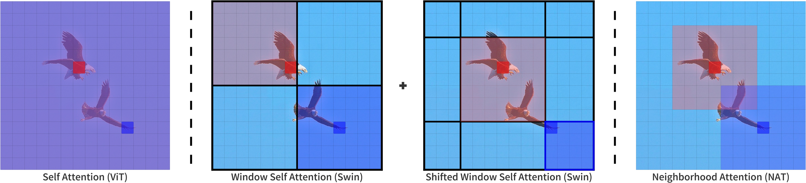

<strong>图 1：自注意力、（移位）窗口自注意力与我们提出的邻域注意力的注意力覆盖范围示意图。</strong> 自注意力允许每个词元关注所有词元。窗口自注意力将自注意力划分为互不重叠的子窗口，随后使用移位窗口自注意力，实现扩大感受野所必需的跨窗口交互。邻域注意力将注意力限制在每个词元周围的邻域内，引入局部归纳偏置，保持平移等变性，并且无需额外操作即可扩大感受野。

<strong>图内标签：</strong> Self Attention（ViT）：自注意力（ViT）；Window Self Attention（Swin）：窗口自注意力（Swin）；Shifted Window Self Attention（Swin）：移位窗口自注意力（Swin）；Neighborhood Attention（NAT）：邻域注意力（NAT）。

## 摘要

我们提出<strong>邻域注意力（Neighborhood Attention，NA）</strong>，这是首个高效且可扩展的视觉滑动窗口注意力机制。NA 是一种逐像素操作，将自注意力（Self Attention，SA）限制在最近的邻近像素上，因此，相比 SA 的二次时间和空间复杂度，NA 具有线性的时间和空间复杂度。滑动窗口模式使 NA 无需额外的像素移位即可扩大感受野，并且能够保持平移等变性，这与 Swin Transformer 的窗口自注意力（Window Self Attention，WSA）不同。我们开发了 <strong>NATTEN</strong>（Neighborhood Attention Extension，邻域注意力扩展），这是一个包含高效 C++ 和 CUDA 内核的 Python 软件包，能够使 NA 的运行速度比 Swin 的 WSA 最高快 40%，同时将内存占用最多降低 25%。我们进一步提出<strong>邻域注意力 Transformer（Neighborhood Attention Transformer，NAT）</strong>，这是一种基于 NA 的新型层次化 Transformer 设计，可提升图像分类和下游视觉任务的性能。实验表明，NAT 具有较强的竞争力：NAT-Tiny 在 ImageNet 上达到 83.2% 的 top-1 准确率，在 MS-COCO 上达到 51.4% 的 mAP，在 ADE20K 上达到 48.4% 的 mIoU；与规模相近的 Swin 模型相比，ImageNet 准确率、COCO mAP 和 ADE20K mIoU 分别提高了 1.9、1.0 和 2.6 个百分点。为支持更多基于滑动窗口注意力的研究，我们开源了项目并发布模型检查点。

<a id="section-1"></a>

## 1 引言

多年来，卷积神经网络（CNN）<a href="#ref-19">[19]</a> 一直是各种计算机视觉应用中事实上的标准模型架构。AlexNet <a href="#ref-18">[18]</a> 在 ImageNet <a href="#ref-10">[10]</a> 上展示了这类网络的有效性，随后出现了 VGG <a href="#ref-26">[26]</a>、ResNet <a href="#ref-17">[17]</a> 和 EfficientNet <a href="#ref-27">[27]</a> 等众多架构。另一方面，Transformer <a href="#ref-31">[31]</a> 最初是为自然语言处理（NLP）提出的基于注意力的模型，旨在利用语言的序列结构。BERT <a href="#ref-11">[11]</a> 和 GPT <a href="#ref-23">[23]</a>、<a href="#ref-24">[24]</a>、<a href="#ref-2">[2]</a> 均在其基础上构建，Transformer 也持续成为 NLP 中最先进的架构。

2020 年末，视觉 Transformer（Vision Transformer，ViT）<a href="#ref-12">[12]</a> 被提出用于图像分类。它仅使用作用于图像块嵌入空间的 Transformer 编码器，主要面向大规模训练。此后，一系列方法尝试提高数据效率 <a href="#ref-28">[28]</a>、<a href="#ref-13">[13]</a>、<a href="#ref-15">[15]</a>，最终使这类 Transformer 模型在不使用 JFT-300M 等大规模数据集预训练的情况下，也达到了 ImageNet-1K 分类的最先进水平。

这些高性能的 Transformer 类方法都基于自注意力（SA），即原始 Transformer <a href="#ref-31">[31]</a> 的基本构件。不计线性投影时，SA 的复杂度与嵌入维度成线性关系，但与词元数量成二次关系。在视觉领域，词元数量通常与图像分辨率成线性关系。因此，对于 ViT 等完全使用 SA 的模型，提高图像分辨率会使计算复杂度和内存占用呈二次增长。这种二次复杂度使此类模型难以直接应用于目标检测和分割等下游视觉任务，因为这些任务的图像分辨率通常远高于分类任务。另一个问题是，卷积能够受益于局部性和二维空间结构等归纳偏置，而从定义上看，点积自注意力是一种全局的一维操作。这意味着，某些此类归纳偏置必须通过大量数据 <a href="#ref-12">[12]</a>，或先进的训练技巧与数据增强方法 <a href="#ref-28">[28]</a>、<a href="#ref-15">[15]</a> 来学习。

为缓解这些问题，研究者提出了局部注意力模块。独立自注意力（Stand-Alone Self-Attention，SASA）<a href="#ref-25">[25]</a> 是较早将局部窗口注意力应用于视觉的方法之一，其中每个像素关注自身周围的一个窗口。其显式滑动窗口模式与采用 `same` 填充的卷积一致：在四周进行零填充，并执行简单的二维光栅扫描，因此能够保持平移等变性。SASA 旨在替换 ResNet 中的卷积，并取得了相对于基线的明显提升。然而，原作者指出，由于缺少像卷积那样高效的实现，SASA 的速度受到限制。另一方面，Swin <a href="#ref-21">[21]</a> 是较早采用局部自注意力的层次化视觉 Transformer 之一。其架构设计和移位窗口自注意力使其在计算上可行，并通过引入额外偏置提升性能，因此易于应用于下游任务。不过，Swin 的局部注意力先在互不重叠的窗口内计算自注意力，再移动窗口；采用这一方式的动机，正是 SASA 等滑动窗口方法存在吞吐量瓶颈。HaloNet <a href="#ref-30">[30]</a> 使用一种光晕扩展（haloing）机制，每次以像素块为单位将自注意力局部化，而不是逐像素处理。其关键动机之一同样是缺少高效的滑动窗口注意力。

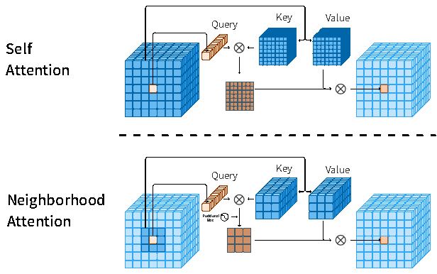

<strong>图 2：单个像素的邻域注意力（NA）与自注意力（SA）的查询－键－值结构对比。</strong> SA 允许每个像素关注其他所有像素，而 NA 将每个像素的注意力限制在其自身周围的邻域内。因此，相邻像素的注意力覆盖范围通常不同。

<strong>图内标签：</strong> Query：查询；Key：键；Value：值；Positional Bias：位置偏置；Self Attention：自注意力；Neighborhood Attention：邻域注意力；⊗：矩阵乘法。

在这项工作中，我们重新考察显式滑动窗口注意力机制，并提出邻域注意力（NA）。NA 将 SA 限制在每个像素最近的邻居上，而这些邻居不一定对应于该像素周围的一个固定窗口。这一对定义的调整使所有像素都能保持相同的注意力覆盖规模；相比之下，在采用零填充的方法（如 SASA）中，角落像素的有效注意力覆盖规模会缩小。随着邻域增大，NA 也逐渐接近 SA；当邻域达到最大时，NA 与 SA 等价。此外，与分块自注意力和窗口自注意力不同，NA 还具有保持平移等变性的优势 <a href="#ref-30">[30]</a>。我们开发了 NATTEN 这一 Python 软件包，提供高效的 C++ 和 CUDA 内核，使 NA 在实际运行中能够比 Swin 的 WSA 更快，同时占用更少的内存。我们构建了邻域注意力 Transformer（NAT），并在多种视觉任务上取得了具有竞争力的结果。

我们的主要贡献如下：

1. 提出<strong>邻域注意力（NA）</strong>：一种简单而灵活的显式滑动窗口注意力机制，将每个像素的注意力覆盖范围限制在最近的邻域内；随着覆盖范围增大，它逐渐接近自注意力，并保持平移等变性。我们将 NA 与自注意力、窗口自注意力和卷积的计算复杂度及内存占用进行了比较。
2. 为 NA 开发高效的 C++ 和 CUDA 内核，包括<strong>分块 NA（tiled NA）</strong>算法，使 NA 的运行速度比 Swin 的 WSA 最高快 40%，同时将内存占用最多降低 25%。我们通过用于显式滑动窗口注意力机制的新 Python 软件包 <strong>NATTEN</strong> 发布这些内核，提供支持自动微分、易于使用的模块，可接入任何现有的 PyTorch 流程。
3. 提出<strong>邻域注意力 Transformer（NAT）</strong>，一种基于 NA 的高效、准确且可扩展的层次化 Transformer。我们在分类和下游任务中展示了它的有效性。例如，NAT-Tiny 仅需 4.3 GFLOPs 和 2800 万个参数，就能在 ImageNet 上达到 83.2% 的 top-1 准确率，在 MS-COCO 上达到 51.4% 的边界框 mAP，在 ADE20K 上达到 48.4% 的 mIoU，显著优于 Swin Transformer 和 ConvNeXt <a href="#ref-22">[22]</a>。

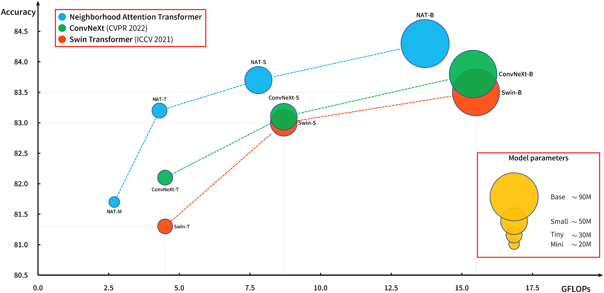

<strong>图 3：ImageNet-1K 分类性能与计算量的关系，气泡大小表示参数数量。</strong> NAT 以更少的 FLOPs 和相近的参数数量，在分类任务上超过了 Swin Transformer 和 ConvNeXt。

<strong>图内标签：</strong> Accuracy：准确率；GFLOPs：十亿次浮点运算；Model parameters：模型参数量；Mini／Tiny／Small／Base：模型规模名称，保留英文；ConvNeXt、Swin 与 NAT 的模型名称保持不变。

<a id="section-2"></a>

## 2 相关工作

本节简要回顾原始自注意力（SA）<a href="#ref-31">[31]</a>、若干具有代表性的视觉 Transformer 和 Transformer 类架构 <a href="#ref-12">[12]</a>、<a href="#ref-28">[28]</a>、若干具有代表性的基于局部注意力的视觉 Transformer <a href="#ref-21">[21]</a>、<a href="#ref-30">[30]</a>，以及近期提出的一种 CNN；后者为基于注意力的模型提供了较新的比较基线。

<a id="section-2-1"></a>

### 2.1 自注意力

Vaswani 等人 <a href="#ref-31">[31]</a> 将缩放点积注意力定义为作用于一个查询和一组键－值对的操作。首先计算查询与键的点积并进行缩放，然后对结果应用 softmax，以归一化注意力权重，最后将这些权重应用于值。其表达式为：

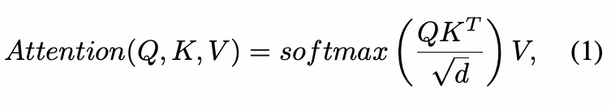

<details>
<summary>公式（1）的 LaTeX 源码</summary>

```latex
Attention ( Q, K, V ) = softmax \left( \frac{Q K^T}{\sqrt{d}} \right) V,
\tag{1}
```

</details>

其中，<i>d</i> 为嵌入维度。在自注意力中，查询和键－值对均来自同一输入的线性投影，随后对它们应用点积注意力。Transformer 通常使用注意力和自注意力的多头版本。多头注意力在不同的嵌入上多次应用点积注意力，由此形成多个注意力头。给定输入 <i>X</i> ∈ ℝ<sup><i>n</i> × <i>d</i></sup>，其中 <i>n</i> 为词元数量，<i>d</i> 为嵌入维度，这一操作的计算复杂度为 𝒪(<i>n</i><sup>2</sup><i>d</i>)，存储注意力权重的空间复杂度为 𝒪(<i>n</i><sup>2</sup>)。

<a id="section-2-2"></a>

### 2.2 视觉 Transformer

Dosovitskiy 等人 <a href="#ref-12">[12]</a> 提出了一种基于 Transformer 的图像分类器，仅由 Transformer 编码器 <a href="#ref-31">[31]</a> 和图像词元化器组成，称为<strong>视觉 Transformer（ViT）</strong>。此前，DETR <a href="#ref-4">[4]</a> 等工作曾探索用于目标检测的 CNN－Transformer 混合模型。ViT 则提出了一种仅依赖单个不重叠卷积层完成图像块划分和嵌入的模型。ViT 主要在非公开的 JFT-300M 数据集上预训练，并在多个基准上超越了当时最先进的 CNN。不过，原作者也指出，当 ViT 在 ImageNet-1K 和 ImageNet-21K 等中等规模数据集上预训练时，它不再具有竞争力。他们将这一现象归因于 ViT 缺少 CNN 内生的归纳偏置，并认为大规模训练可以弥补这一不足。这虽然实际上表明了 ViT 在中等规模训练下处于劣势，但也提供了经验性证据：在更大规模下，基于 Transformer 的模型能够超过 CNN。ViT 为随后更多视觉 Transformer 乃至各类基于注意力的模型铺平了道路，这些后续模型将其推广到中等规模学习 <a href="#ref-28">[28]</a>，甚至是在更小数据集上的小规模学习 <a href="#ref-15">[15]</a>。Touvron 等人 <a href="#ref-28">[28]</a> 通过探索数据效率扩展了视觉 Transformer 的研究。他们的<strong>数据高效图像 Transformer（Data-efficient image Transformer，DeiT）</strong>仅做少量架构改动，并使用先进的数据增强和训练技巧，就推动了 ViT 的性能提升。这项工作凸显了基于 Transformer 的图像分类器在中等数据规模下的潜力，也促使更多方法采用其训练技巧 <a href="#ref-21">[21]</a>、<a href="#ref-29">[29]</a>。

<a id="section-2-3"></a>

### 2.3 局部注意力

<strong>独立自注意力（SASA）</strong><a href="#ref-25">[25]</a> 是较早的滑动窗口自注意力模式之一，旨在替换现有 CNN 中的卷积。它的工作方式类似于带零填充的卷积，通过在特征图上滑动采样来提取键－值对。原作者报告了明显的准确率提升，但也发现，尽管理论计算成本更低，具体实现的延迟却较高。这种注意力模式也被 Longformer <a href="#ref-1">[1]</a> 用于语言处理，即滑动窗口注意力，随后被 Vision Longformer（ViL）<a href="#ref-38">[38]</a> 采用。虽然 Longformer 和 ViL 的实现与 SASA 不同，但由于计算开销，它们仍无法扩展到更大的窗口和模型。此外，由填充导致的角落位置感受野缩小问题也没有得到解决。

Liu 等人提出了窗口注意力和<strong>移位窗口（Shifted Window，Swin）注意力</strong> <a href="#ref-21">[21]</a>：这两种自注意力机制采用不滑动的窗口，先对特征图进行分区，再在各分区内独立计算自注意力。这一操作的理论复杂度与 SASA 相近，却容易通过批量矩阵乘法并行执行。移位版本接在常规版本之后，顾名思义，它会移动分区边界，从而允许感受野增长所必需的跨窗口交互。其模型 <strong>Swin Transformer</strong> 是较早的层次化视觉 Transformer 之一。它生成金字塔状特征图，在降低空间维度的同时增加通道深度。这种结构多年来已在 CNN 中广泛使用，也使 Swin 易于与其他网络结合，应用于检测和分割等下游任务。Swin 在 ImageNet-1K 分类中超过了使用卷积教师模型的 DeiT。此外，Swin Transformer 在 MS-COCO 目标检测和 ADE20K 语义分割上均达到了最先进水平。

Vaswani 等人 <a href="#ref-30">[30]</a> 提出了 <strong>HaloNet</strong>，通过以新的分块注意力模式替换 SASA，来规避其速度问题。他们指出，这一改动虽然放宽了平移等变性要求，但能够在速度和内存方面取得合理的权衡。HaloNet 的注意力机制包含三个阶段：分块、光晕扩展和注意力计算。首先将输入特征图划分为互不重叠的子集，作为查询；随后提取经“光晕扩展”得到的相邻块，作为键和值；最后对提取的查询和键－值对计算注意力。实验表明，HaloNet 既能降低相对于 SASA 的计算成本，也能提升性能，尤其是在网络中与卷积层结合使用时。许多工作沿用了 Swin 的 WSA，例如 RegionViT <a href="#ref-6">[6]</a> 在每个局部自注意力层中插入一个区域词元，以引入全局上下文。这些工作和 HaloNet 表明，研究界对滑动窗口注意力模式的兴趣有所减弱，部分原因是人们认为其效率低下。我们希望通过提出 NATTEN 改变这一看法。

<a id="section-2-4"></a>

### 2.4 新的卷积基线

Liu 等人 <a href="#ref-22">[22]</a> 提出了一种受 Swin 等模型影响的新 CNN 架构，称为 ConvNeXt。这些模型不基于注意力，却能在不同视觉任务中超过 Swin。此后，这项工作成为了比较卷积模型和注意力模型时使用的新 CNN 基线。

我们提出的邻域注意力在设计上将感受野限制在每个查询周围的窗口内，因此不需要 Swin 所用的循环移位等额外技巧。此外，邻域注意力能够保持平移等变性，而 HaloNet 和 Swin 等方法为了效率而对此作出了取舍。我们通过 NATTEN Python 软件包证明，邻域注意力的运行速度可以超过 Swin 等方法，同时占用更少内存。我们还引入了一种采用该注意力机制的层次化 Transformer 类模型，称为邻域注意力 Transformer，并在图像分类、目标检测和语义分割任务上展示了其相对于 Swin 的性能。


<a id="section-3"></a>

## 3 方法

本节介绍邻域注意力：它在考虑视觉数据结构的基础上，将自注意力（见公式 1）局部化。这不仅降低了相对于自注意力的计算成本，还引入了与卷积类似的局部归纳偏置。我们表明，在限制自注意力的作用范围方面，NA 是比此前提出的 SASA <a href="#ref-25">[25]</a> 更好的选择，而两者的理论成本相同。随后，我们介绍 Python 扩展包 NATTEN，它提供了面向 CPU 和 GPU 加速的高效 NA 实现。我们讨论这一扩展中的新设计，以及它如何在使用更少内存的同时，达到超过 Swin 的 WSA 和 SWSA 的速度。最后，我们介绍采用这一新机制替代自注意力的模型——<strong>邻域注意力 Transformer（Neighborhood Attention Transformer，NAT）</strong>。此外，NAT 采用与 Swin <a href="#ref-21">[21]</a> 类似的多阶段层次化设计，即在不同阶段之间对特征图进行下采样，而非一次性完成。与 Swin 不同，NAT 使用重叠卷积，而非不重叠的图像块式卷积，来下采样特征图；已有研究表明，这能够通过引入有益的归纳偏置来改善模型性能 <a href="#ref-34">[34]</a>、<a href="#ref-15">[15]</a>。

<a id="section-3-1"></a>

### 3.1 邻域注意力

为降低注意力的二次计算成本，Swin 的 WSA 对自注意力进行限制，可以认为是现有方法中速度最快的方法之一。它只是将输入划分为若干区域，并在每个区域中独立应用自注意力。WSA 需要与其移位变体 SWSA 配合使用：SWSA 移动这些分区边界，以允许窗口外的交互。这对于扩大感受野至关重要。然而，将自注意力局部化的最直接方式，是让每个像素关注其邻近像素。这样，大多数像素周围都会有一个随位置动态移动的窗口，能够扩大感受野，因此无需再人为设计一个移位变体。此外，与 Swin 不同，这种动态限制自注意力的方式可以像卷积一样保留平移等变性 <a href="#ref-30">[30]</a>（我们在附录 C 中分析了包括本方法在内的不同方法的平移等变性）。受此启发，我们提出<strong>邻域注意力（Neighborhood Attention，NA）</strong>。

给定输入 <i>X</i> ∈ ℝ<sup><i>n</i> × <i>d</i></sup>，它是一个各行均为 <i>d</i> 维词元向量的矩阵；再给定 <i>X</i> 的线性投影 <i>Q</i>、<i>K</i>、<i>V</i>，以及相对位置偏置 <i>B</i>(<i>i</i>, <i>j</i>)。对于邻域大小为 <i>k</i> 的第 <i>i</i> 个输入，我们将其注意力权重 <b>A</b><sub><i>i</i></sub><sup><i>k</i></sup> 定义为：该输入的查询投影与其最近的 <i>k</i> 个邻居的键投影之间的点积，并加入相对位置偏置：

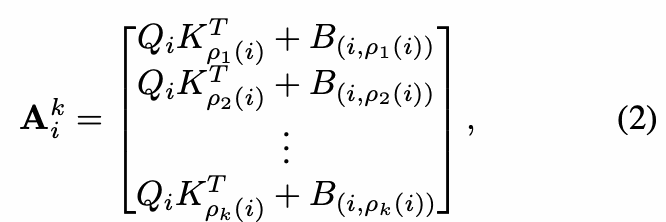

<details>
<summary>公式（2）的 LaTeX 源码</summary>

```latex
\mathbf{A}_{i}^{k} = \begin{bmatrix}Q_i K_{\rho_{1}{(i)}}^T + B_{(i,\rho_{1}{(i)})} \\Q_i K_{\rho_{2}{(i)}}^T + B_{(i,\rho_{2}{(i)})} \\ \vdots \\ Q_i K_{\rho_{k}{(i)}}^T + B_{(i,\rho_{k}{(i)})}\end{bmatrix},
\tag{2}
```

</details>

其中，<i>ρ</i><sub><i>j</i></sub>(<i>i</i>) 表示 <i>i</i> 的第 <i>j</i> 个最近邻。随后，我们将邻域值 <b>V</b><sub><i>i</i></sub><sup><i>k</i></sup> 定义为一个矩阵，其中各行为第 <i>i</i> 个输入最近的 <i>k</i> 个邻居的值投影：

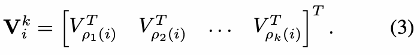

<details>
<summary>公式（3）的 LaTeX 源码</summary>

```latex
\mathbf{V}_{i}^{k} = \begin{bmatrix}V_{\rho_{1}{(i)}}^T & V_{\rho_{2}{(i)}}^T & \hdots & V_{\rho_{k}{(i)}}^T\end{bmatrix}^T .
\tag{3}
```

</details>

于是，邻域大小为 <i>k</i> 的第 <i>i</i> 个词元的邻域注意力定义为：

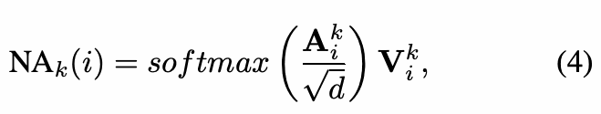

<details>
<summary>公式（4）的 LaTeX 源码</summary>

```latex
\text{NA}_{k}{(i)} = softmax\left(\frac{\mathbf{A}_{i}^{k}}{\sqrt{d}}\right) \mathbf{V}_{i}^{k},
\tag{4}
```

</details>

其中，√<i>d</i> 是缩放参数。对特征图中的每个像素都重复这一操作。图 2 和图 VIII 展示了该操作的示意图。

从这一定义不难看出，随着 <i>k</i> 增大，<b>A</b><sub><i>i</i></sub><sup><i>k</i></sup> 趋近于自注意力权重，<b>V</b><sub><i>i</i></sub><sup><i>k</i></sup> 趋近于 <i>V</i><sub><i>i</i></sub> 本身，因此邻域注意力趋近于自注意力。这正是 NA 与 SASA <a href="#ref-25">[25]</a> 的关键区别：SASA 让每个像素关注其周围的一个窗口，并在输入周围进行填充，以处理边界情形。由于这一差别，NA 会随着窗口大小增加而趋近于自注意力；SASA 则由于输入周围的零填充而不具备这一性质。

<a id="section-3-2"></a>

### 3.2 分块 NA 与 NATTEN

过去，对逐像素限制自注意力的探索并不充分，主要原因是这种操作被认为计算成本较高 <a href="#ref-25">[25]</a>、<a href="#ref-21">[21]</a>、<a href="#ref-30">[30]</a>，需要在更底层重新实现。这是因为自注意力本身可以分解为矩阵乘法；矩阵乘法很容易在加速器上并行执行，而且计算软件已针对不同使用场景提供了大量高效算法，例如 LAPACK、cuBLAS 和 CUTLASS。此外，PyTorch 等大多数深度学习平台都构建在这类软件及 cuDNN 等附加库之上。这对研究者非常有帮助：他们可以使用矩阵乘法、卷积等操作的抽象接口，由后端根据硬件、软件和使用场景决定运行哪一种算法。这些平台通常还会处理梯度的自动计算，使深度神经网络的设计和训练变得非常直接。

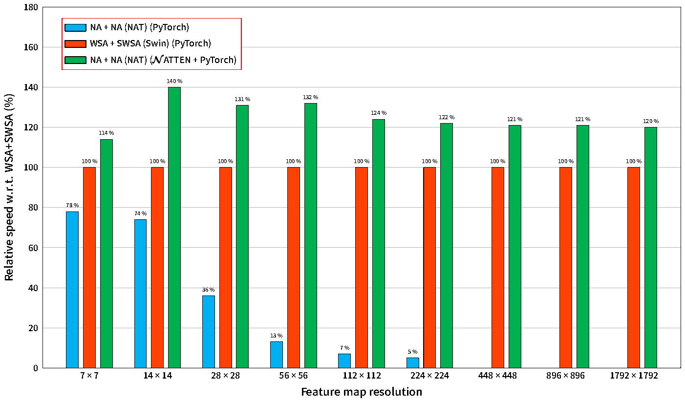

<strong>图 4：NAT 相对于 Swin 的逐层相对速度。</strong> 两个核大小为 7² 的 NA 层，相较于一对核大小相同的 WSA 和 SWSA 层，速度最高可提升 40%。延迟在单张 A100 GPU 上测量。NA 的 PyTorch 实现在 448² 及更高分辨率下会耗尽内存。

<strong>图内标签：</strong> Feature map resolution：特征图分辨率；Relative speed w.r.t. WSA+SWSA (%)：相对于 WSA+SWSA 的速度（%）；NA + NA (NAT) (PyTorch)：NA + NA（NAT，PyTorch 实现）；WSA + SWSA (Swin) (PyTorch)：WSA + SWSA（Swin，PyTorch 实现）；NA + NA (NAT) (NATTEN + PyTorch)：NA + NA（NAT，NATTEN + PyTorch 实现）。

由于 NA 的逐像素结构（SASA 等其他逐像素注意力机制也存在这一特点 <a href="#ref-25">[25]</a>），以及 NA 对邻域所作的新定义，要在这些平台中实现 NA，就只能组合多项低效操作，先提取邻域并将其存为中间张量，再计算注意力。这样的操作速度显著变慢，内存用量则呈指数级增长。为应对这些挑战，我们开发了一组高效的 CPU 和 CUDA 内核，并将其封装为 Python 扩展包 <strong>Neighborhood Attention Extension（邻域注意力扩展，NATTEN）</strong>。NATTEN 支持半精度、1D 与 2D 数据，并提供与 PyTorch 自动微分机制兼容的集成。这意味着用户只需将 NA 作为 PyTorch 模块导入，就能把它集成到现有流程中。

我们还指出，SASA 也能通过这一扩展包轻松实现，而且无需改动底层内核，只需对输入进行零填充即可，因为 SASA 是 NA 的一个特例。反过来则不成立。NATTEN 还包含我们的<strong>分块 NA 算法</strong>：它将互不重叠的查询块加载到共享内存中，再计算邻域注意力权重，从而尽量减少全局内存读取。与朴素实现相比，分块 NA 可以将延迟降低最多一个数量级（技术细节见附录 A），并使基于 NA 的模型比类似的 Swin 模型快最多 40%（见图 4）。NATTEN 已开源：[https://github.com/SHI-Labs/NATTEN](https://github.com/SHI-Labs/NATTEN)。

<a id="section-3-3"></a>

### 3.3 邻域注意力 Transformer

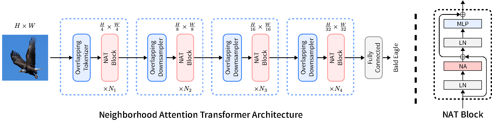

<strong>图 5：NAT 模型及其层次化设计概览。</strong> 模型首先使用一个卷积下采样器，随后依次经过 4 个阶段，每个阶段包含多个 NAT 块，即类似 Transformer 的编码器层。每层由多头邻域注意力（NA）、多层感知机（MLP）、各模块之前的层归一化（LN），以及跳跃连接组成。在阶段之间，特征图的高和宽减半，通道数加倍。这使模型能够通过特征金字塔，更方便地迁移到下游任务。

<strong>图内标签：</strong> Neighborhood Attention Transformer Architecture：邻域注意力 Transformer 架构；Overlapping Tokenizer：采用重叠卷积的词元化器；Overlapping Downsampler：采用重叠卷积的下采样器；NAT Block：NAT 块；Fully Connected：全连接层；Bald Eagle：白头海雕；LN：层归一化；NA：邻域注意力；MLP：多层感知机；⊕：逐元素相加；<i>H</i> × <i>W</i> 及各阶段的分数标注表示空间分辨率，<i>N</i><sub>1</sub>–<i>N</i><sub>4</sub> 表示各阶段 NAT 块的重复次数。

NAT 使用两个连续的 3×3 卷积对输入进行嵌入，二者步幅均为 2×2，使特征图的高和宽分别降至输入的 1/4。这类似于使用图像块大小为 4×4 的图像块嵌入层，但使用重叠卷积替代不重叠卷积，以引入有益的归纳偏置 <a href="#ref-34">[34]</a>、<a href="#ref-15">[15]</a>。另一方面，重叠卷积会增加计算成本，两个卷积也会带来更多参数。不过，我们通过重新配置模型来处理这一问题，从而获得更好的权衡。

| 变体 | 各阶段层数 | 维度 × 头数 | MLP 比例 | 参数量 | FLOPs |
| --- | --- | --- | ---: | ---: | ---: |
| <strong>NAT-Mini</strong> | 3, 4, 6, 5 | 32 × 2 | 3 | 20 M | 2.7 G |
| <strong>NAT-Tiny</strong> | 3, 4, 18, 5 | 32 × 2 | 3 | 28 M | 4.3 G |
| <strong>NAT-Small</strong> | 3, 4, 18, 5 | 32 × 3 | 2 | 51 M | 7.8 G |
| <strong>NAT-Base</strong> | 3, 4, 18, 5 | 32 × 4 | 2 | 90 M | 13.7 G |

<strong>表 1：NAT 各变体的比较。</strong>

NAT 由 4 个阶段组成，除最后一个阶段外，每个阶段之后都接一个下采样器。下采样器将特征图的高和宽减半，同时使通道数加倍。我们使用步幅为 2×2 的 3×3 卷积，替代 Swin 使用的 2×2 不重叠卷积（图像块合并）。由于词元化器按 4 倍进行下采样，模型产生的特征图尺寸依次为 (<i>h</i>)/(4) × (<i>w</i>)/(4)、(<i>h</i>)/(8) × (<i>w</i>)/(8)、(<i>h</i>)/(16) × (<i>w</i>)/(16) 和 (<i>h</i>)/(32) × (<i>w</i>)/(32)。这一设计变化受到此前成功的 CNN 结构启发，也被 PVT <a href="#ref-32">[32]</a>、ViL <a href="#ref-38">[38]</a> 和 Swin Transformer <a href="#ref-21">[21]</a> 等层次化注意力方法采用。此外，我们在较大的模型变体中使用 LayerScale <a href="#ref-29">[29]</a> 来提高稳定性。图 5 展示了整体网络结构，表 1 汇总了不同 NAT 变体。

<a id="section-3-4"></a>

### 3.4 复杂度分析

| 模块 | FLOPs | 内存用量 |
| --- | --- | --- |
| 自注意力（SA） | 3<i>h</i><i>w</i><i>d</i><sup>2</sup> + 2<i>h</i><sup>2</sup><i>w</i><sup>2</sup><i>d</i> | 3<i>d</i><sup>2</sup> + <i>h</i><sup>2</sup><i>w</i><sup>2</sup> |
| 窗口自注意力（WSA） | 3<i>h</i><i>w</i><i>d</i><sup>2</sup> + 2<i>h</i><i>w</i><i>d</i><i>k</i><sup>2</sup> | 3<i>d</i><sup>2</sup> + <i>h</i><i>w</i><i>k</i><sup>2</sup> |
| 邻域注意力（NA） | 3<i>h</i><i>w</i><i>d</i><sup>2</sup> + 2<i>h</i><i>w</i><i>d</i><i>k</i><sup>2</sup> | 3<i>d</i><sup>2</sup> + <i>h</i><i>w</i><i>k</i><sup>2</sup> |
| 卷积 | <i>h</i><i>w</i><i>d</i><sup>2</sup><i>k</i><sup>2</sup> | <i>d</i><sup>2</sup><i>k</i><sup>2</sup> |

<strong>表 2：不同注意力模式与卷积的计算成本和内存用量。</strong> SA 的复杂度相对于分辨率呈二次增长，而 WSA、NA 和卷积的复杂度呈线性增长。

本小节分析复杂度和内存用量，并在表 2 中比较 SA、WSA、NA 和卷积。为简化讨论，我们不考虑注意力头。给定形状为 <i>h</i> × <i>w</i> × <i>d</i> 的输入特征图，其中 <i>d</i> 为通道数，<i>h</i> 和 <i>w</i> 分别为特征图的高度与宽度，<i>Q</i><i>K</i><i>V</i> 线性投影需要 3<i>h</i><i>w</i><i>d</i><sup>2</sup> 次浮点运算，三种注意力模式在这一点上相同。

SA 的复杂度为二次量级，因为计算注意力权重和计算输出分别需要 <i>h</i><sup>2</sup><i>w</i><sup>2</sup><i>d</i> 次浮点运算，注意力权重的形状则为 <i>h</i><i>w</i> × <i>h</i><i>w</i>。Swin 的 WSA 将查询、键和值划分为 (<i>h</i>)/(<i>k</i>) × (<i>w</i>)/(<i>k</i>) 个形状为 <i>k</i> × <i>k</i> 的窗口，再在每个窗口内部应用自注意力，所需浮点运算次数为 <i>h</i><i>w</i><i>d</i><i>k</i><sup>2</sup>。由于其注意力权重的形状为 (<i>h</i>)/(<i>k</i>) × (<i>w</i>)/(<i>k</i>) × <i>k</i><sup>2</sup> × <i>k</i><sup>2</sup>，WSA 的内存用量因此为 <i>h</i><i>w</i><i>d</i><i>k</i><sup>2</sup>。

在 NA 中，<b>A</b><sub><i>i</i></sub><sup><i>k</i></sup> 的大小为 <i>h</i> × <i>w</i> × <i>k</i><sup>2</sup>，计算它的成本为 <i>h</i><i>w</i><i>d</i><i>k</i><sup>2</sup>。<b>V</b><sub><i>i</i></sub><sup><i>k</i></sup> 的形状为 <i>h</i> × <i>w</i> × <i>k</i><sup>2</sup> × <i>d</i>，因此将注意力权重应用于它的计算成本也是 <i>h</i><i>w</i><i>d</i><i>k</i><sup>2</sup>。对于卷积，计算成本为 <i>h</i><i>w</i><i>d</i><sup>2</sup><i>k</i><sup>2</sup>，内存用量则仅为 <i>d</i><sup>2</sup><i>k</i><sup>2</sup>。表 2 的汇总表明，Swin 的 WSA 与 NA 在理论上具有相同的计算成本和内存用量。


<a id="section-4"></a>

## 4 实验

我们通过图像分类、目标检测和语义分割等不同视觉任务上的实验，展示 NAT 的适用性和有效性。我们还对不同的注意力模式及 NAT 的架构设计进行了消融研究。包括显著性分析在内的更多实验见附录 B。

<a id="section-4-1"></a>

### 4.1 分类

我们在 ImageNet-1K <a href="#ref-10">[10]</a> 上训练不同的 NAT 变体，以便与基于 Transformer 和卷积的其他图像分类器进行比较。该数据集仍是少数中等规模图像分类基准之一，包含约 128 万张训练图像、5 万张验证图像和 10 万张测试图像，分为 1000 个类别。我们使用常用的 `timm` <a href="#ref-33">[33]</a>（Apache License v2）训练 NAT，并采用被比较方法中使用的常规数据增强与训练技巧 <a href="#ref-21">[21]</a>、<a href="#ref-22">[22]</a>，其中数据增强包括 CutMix <a href="#ref-36">[36]</a>、Mixup <a href="#ref-37">[37]</a>、RandAugment <a href="#ref-8">[8]</a> 和随机擦除（Random Erasing）<a href="#ref-39">[39]</a>。我们遵循 Swin <a href="#ref-21">[21]</a> 的训练配置，包括学习率、按迭代步调整的余弦调度及其他超参数。按照惯例，我们训练 300 个 epoch，其中前 20 个 epoch 用于学习率预热，其余阶段按照调度器衰减学习率，之后再进行额外 10 个 epoch 的冷却训练 <a href="#ref-28">[28]</a>。

结果列于表 3，并在图 3 中可视化。我们观察到，NAT-Mini 的准确率比 Swin-Tiny 高 0.5 个百分点，同时参数更少、吞吐量更高、内存占用更低。其余三个变体也始终优于参数量和 FLOPs 相近的 Swin 与 ConvNeXt 对应模型。虽然 Small 变体因架构差异而比对应的 Swin 模型略慢，但 Base 变体的速度则反超了 Swin-Base。

| 模型 | 参数量 | FLOPs | 吞吐量（图像/秒） | 内存（GB） | Top-1（%） |
| --- | ---: | ---: | ---: | ---: | ---: |
| NAT-M | 20 M | 2.7 G | 2135 | 2.4 | 81.8 |
| Swin-T | 28 M | 4.5 G | 1730 | 4.8 | 81.3 |
| ConvNeXt-T | 28 M | 4.5 G | 2491 | 3.4 | 82.1 |
| NAT-T | 28 M | 4.3 G | 1541 | 2.5 | <strong>83.2</strong> |
| Swin-S | 50 M | 8.7 G | 1059 | 5.0 | 83.0 |
| ConvNeXt-S | 50 M | 8.7 G | 1549 | 3.5 | 83.1 |
| NAT-S | 51 M | 7.8 G | 1051 | 3.7 | <strong>83.7</strong> |
| Swin-B | 88 M | 15.4 G | 776 | 6.7 | 83.5 |
| ConvNeXt-B | 89 M | 15.4 G | 1107 | 4.8 | 83.8 |
| NAT-B | 90 M | 13.7 G | 783 | 5.0 | <strong>84.3</strong> |

<strong>表 3：ImageNet-1K 分类性能。</strong> 所有模型均以 224×224 分辨率运行，未使用额外数据或预训练。峰值内存占用与吞吐量均在单张 NVIDIA A100 GPU 上、以批大小 256 测量。

<a id="section-4-2"></a>

### 4.2 目标检测与实例分割

我们以在 ImageNet 上预训练的 NAT 为骨干网络，在 MS-COCO <a href="#ref-20">[20]</a> 上训练 Mask R-CNN <a href="#ref-16">[16]</a> 和 Cascade Mask R-CNN <a href="#ref-3">[3]</a>。我们遵循 Swin <a href="#ref-21">[21]</a> 的训练设置，使用 `mmdetection` <a href="#ref-5">[5]</a>（Apache License v2），并采用相同的加速 3 × 学习率调度。

结果列于表 4。在 Mask R-CNN 下，NAT-Mini 超过了 Swin-Tiny；在 Cascade Mask R-CNN 下则略逊于后者，但在两种情况下 FLOPs 都显著更少。在 Mask R-CNN 和 Cascade Mask R-CNN 下，NAT-Tiny 都超过了 Swin 和 ConvNeXt 的对应模型，不过吞吐量略低于对应的 Swin 模型。NAT-Small 达到了与对应 Swin 模型相当的性能，而且速度更快。NAT-Base 则在拥有更高吞吐量的同时，还能超过对应的 Swin 模型。

<strong>表 4，A 部分：Mask R-CNN，3× 训练调度。</strong>

| 骨干网络 | 参数量 | FLOPs | 吞吐量（FPS） | AP<sup>b</sup> | AP<sup>b</sup><sub>50</sub> | AP<sup>b</sup><sub>75</sub> | AP<sup>m</sup> | AP<sup>m</sup><sub>50</sub> | AP<sup>m</sup><sub>75</sub> |
| --- | ---: | ---: | ---: | ---: | ---: | ---: | ---: | ---: | ---: |
| NAT-M | 40 M | 225 G | 54.1 | 46.5 | 68.1 | 51.3 | 41.7 | 65.2 | 44.7 |
| Swin-T | 48 M | 267 G | 45.1 | 46.0 | 68.1 | 50.3 | 41.6 | 65.1 | 44.9 |
| ConvNeXt-T | 48 M | 262 G | 52.0 | 46.2 | 67.0 | 50.8 | 41.7 | 65.0 | 44.9 |
| NAT-T | 48 M | 258 G | 44.5 | 47.7 | 69.0 | 52.6 | 42.6 | 66.1 | 45.9 |
| Swin-S | 69 M | 359 G | 31.7 | 48.5 | 70.2 | 53.5 | 43.3 | 67.3 | 46.6 |
| NAT-S | 70 M | 330 G | 34.8 | 48.4 | 69.8 | 53.2 | 43.2 | 66.9 | 46.5 |

<strong>表 4，B 部分：Cascade Mask R-CNN，3× 训练调度。</strong>

| 骨干网络 | 参数量 | FLOPs | 吞吐量（FPS） | AP<sup>b</sup> | AP<sup>b</sup><sub>50</sub> | AP<sup>b</sup><sub>75</sub> | AP<sup>m</sup> | AP<sup>m</sup><sub>50</sub> | AP<sup>m</sup><sub>75</sub> |
| --- | ---: | ---: | ---: | ---: | ---: | ---: | ---: | ---: | ---: |
| NAT-M | 77 M | 704 G | 27.8 | 50.3 | 68.9 | 54.9 | 43.6 | 66.4 | 47.2 |
| Swin-T | 86 M | 745 G | 25.1 | 50.4 | 69.2 | 54.7 | 43.7 | 66.6 | 47.3 |
| ConvNeXt-T | 86 M | 741 G | 27.3 | 50.4 | 69.1 | 54.8 | 43.7 | 66.5 | 47.3 |
| NAT-T | 85 M | 737 G | 24.9 | 51.4 | 70.0 | 55.9 | 44.5 | 67.6 | 47.9 |
| Swin-S | 107 M | 838 G | 20.3 | 51.9 | 70.7 | 56.3 | 45.0 | 68.2 | 48.8 |
| ConvNeXt-S | 108 M | 827 G | 23.0 | 51.9 | 70.8 | 56.5 | 45.0 | 68.4 | 49.1 |
| NAT-S | 108 M | 809 G | 21.7 | 52.0 | 70.4 | 56.3 | 44.9 | 68.1 | 48.6 |
| Swin-B | 145 M | 982 G | 17.3 | 51.9 | 70.5 | 56.4 | 45.0 | 68.1 | 48.9 |
| ConvNeXt-B | 146 M | 964 G | 19.5 | 52.7 | 71.3 | 57.2 | 45.6 | 68.9 | 49.5 |
| NAT-B | 147 M | 931 G | 18.6 | 52.5 | 71.1 | 57.1 | 45.2 | 68.6 | 49.0 |

<strong>表 4：COCO 目标检测和实例分割性能。</strong> FLOPs 按输入分辨率 (1280, 800) 计算。吞吐量在单张 NVIDIA A100 GPU 上、以相同分辨率测量。AP 的上标 b 表示边界框，上标 m 表示实例掩码；下标 50 和 75 分别表示 IoU 阈值为 0.50 和 0.75。

<a id="section-4-3"></a>

### 4.3 语义分割

为展示 NAT 在语义分割上的性能，我们以 NAT 为骨干网络，在 ADE20K <a href="#ref-40">[40]</a> 上训练 UPerNet <a href="#ref-35">[35]</a>。我们遵循 Swin 在 ADE20K 上的训练配置，并使用 `mmsegmentation` <a href="#ref-7">[7]</a>（Apache License v2）。此外，按照标准做法，训练时对输入图像进行随机缩放，并裁剪为 512 × 512。

结果列于表 5。可以看出，NAT-Mini 超过了 Swin-Tiny，并且与 ConvNeXt-Tiny 非常接近。NAT-Tiny 显著超过 ConvNeXt-Tiny，同时效率略高。NAT-Small 的单尺度性能优于 Swin-Small，多尺度性能则与之持平。NAT-Base 同样与 Swin-Base 表现相当，但略低于 ConvNeXt-Base。需要注意的是，NAT-Small 和 NAT-Base 的 FLOPs 都低于 Swin 与 ConvNeXt 的对应模型，而性能处于相同水平范围。

还需注意，在这一任务中特定的输入图像分辨率（512 × 512）会产生无法被 Swin 的 7 × 7 窗口大小整除的特征图。这迫使模型在每次注意力计算前对输入特征图进行零填充，从而使 Swin 在原有差距之外进一步增加 FLOPs。相比之下，NAT 支持任意大小的特征图。

| 骨干网络 | 参数量 | FLOPs | 吞吐量（FPS） | 单尺度 mIoU | 多尺度 mIoU |
| --- | ---: | ---: | ---: | ---: | ---: |
| NAT-M | 50 M | 900 G | 24.5 | 45.1 | 46.4 |
| Swin-T | 60 M | 946 G | 21.3 | 44.5 | 45.8 |
| ConvNeXt-T | 60 M | 939 G | 23.3 | 46.0 | 46.7 |
| NAT-T | 58 M | 934 G | 21.4 | 47.1 | 48.4 |
| Swin-S | 81 M | 1040 G | 17.0 | 47.6 | 49.5 |
| ConvNeXt-S | 82 M | 1027 G | 19.1 | 48.7 | 49.6 |
| NAT-S | 82 M | 1010 G | 17.9 | 48.0 | 49.5 |
| Swin-B | 121 M | 1188 G | 14.6 | 48.1 | 49.7 |
| ConvNeXt-B | 122 M | 1170 G | 16.4 | 49.1 | 49.9 |
| NAT-B | 123 M | 1137 G | 15.6 | 48.5 | 49.7 |

<strong>表 5：ADE20K 语义分割性能。</strong> FLOPs 按输入分辨率 (2048, 512) 计算。吞吐量在单张 NVIDIA A100 GPU 上、以相同分辨率测量。

<a id="section-4-4"></a>

### 4.4 消融研究

我们将 Swin 的注意力模式（WSA+SWSA）与滑动窗口模式进行比较，后者包括 SASA <a href="#ref-25">[25]</a> 和我们提出的 NA。这里使用 NATTEN 软件包实现 SASA，因此其吞吐量与 NA 近似相同，内存占用也完全一致。我们仅替换 Swin-Tiny 中的注意力模块，然后在 ImageNet-1K 分类、MS-COCO 目标检测与实例分割以及 ADE20K 分割任务上运行模型。结果列于表 6。

| 注意力 | ImageNet Top-1 | MS-COCO AP<sup>b</sup> | MS-COCO AP<sup>m</sup> | ADE20K mIoU | 参数量 | FLOPs | 吞吐量（图像/秒） | 内存（GB） |
| --- | ---: | ---: | ---: | ---: | ---: | ---: | ---: | ---: |
| SWSA | 81.3% | 46.0 | 41.6 | 45.8 | 28.28 M | 4.51 G | 1730 | 4.8 |
| SASA | 81.6% | 46.0 | 41.4 | 46.4 | 28.27 M | 4.51 G | 2021 | 4.0 |
| NA | 81.8% | 46.2 | 41.5 | 46.4 | 28.28 M | 4.51 G | 2021 | 4.0 |

<strong>表 6：不同注意力机制的性能比较。</strong> 所有模型的架构均与 Swin-T 相同，仅替换注意力机制。SASA 采用 NATTEN 实现，因此具有与 NA 相同的速度和内存效率。

此外，我们以 Swin-Tiny 为基线进行消融，单独研究 NAT 设计中卷积下采样及更深、更窄架构的影响。我们逐步将该模型转变为 NAT-Tiny，结果列于表 7。首先，将基于图像块的嵌入与图像块合并操作，替换为 NAT 使用的重叠卷积设计。这带来了接近 0.5 个百分点的准确率提升。第二步，将模型改得更深、更窄，以降低参数量和计算量；我们观察到，准确率在第一步的基础上又提高了约 0.9 个百分点。随后，我们尝试将 Swin 中的 WSA 和 SWSA 注意力模式替换为 SASA <a href="#ref-25">[25]</a>，发现准确率略有下降。但将 WSA 和 SWSA 替换为我们提出的 NA，则又带来了 0.5 个百分点的准确率提升。

| 注意力 | 下采样方式 | 各阶段层数 | 注意力头数 | MLP 扩展比 | Top-1（%） | 参数量 | FLOPs（G） | 吞吐量（图像/秒） | 内存（GB） |
| --- | --- | --- | ---: | ---: | ---: | ---: | ---: | ---: | ---: |
| SWSA | 图像块（Patch） | 2, 2, 6, 2 | 3 | 4 | 81.29 | 28.3 M | 4.5 | 1730 | 4.8 |
| SWSA | 卷积（Conv） | 2, 2, 6, 2 | 3 | 4 | 81.78 | 30.3 M | 4.9 | 1692 | 4.8 |
| SWSA | 卷积（Conv） | 3, 4, 18, 5 | 2 | 3 | 82.72 | 27.9 M | 4.3 | 1320 | 3.0 |
| SASA | 卷积（Conv） | 3, 4, 18, 5 | 2 | 3 | 82.54 | 27.9 M | 4.3 | 1541 | 2.5 |
| NA | 卷积（Conv） | 3, 4, 18, 5 | 2 | 3 | 83.20 | 27.9 M | 4.3 | 1541 | 2.5 |

<strong>表 7：以 Swin-T 为基线的 NAT 消融研究。</strong> 通过重叠卷积（第 2 行）及 NAT 配置（第 3 行），我们显著提高了 Swin 的分类准确率（第 1 行）。将 SWSA 替换为 NA（第 5 行）使准确率提高了接近 0.5 个百分点，而替换为 SASA（第 4 行）则使准确率略有下降。SASA 采用 NATTEN 实现，因此具有与 NA 相同的速度和内存效率。

我们还在表 8 中给出了核大小实验，尝试了从 3×3 到 9×9 的核大小，以分析其对模型性能的影响。

| 核大小 | ImageNet Top-1（%） | ImageNet 吞吐量（图像/秒） | MS-COCO AP<sup>b</sup> | MS-COCO AP<sup>m</sup> | MS-COCO 吞吐量（FPS） | ADE20K mIoU | ADE20K 吞吐量（FPS） |
| --- | ---: | ---: | ---: | ---: | ---: | ---: | ---: |
| 3×3 | 81.4 | 2015 | 46.1 | 41.4 | 46.8 | 46.0 | 23.6 |
| 5×5 | 81.6 | 1810 | 46.8 | 42.0 | 45.5 | 46.3 | 22.9 |
| 7×7 | 83.2 | 1537 | 47.7 | 42.6 | 44.5 | 48.4 | 21.4 |
| 9×9 | 83.1 | 1253 | 48.5 | 43.3 | 39.4 | 48.1 | 20.2 |

<strong>表 8：NAT-Tiny 在不同核大小下的性能。</strong>

<a id="section-5"></a>

## 5 结论

本文提出了邻域注意力（NA），这是首个高效且可扩展的视觉滑动窗口注意力机制。NA 是一种逐像素操作，将每个像素的自注意力限制在其最近的邻域内，因此具有线性复杂度。它还引入了局部归纳偏置，并保持平移等变性，这与分块自注意力（HaloNet）和窗口自注意力（Swin）不同。与 SASA 不同，NA 随着窗口增大而逐渐接近自注意力，且不会限制角落位置的注意力覆盖范围。我们通过开发 NATTEN，挑战了“显式滑动窗口注意力模式效率不高或难以并行化”这一常见观点 <a href="#ref-21">[21]</a>。借助 NATTEN，基于 NA 的模型甚至能够比现有替代方案运行得更快，尽管后者主要运行在基于底层计算库构建、经过高度优化的深度学习库之上。我们还提出邻域注意力 Transformer（NAT），并展示了这类模型的能力：NAT 在图像分类上超过 Swin Transformer 和 ConvNeXt，在下游视觉任务中也优于二者或具有相当的竞争力。我们开源了整个项目，以鼓励这一方向的更多研究。

<strong>致谢。</strong> 本工作部分受到美国情报高级研究计划局（Intelligence Advanced Research Projects Activity，IARPA）的支持，合同编号为 2022-21102100004。我们感谢 Picsart AI Research（PAIR）和 Meta 的慷慨支持，使本工作得以完成。


## References

<a id="ref-1"></a>

[1] Iz Beltagy, Matthew E Peters, and Arman Cohan. Longformer: The long-document transformer. *arXiv preprint arXiv:2004.05150*, 2020.

<a id="ref-2"></a>

[2] Tom Brown, Benjamin Mann, Nick Ryder, Melanie Subbiah, Jared D Kaplan, Prafulla Dhariwal, Arvind Neelakantan, Pranav Shyam, Girish Sastry, Amanda Askell, et al. Language models are few-shot learners. In *Advances in Neural Information Processing Systems (NeurIPS)*, 2020.

<a id="ref-3"></a>

[3] Zhaowei Cai and Nuno Vasconcelos. Cascade r-cnn: Delving into high quality object detection. In *IEEE/CVF Conference on Computer Vision and Pattern Recognition (CVPR)*, 2018.

<a id="ref-4"></a>

[4] Nicolas Carion, Francisco Massa, Gabriel Synnaeve, Nicolas Usunier, Alexander Kirillov, and Sergey Zagoruyko. End-to-end object detection with transformers. In *European Conference on Computer Vision (ECCV)*, 2020.

<a id="ref-5"></a>

[5] Kai Chen, Jiaqi Wang, Jiangmiao Pang, Yuhang Cao, Yu Xiong, Xiaoxiao Li, Shuyang Sun, Wansen Feng, Ziwei Liu, Jiarui Xu, et al. Mmdetection: Open mmlab detection toolbox and benchmark. *arXiv preprint arXiv:1906.07155*, 2019.

<a id="ref-6"></a>

[6] Richard Chen, Rameswar Panda, and Quanfu Fan. Regionvit: Regional-to-local attention for vision transformers. In *International Conference on Learning Representations (ICLR)*, 2022.

<a id="ref-7"></a>

[7] MMSegmentation Contributors. MMSegmentation: Openmmlab semantic segmentation toolbox and benchmark. <https://github.com/open-mmlab/mmsegmentation>, 2020.

<a id="ref-8"></a>

[8] Ekin D Cubuk, Barret Zoph, Jonathon Shlens, and Quoc V Le. Randaugment: Practical automated data augmentation with a reduced search space. In *IEEE/CVF Conference on Computer Vision and Pattern Recognition (CVPR) Workshops*, 2020.

<a id="ref-9"></a>

[9] Jifeng Dai, Haozhi Qi, Yuwen Xiong, Yi Li, Guodong Zhang, Han Hu, and Yichen Wei. Deformable convolutional networks. In *IEEE/CVF International Conference on Computer Vision (ICCV)*, 2017.

<a id="ref-10"></a>

[10] Jia Deng, Wei Dong, Richard Socher, Li-Jia Li, Kai Li, and Li Fei-Fei. Imagenet: A large-scale hierarchical image database. In *IEEE/CVF Conference on Computer Vision and Pattern Recognition (CVPR)*, 2009.

<a id="ref-11"></a>

[11] Jacob Devlin, Ming-Wei Chang, Kenton Lee, and Kristina Toutanova. BERT: Pre-training of deep bidirectional transformers for language understanding. In *Proceedings of the Conference of the North American Chapter of the Association for Computational Linguistics (NAACL)*, 2019.

<a id="ref-12"></a>

[12] Alexey Dosovitskiy, Lucas Beyer, Alexander Kolesnikov, Dirk Weissenborn, Xiaohua Zhai, Thomas Unterthiner, Mostafa Dehghani, Matthias Minderer, Georg Heigold, Sylvain Gelly, et al. An image is worth 16x16 words: Transformers for image recognition at scale. In *International Conference on Learning Representations (ICLR)*, 2020.

<a id="ref-13"></a>

[13] Alaaeldin El-Nouby, Hugo Touvron, Mathilde Caron, Piotr Bojanowski, Matthijs Douze, Armand Joulin, Ivan Laptev, Natalia Neverova, Gabriel Synnaeve, Jakob Verbeek, et al. Xcit: Cross-covariance image transformers. In *Advances in Neural Information Processing Systems (NeurIPS)*, 2021.

<a id="ref-14"></a>

[14] Ian Goodfellow, Yoshua Bengio, and Aaron Courville. *Deep Learning*. MIT Press, 2016. <http://www.deeplearningbook.org>.

<a id="ref-15"></a>

[15] Ali Hassani, Steven Walton, Nikhil Shah, Abulikemu Abuduweili, Jiachen Li, and Humphrey Shi. Escaping the big data paradigm with compact transformers. *arXiv preprint arXiv:2104.05704*, 2021.

<a id="ref-16"></a>

[16] Kaiming He, Georgia Gkioxari, Piotr Dollár, and Ross Girshick. Mask r-cnn. In *IEEE/CVF International Conference on Computer Vision (ICCV)*, 2017.

<a id="ref-17"></a>

[17] Kaiming He, Xiangyu Zhang, Shaoqing Ren, and Jian Sun. Deep residual learning for image recognition. In *IEEE/CVF Conference on Computer Vision and Pattern Recognition (CVPR)*, 2016.

<a id="ref-18"></a>

[18] Alex Krizhevsky, Ilya Sutskever, and Geoffrey E. Hinton. Imagenet classification with deep convolutional neural networks. In *Advances in Neural Information Processing Systems (NeurIPS)*, 2012.

<a id="ref-19"></a>

[19] Yann LeCun, Bernhard Boser, John S Denker, Donnie Henderson, Richard E Howard, Wayne Hubbard, and Lawrence D Jackel. Backpropagation applied to handwritten zip code recognition. *Neural computation*, 1(4), 1989.

<a id="ref-20"></a>

[20] Tsung-Yi Lin, Michael Maire, Serge Belongie, James Hays, Pietro Perona, Deva Ramanan, Piotr Dollár, and C Lawrence Zitnick. Microsoft coco: Common objects in context. In *European Conference on Computer Vision (ECCV)*, 2014.

<a id="ref-21"></a>

[21] Ze Liu, Yutong Lin, Yue Cao, Han Hu, Yixuan Wei, Zheng Zhang, Stephen Lin, and Baining Guo. Swin transformer: Hierarchical vision transformer using shifted windows. In *IEEE/CVF International Conference on Computer Vision (ICCV)*, 2021.

<a id="ref-22"></a>

[22] Zhuang Liu, Hanzi Mao, Chao-Yuan Wu, Christoph Feichtenhofer, Trevor Darrell, and Saining Xie. A convnet for the 2020s. *IEEE/CVF Conference on Computer Vision and Pattern Recognition (CVPR)*, 2022.

<a id="ref-23"></a>

[23] Alec Radford, Karthik Narasimhan, Tim Salimans, Ilya Sutskever, et al. Improving language understanding by generative pre-training, 2018.

<a id="ref-24"></a>

[24] Alec Radford, Jeffrey Wu, Rewon Child, David Luan, Dario Amodei, Ilya Sutskever, et al. Language models are unsupervised multitask learners, 2019.

<a id="ref-25"></a>

[25] Prajit Ramachandran, Niki Parmar, Ashish Vaswani, Irwan Bello, Anselm Levskaya, and Jon Shlens. Stand-alone self-attention in vision models. *Advances in Neural Information Processing Systems (NeurIPS)*, 2019.

<a id="ref-26"></a>

[26] Karen Simonyan and Andrew Zisserman. Very deep convolutional networks for large-scale image recognition. *arXiv preprint arXiv:1409.1556*, 2014.

<a id="ref-27"></a>

[27] Mingxing Tan and Quoc Le. Efficientnet: Rethinking model scaling for convolutional neural networks. In *International Conference on Machine Learning (ICML)*, 2019.

<a id="ref-28"></a>

[28] Hugo Touvron, Matthieu Cord, Matthijs Douze, Francisco Massa, Alexandre Sablayrolles, and Hervé Jégou. Training data-efficient image transformers & distillation through attention. In *International Conference on Machine Learning (ICML)*, 2021.

<a id="ref-29"></a>

[29] Hugo Touvron, Matthieu Cord, Alexandre Sablayrolles, Gabriel Synnaeve, and Hervé Jégou. Going deeper with image transformers. In *IEEE/CVF International Conference on Computer Vision (ICCV)*, 2021.

<a id="ref-30"></a>

[30] Ashish Vaswani, Prajit Ramachandran, Aravind Srinivas, Niki Parmar, Blake Hechtman, and Jonathon Shlens. Scaling local self-attention for parameter efficient visual backbones. In *IEEE/CVF Conference on Computer Vision and Pattern Recognition (CVPR)*, 2021.

<a id="ref-31"></a>

[31] Ashish Vaswani, Noam Shazeer, Niki Parmar, Jakob Uszkoreit, Llion Jones, Aidan N Gomez, Łukasz Kaiser, and Illia Polosukhin. Attention is all you need. In *Advances in Neural Information Processing Systems (NeurIPS)*, 2017.

<a id="ref-32"></a>

[32] Wenhai Wang, Enze Xie, Xiang Li, Deng-Ping Fan, Kaitao Song, Ding Liang, Tong Lu, Ping Luo, and Ling Shao. Pyramid vision transformer: A versatile backbone for dense prediction without convolutions. In *IEEE/CVF International Conference on Computer Vision (ICCV)*, 2021.

<a id="ref-33"></a>

[33] Ross Wightman. Pytorch image models. <https://github.com/rwightman/pytorch-image-models>, 2019.

<a id="ref-34"></a>

[34] Haiping Wu, Bin Xiao, Noel Codella, Mengchen Liu, Xiyang Dai, Lu Yuan, and Lei Zhang. Cvt: Introducing convolutions to vision transformers. In *IEEE/CVF International Conference on Computer Vision (ICCV)*, 2021.

<a id="ref-35"></a>

[35] Tete Xiao, Yingcheng Liu, Bolei Zhou, Yuning Jiang, and Jian Sun. Unified perceptual parsing for scene understanding. In *European Conference on Computer Vision (ECCV)*, 2018.

<a id="ref-36"></a>

[36] Sangdoo Yun, Dongyoon Han, Seong Joon Oh, Sanghyuk Chun, Junsuk Choe, and Youngjoon Yoo. Cutmix: Regularization strategy to train strong classifiers with localizable features. In *IEEE/CVF International Conference on Computer Vision (ICCV)*, 2019.

<a id="ref-37"></a>

[37] Hongyi Zhang, Moustapha Cisse, Yann N. Dauphin, and David Lopez-Paz. mixup: Beyond empirical risk minimization. In *International Conference on Learning Representations (ICLR)*, 2018.

<a id="ref-38"></a>

[38] Pengchuan Zhang, Xiyang Dai, Jianwei Yang, Bin Xiao, Lu Yuan, Lei Zhang, and Jianfeng Gao. Multi-scale vision longformer: A new vision transformer for high-resolution image encoding. In *IEEE/CVF International Conference on Computer Vision (ICCV)*, 2021.

<a id="ref-39"></a>

[39] Zhun Zhong, Liang Zheng, Guoliang Kang, Shaozi Li, and Yi Yang. Random erasing data augmentation. In *AAAI Conference on Artificial Intelligence (AAAI)*, 2020.

<a id="ref-40"></a>

[40] Bolei Zhou, Hang Zhao, Xavier Puig, Sanja Fidler, Adela Barriuso, and Antonio Torralba. Scene parsing through ade20k dataset. In *IEEE/CVF Conference on Computer Vision and Pattern Recognition (CVPR)*, 2017.

<a id="ref-41"></a>

[41] Xizhou Zhu, Weijie Su, Lewei Lu, Bin Li, Xiaogang Wang, and Jifeng Dai. Deformable detr: Deformable transformers for end-to-end object detection. In *International Conference on Learning Representations (ICLR)*, 2020.


## 附录

我们在图 VIII 中更详细地展示了邻域。需要注意，角部像素处重复使用窗口这一点，对于 NA 逐渐趋近 SA 尤为重要。我们还在附录 A 中介绍 NATTEN 软件包的细节，在附录 B 中给出补充实验，并在附录 C 中讨论自注意力机制的平移等变性。

## 附录 A NATTEN

本节说明，在研究动态滑动窗口注意力模式时，为什么需要 NATTEN 这样的扩展，以及它旨在如何解决相关问题。

<a id="section-a-1"></a>

### A.1 背景

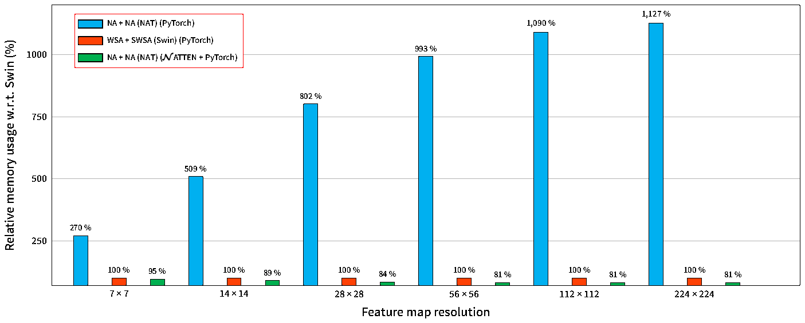

<strong>图 I：NAT 相对于 Swin 的逐层内存用量。</strong> 不使用 NATTEN 时，纯 PyTorch 实现的 NA 相对于 Swin 的内存占用会迅速增长；使用 NATTEN 后，其内存用量则始终更低。

<strong>图内标签：</strong> Relative memory usage w.r.t. Swin：相对于 Swin 的内存用量；Feature map resolution：特征图分辨率；WSA + SWSA (Swin)：窗口自注意力 + 移位窗口自注意力（Swin）；NA + NA (NAT)：连续两层邻域注意力（NAT）。

尽管深度神经网络中的许多运算都可以分解为矩阵乘法，但某些逐位置运算，例如卷积，需要专门的实现才能获得更优的并行化。因此，大多数底层计算库都原生支持卷积、循环模块及其他类似运算，PyTorch 等深度学习框架则调用这些库。换言之，给定一组输入和一种运算，深度学习框架会综合考虑执行该运算的硬件与软件，为这一特定情形选择当前可用的最高效实现。

这显著降低了研究的难度，但也不可避免地使研究受到已有高效实现的运算范围的限制。为提高灵活性，一些深度学习框架也允许在必要时构建扩展。扩展由此能够采用定制的 CPU 与 GPU 实现。可变形卷积（Deformable Convolutions）<a href="#ref-9">[9]</a>和可变形注意力（Deformable Attention）<a href="#ref-41">[41]</a>就是典型例子：二者均已实现为 PyTorch 的 CUDA 扩展。

滑动窗口注意力机制也一样，需要手工编写实现，才能尽可能提高并行度和带宽利用率。缺少这些实现时，唯一的替代方案是 Python 实现，而这种方案通常难以扩展。例如，仅使用 PyTorch 实现邻域注意力，需要提取滑动窗口，重复并重排这些窗口以构成邻域，然后执行两次批量矩阵乘法。这意味着需要两次独立的 C++／CUDA 调用，生成体积很大的中间张量，从而导致内存用量与延迟呈指数增长。即便采用经过最充分优化的纯 PyTorch 实现，在 56 × 56 的特征图上（ImageNet 模型的第一级），NA 的运行速度也只有 <strong>Swin Transformer 的 13%</strong>，同时需要约 <strong>9 倍的内存</strong>。采用朴素 CUDA 实现后，同一个 NA 模块的运行速度达到 <strong>Swin 的 102%</strong>，内存用量则减少约 <strong>20%</strong>。使用我们的<strong>分块 NA（Tiled NA）</strong>算法后，同一个模块的速度达到 <strong>Swin 的 132%</strong>，而内存用量不变。图 II 和图 I 提供了更多基准测试，从相对速度与内存用量两方面比较不同 NA 实现与 Swin Transformer。

这正是我们开发 NATTEN 的原因。它目前作为 PyTorch 的扩展，提供 `NeighborhoodAttention1D` 和 `NeighborhoodAttention2D` 两个 torch 模块。这样，任何 PyTorch 用户都可以在自己的模型中集成 NA，既可用于词元，也可用于像素。

每个模块均包含查询、键和值的线性投影，以及最后的输出线性投影；这是大多数点积自注意力模块的标准结构。NATTEN 分别为公式 2 和公式 4 提供一个自动求导函数。生成张量 `q`、`k` 和 `v` 后，将 `q`、`k` 与位置偏置 `b` 传入 C 函数 `QK+RPB`，即可计算注意力权重（见公式 2）。该函数会选择适当的内核进行调用：CPU 或 CUDA、朴素或专用、半精度或全精度。随后，使用 torch 的原生实现，对输出的注意力权重 `a` 应用 softmax 和 dropout。最后，将 `a` 和 `v` 传入 C 函数 `AV`，计算 NA 的最终输出。

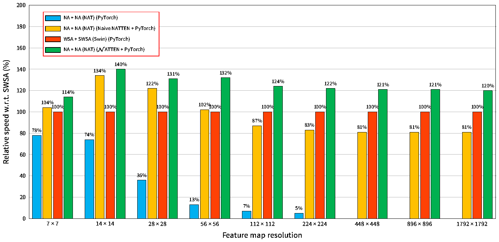

<strong>图 II：基于 torch 的 NA、朴素 NA 和分块 NA 相对于 WSA+SWSA 的吞吐量比较。</strong> 延迟在单张 A100 GPU 上测量。需要注意，当分辨率达到 448² 及以上时，NA 的纯 PyTorch 实现会耗尽显存。

<strong>图内标签：</strong> Relative speed w.r.t. WSA (%)：相对于 WSA 的速度（%）；Feature map resolution：特征图分辨率；Naive NATTEN：朴素 NATTEN 实现。

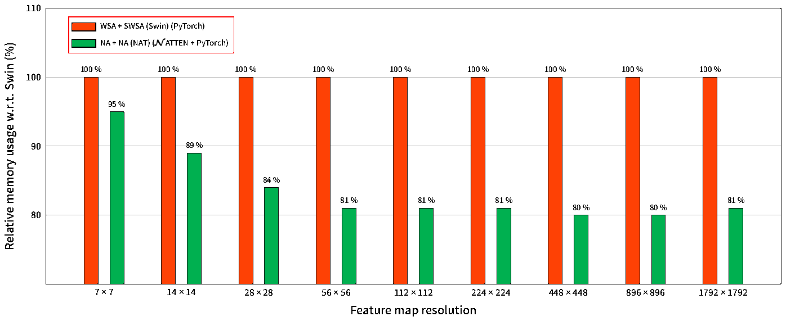

<strong>图 III：NAT 相对于 Swin 的逐层内存用量。</strong> NA 不需要 SWSA 中的像素移位和带掩码的注意力运算，而且位置偏置的加法已融合到 C++／CUDA 内核中，因此，采用 NATTEN 的 NA 比使用 WSA+SWSA 的类似模型占用更少的内存。

<strong>图内标签：</strong> Relative memory usage w.r.t. Swin：相对于 Swin 的内存用量；Feature map resolution：特征图分辨率。

<a id="section-a-2"></a>

### A.2 朴素 CUDA 内核

最初，我们开发了 7 个朴素 CUDA 内核：1 个用于 `QK+RPB`，1 个用于 `AV`，另外 5 个分别计算 `q`、`k`、`b`、`a` 和 `v` 的梯度。朴素内核只是把计算分配到可用的线程块中，不使用共享内存或线程束优化。尽管实现简单，其基准测试速度仍可达到 WSA+SWSA 层的 80%–130%（二者的核大小均为 7 × 7）。然而，朴素内核并非最优：它们直接从 GPU 全局内存读取数据，这会成为吞吐量瓶颈。

<a id="section-a-3"></a>

### A.3 半精度

支持混合精度训练并不太复杂。由于张量数据类型通常采用模板参数，PyTorch 的 ATen 分派器默认会将全部内核分别编译为双精度和单精度版本。选择不同的分派器后，就可以方便地将内核编译为支持 `half` 张量的版本。然而，如果不结合使用 CUDA 的向量化 `half2` 数据类型及运算符，仅仅支持半精度通常难以显著改善带宽利用率。因此，我们单独定义了半精度内核，以使用向量化加载、乘加与存储操作。这样能够更明显地提高混合精度训练的速度。

<a id="section-a-4"></a>

### A.4 分块邻域注意力

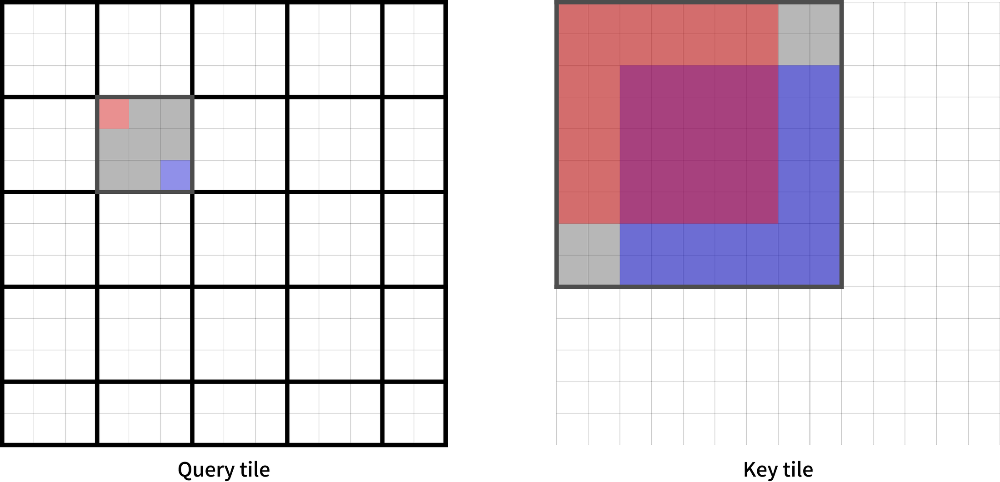

<strong>图 IV：核大小为 7 × 7、分块大小为 3 × 3 时的分块邻域注意力示意图。</strong> 查询被划分成多个分块（左）。由于相邻查询所需的键高度重叠，可以根据核大小方便地确定对应的键分块（右）。这样，每个独立的线程块就能利用其线程之间的共享内存，计算一个特定查询分块的输出。图中还用不同颜色突出显示了两个查询（左上角和右下角）及其各自的邻域，以说明计算各分块输出所需的信息都包含在已加载的分块中。

<strong>图内标签：</strong> Query tile：查询分块；Key tile：键分块。

CUDA 允许方便地分配和使用线程块内的共享内存（[技术措辞校订见核对记录](translation-notes.zh.md#cuda-wording)）。不过，这通常需要改变算法。因此，我们为注意力权重计算内核及其反向传播内核实现了分块版本：先把输入划分成互不重叠的分块，再给线程块中的每个线程分配一定数量的相邻单元，让它们从全局内存读取这些单元；同步后，根据共享内存中的值计算输出。图 IV 展示了这一过程。使用共享内存也带来了新的挑战，包括但不限于：

1. 分块大小的取值范围受到核大小、维度以及 GPU 共享内存容量上限的约束。
2. 计算过程中的共享内存存储体冲突（bank conflict）。
3. 从各个输入读取数据的次数随分块大小而变化。

例如，图 IV 展示了核大小为 7 × 7、查询分块大小为 3 × 3 的 NA，此时需要大小为 9 × 9 的键分块。之所以选择 3 × 3 的查询分块，是综合考虑了共享内存大小（48 KB）、每个线程块的线程总数（从计算能力 2.0 起为 1024）以及嵌入维度等其他与具体问题相关的因素。键分块的边长始终等于 <i>t</i><sub><i>q</i></sub> + <i>k</i> − 1，其中 <i>t</i><sub><i>q</i></sub> 为查询分块的边长，<i>k</i> 为核的边长；在这里，3 + 7 − 1 = 9。

通过详细的内部分析，我们实现并优化了核大小分别为 3、5、7、9、11 和 13 的分块 NA。虽然并未在所有使用场景下避免全部存储体冲突，但借助 NVIDIA Nsight™ 的性能分析，已尽量减少这些冲突。尽管这一实现已经显著提高了 NA 训练和推理中的带宽利用率，NATTEN 仍处于较早的发展阶段。我们希望改进现有内核，针对不同使用场景添加更优的内核，并通过 CUDA 12 增加对新 Hopper 架构的支持。

<a id="section-a-5"></a>

### A.5 CPU 内核

我们也扩展了 NATTEN，使其支持 CPU 上的训练和推理。邻域注意力的 CPU 函数采用简单的 C++ 实现，在较新版本的 PyTorch 中支持 AVX 向量化。因此，它们能够方便地利用多线程计算；在消费级 CPU 上，相较于规模相近的模型，通常具有较好的延迟表现。当前版本共包含 7 个 CPU 内核，与朴素实现类似：每种运算对应一个内核，每个梯度也对应一个内核。我们预计，未来不久会进一步优化并添加更多 CPU 内核。

<a id="section-a-6"></a>

### A.6 后续工作

我们希望持续维护 NATTEN，帮助社区使用滑动窗口注意力模块。我们的目标是最终采用隐式通用矩阵乘法（implicit GEMM）实现邻域注意力，使 NATTEN 能够构建在 CUTLASS 等开源软件包之上，更充分地发挥硬件加速器的能力。

## 附录 B 补充实验

<a id="section-b-1"></a>

### B.1 相对位置偏置的消融实验

表 I 给出了相对位置偏置，以及像素移位（仅针对 WSA）的消融实验。

| 注意力 | 位置偏置 | Top-1（%） | 参数量 | FLOPs |
| --- | --- | ---: | ---: | ---: |
| WSA-SWSA | 无 | 80.1（+0.0） | 28.26 M | 4.51 G |
| NA+NA | 无 | 80.6（+0.5） | 28.26 M | 4.51 G |
| WSA-WSA | 相对位置偏置 | 80.2（+0.0） | 28.28 M | 4.51 G |
| WSA-SWSA | 相对位置偏置 | 81.3（+1.1） | 28.28 M | 4.51 G |
| SASA-SASA | 相对位置偏置 | 81.6（+0.3） | 28.28 M | 4.51 G |
| NA-NA | 相对位置偏置 | 81.8（+0.5） | 28.28 M | 4.51 G |

<strong>表 I：有无位置偏置时，NA 与 WSA 的比较。</strong> Swin 的结果直接取自其原始论文。

<a id="section-b-2"></a>

### B.2 显著性分析

为了进一步说明不同注意力机制和模型之间的差异，我们展示了 ViT-Base、Swin-Base 和 NAT-Base 的显著性图。我们从 ImageNet 验证集中选取若干图像，分别输入三个模型，并根据输出生成显著性图，结果见图 VII。除 ViT 将原声吉他预测为“舞台”之外，其他图像的预测均正确，对应类别分别为白头海雕、原声吉他、蜂鸟和蒸汽机车。从这些显著性图可以看出，所有模型都有较好的可解释性，不过关注的区域略有不同。NAT 的边缘检测似乎稍好一些；我们认为，这归因于本文提出的局部注意力机制，以及卷积下采样器。

## 附录 C 关于平移等变性的说明

本节讨论注意力模型的平移等变性；在卷积模型中，这通常被视为一种有用的性质<a href="#ref-14">[14]</a>。为此，我们首先定义等变性与平移，然后考察不同模块是否具有平移等变性。

<strong>平移。</strong> 在计算机视觉语境中，平移通常指像素位置的移动，有时也包括旋转。

<strong>等变性。</strong> 如果 𝒯(<i>f</i>(<i>x</i>)) = <i>f</i>(𝒯(<i>x</i>))，则称函数 <i>f</i> 对函数 𝒯 是等变的。

<strong>平移等变性。</strong> 运算 <i>f</i> 对平移变换具有等变性。

<strong>线性投影。</strong> 单个线性层也可以表示为 1 × 1 卷积，按定义，它对像素顺序的任何改变都是等变的。因此，线性投影也具有平移等变性。

<strong>卷积。</strong> 由于具有动态滑动窗口结构和固定的卷积核权重，卷积具有平移等变性<a href="#ref-14">[14]</a>：每个输出像素都由以对应输入像素为中心的窗口与固定卷积核权重计算得到。

<strong>自注意力。</strong> SA（公式 1）具有平移等变性<a href="#ref-25">[25]</a>，原因是：（1）线性投影保持该性质；（2）自注意力权重对顺序的任何改变也是等变的。

<strong>SASA。</strong> SASA<a href="#ref-25">[25]</a>遵循与卷积相同的光栅扫描模式，为每个查询提取键值对，这表明它保持了平移等变性。不过，卷积使用固定的卷积核权重，因此能够保持该性质。另一方面，尽管 SASA 使用动态权重，这些权重仍然是窗口内像素的函数。因此，SASA 也保持了平移等变性。需要注意，SASA 不具备自注意力中那种与位置无关的性质。

<strong>HaloNet。</strong> HaloNet<a href="#ref-30">[30]</a>中的分块自注意力模式被描述为“放宽”了平移等变性。原因很简单：同一区域中的像素共享一个邻域，因而放宽了逐像素滑动窗口的要求，平移等变性也随之放宽。

<strong>WSA 与 SWSA。</strong> WSA 和 SWSA 都包含分区这一基本操作，分区仅有常规与移位两种形式，因此不会像 SASA 或卷积那样随位置动态滑动。这会破坏平移等变性，因为平移会改变内容与分区边界的相对位置。例如，特征图中的一个物体原本可能完整地位于一个 WSA 分区内，但一次平移就可能使该物体横跨两个不同分区。为说明这一点，我们在图 VI 中可视化了单个 Swin 模块（WSA + SWSA）的激活，并比较分别对输入与输出施加变换的结果。我们将全部线性投影替换为恒等函数，因为已知它们具有等变性；同时移除了位置偏置，以简化可视化。

<strong>NA。</strong> 我们指出，与 SASA 类似，NA 在大多数情况下保持平移等变性。然而，为了保持注意力覆盖范围，NA 在角部情形下放宽了平移等变性。我们在图 VI 中展示了对示例输入及其 NA 输出施加变换的结果，与 Swin 的展示方式相同。不过，需要再次强调：NA 在角部情形下放宽了平移等变性，主要原因在于它对邻域的定义会使边缘像素重复使用滑动窗口。图 V 采用较大的核（图像大小的四分之一）将这一现象可视化，并与 Swin 和 SASA 进行比较。

角部情形的处理差异，是滑动窗口注意力机制与卷积之间应当存在的一个重要区别。在角部情形下重复使用滑动窗口——NA 通过邻域定义实现了这一点——对注意力是有益的，因为这些重复窗口仍然对应于原始自注意力权重的子集，只是对其范围作了限制。卷积则不具备这一性质：由于卷积核固定，重复的滑动窗口会产生重复的输出像素。另一方面，注意力中的零填充（角部不重复窗口，如 SASA）表达能力较弱，因为它会进一步限制角部情形下的注意力覆盖范围。而且，随着窗口增大，它也不会逐渐趋近自注意力；NA 则会。

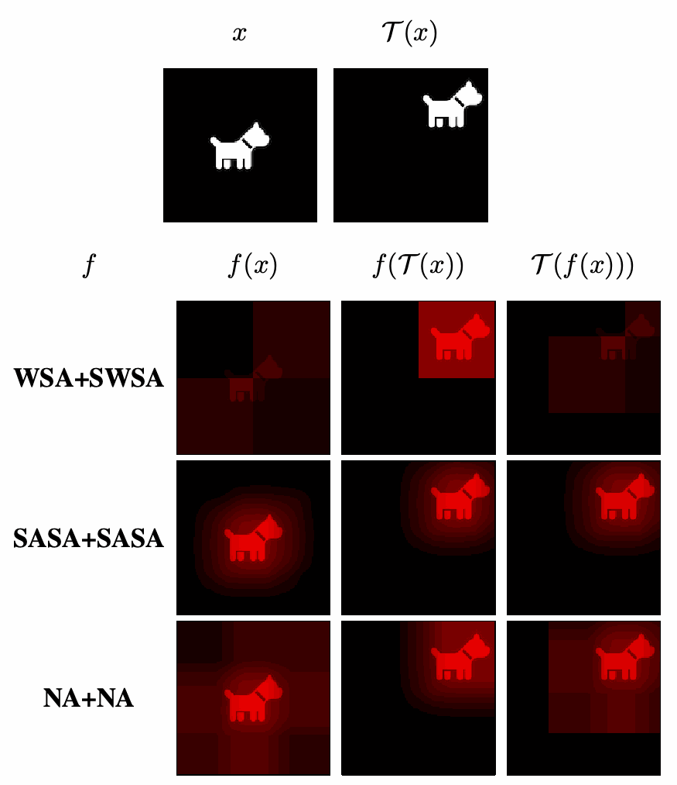

<strong>图 V：使用四分之一图像大小的核，对角部像素进行可视化。</strong> <i>x</i> 表示物体位于中心的输入图像，<i>f</i>(<i>x</i>) 表示应用函数 <i>f</i> 后的输出，𝒯 表示将物体移至图像右上角的平移变换。尽管 SASA 在角部像素处对平移等变性的破坏没有 NA 那么明显，但它在这些区域的注意力覆盖范围会减小，这正是它无法逐渐趋近自注意力的原因。只要将 SASA 与 NA 对物体居中的原始输入所产生的输出进行比较，就能看到注意力覆盖范围减小所带来的影响。

<strong>图内标签：</strong> WSA+SWSA：窗口自注意力与移位窗口自注意力；SASA+SASA：连续两层 SASA；NA+NA：连续两层 NA；<i>f</i>(𝒯(<i>x</i>))：先变换输入，再应用模型；𝒯(<i>f</i>(<i>x</i>))：先应用模型，再变换输出。

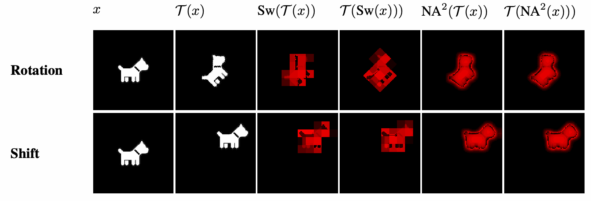

<strong>图 VI：对 Swin 与 NAT 施加变换的可视化。</strong> 𝒯 表示变换函数，上行为旋转，下行为平移。“Sw”表示对输入依次应用 WSA 与 SWSA，并在二者之间设置残差连接；这种模式会破坏平移等变性。“NA²”表示对输入应用两层 NA，并在二者之间设置残差连接。NA 的滑动窗口性质使其能够保持平移等变性。

<strong>图内标签：</strong> Rotation：旋转；Shift：平移；<i>x</i>：输入；𝒯(<i>x</i>)：变换后的输入。各列依次比较先变换输入再应用 Sw／NA²，与先应用 Sw／NA² 再变换输出的结果。

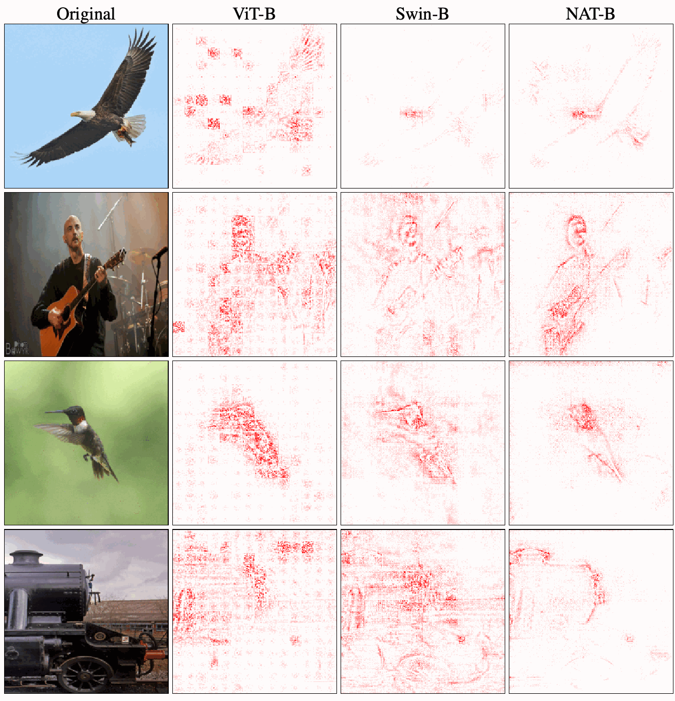

<strong>图 VII：ImageNet 验证集中部分图像的显著性图，比较 ViT-Base、Swin-Base 与 NAT-Base。</strong> 这些图像的真实类别依次为白头海雕、原声吉他、蜂鸟和蒸汽机车。

<strong>图内标签：</strong> Original：原图；ViT-B／Swin-B／NAT-B：对应模型的 Base 版本。


<strong>图 VIII：7 × 7 特征图上的 3 × 3 邻域注意力模式示意图。</strong> 查询标为橙色，其注意力覆盖范围（键值对）标为深蓝色。由于邻域的定义，角部会重复使用同一个“窗口”，从而使注意力覆盖范围与特征图的其他位置保持一致。另一种选择是采用更小的邻域，即像 SASA 那样在角部使用零填充。
