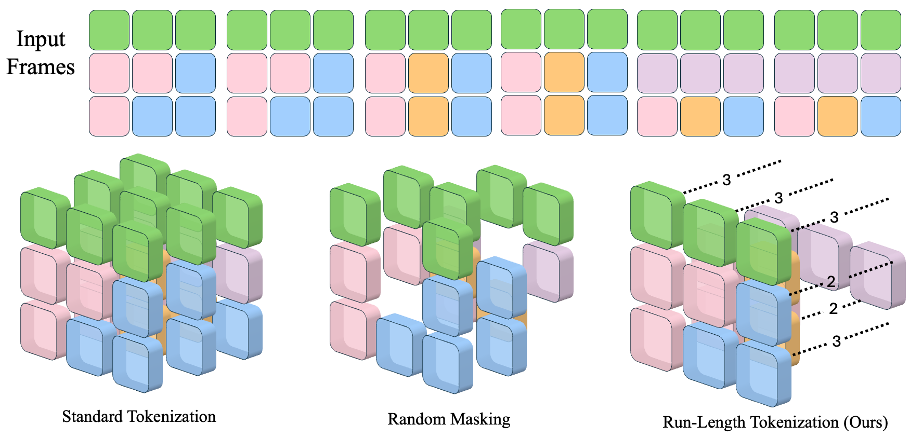
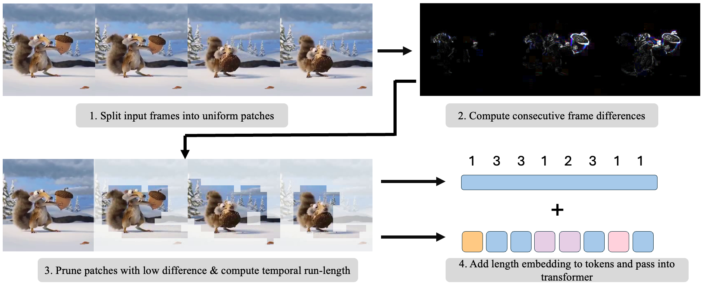
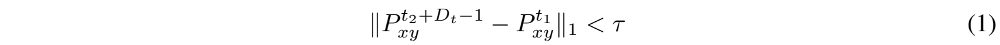
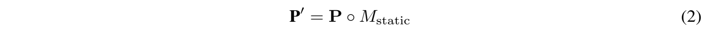
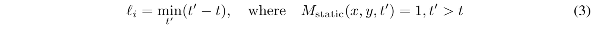
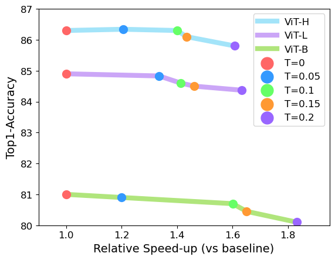
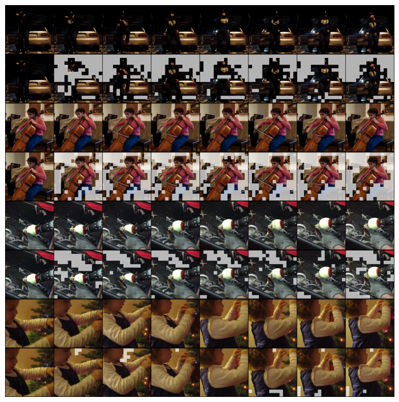
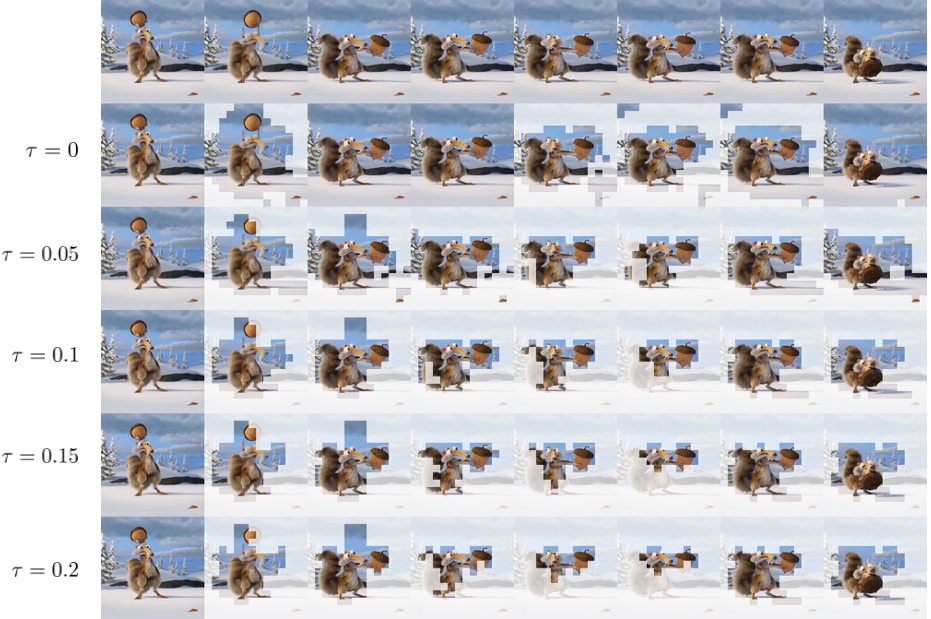
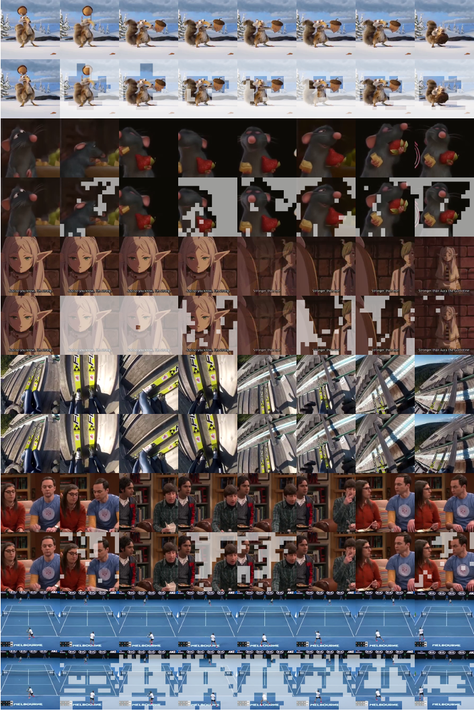

# 不必再看一遍：利用游程词元化加速视频 Transformer

**Don’t Look Twice: Faster Video Transformers with Run-Length Tokenization**

Rohan Choudhury¹ · Guanglei Zhu\*¹ · Sihan Liu\*¹ · Koichiro Niinuma² · Kris M. Kitani¹ · László A. Jeni¹

¹ 卡内基梅隆大学　² 富士通研究院　* 同等贡献

联系邮箱：rchoudhu@andrew.cmu.edu

第 38 届神经信息处理系统大会（NeurIPS 2024）

## 译本说明

本译本依据 [arXiv:2411.05222v1](https://arxiv.org/abs/2411.05222v1)（2024 年 11 月 7 日提交）及其 PDF、LaTeX 源文件制作，涵盖摘要、正文、致谢、56 条参考文献及附录 A、B。原论文作者享有署名权，原文采用 [CC BY 4.0](https://creativecommons.org/licenses/by/4.0/) 许可。本版本由 Codex 翻译为中文并重新排版，属于非官方译本；原作者未对译文进行审定。翻译与新增译注也按 CC BY 4.0 提供。

6 幅图保留原始图像，中文图注和图内标签对照紧随其后；4 个编号公式在 Markdown 中使用原公式的高清裁图显示，以确保符号、上下标与编号一致；Markdown 的每个公式下方还保留可展开的 LaTeX 源码。5 个表格重排为中文可编辑表格，所有数值、单位、模型名及文献编号均保留。原文中重复的段落、相互冲突的说法和疑似笔误，保留其原意并以“译注”区分说明。

原文关于“耗时减少百分比”和“速度提升百分比”的表述不总是一致。本译文保留原数字；核对具体实验时，应以相应表格中的耗时、吞吐量和加速比为准。例如，加速比 1.4× 表示速度提高 40%，对应耗时减少约 28.6%，并不表示耗时减少 40%。

论文项目页：[https://rccchoudhury.github.io/projects/rlt/](https://rccchoudhury.github.io/projects/rlt/)

### 核心术语对照

| 英文 | 本译本用语 |
| --- | --- |
| Run-Length Tokenization / RLT | 游程词元化 / RLT |
| run / run-length | 游程 / 游程长度 |
| token / tokenization | 词元 / 词元化 |
| patch / static patch | 图像块 / 静态图像块 |
| tubelet / tubelet size | 时空管块 / 时空管块大小 |
| patch embedding | 图像块嵌入 |
| positional encoding / length encoding | 位置编码 / 长度编码 |
| pruning / random masking | 剪枝 / 随机掩码 |
| example packing | 样本打包 |
| content-aware / content-agnostic | 内容感知 / 与内容无关 |
| wall-clock time / throughput | 实际耗时 / 吞吐量 |
| inductive bias / fine-tuning | 归纳偏置 / 微调 |
| Proportional Attention | 比例注意力 |
| GFLOPs / FPS / top-1 accuracy | 十亿次浮点运算 / 每秒帧数 / top-1 准确率 |

## 摘要

由于输入词元数量极其庞大，Transformer 在视频上的训练速度很慢，尽管许多视频词元会随时间重复出现。现有去除这类信息量不足的词元的方法，要么带来显著开销，抵消了加速收益，要么需要针对不同数据集和样本进行调参。我们提出游程词元化（Run-Length Tokenization，RLT）：这是一种受数据压缩中的游程编码启发、用于加速视频 Transformer 的简单方法。RLT 在模型推理之前，高效地找出并移除随时间重复出现的图像块“游程”，再用单个图像块和一个位置编码替代它们，以表示所得词元的新长度。我们的方法具有**内容感知能力**，无需针对不同数据集调参，而且**速度快**，引入的开销可以忽略不计。RLT 显著加快了训练：在达到与基线模型相当的性能时，视频 Transformer 微调的实际耗时减少了 30%。RLT 也可以在**不进行任何训练**的情况下使用，使模型吞吐量提高 35%，准确率仅下降 0.1%。在 30 FPS 下，RLT 使训练速度提高超过 100%；在较长视频的数据集上，词元数量最多可减少 80%。项目主页：[https://rccchoudhury.github.io/projects/rlt/](https://rccchoudhury.github.io/projects/rlt/)。

## 1 引言

视觉 Transformer（Vision Transformer，ViT）[11] 凭借其扩展特性和极少的归纳偏置，在图像和视频建模中取得了巨大成功。遗憾的是，视频的词元数量通常比图像高出若干个数量级，因此在视频上训练这类模型的成本显著更高。原因之一在于，视频 Transformer 通过将视频划分为大小统一的时空图像块 [2, 3] 来进行词元化，再将这些图像块嵌入潜在词元空间。因此，词元数量仅取决于视频长度和分辨率。研究者因而不得不使用非常短的视频（少于 10 秒），并大幅下采样，将其帧率（每秒帧数，FPS）和空间分辨率降至较低水平。

解决这一问题的一个有前景的方向是减少输入词元数量。与语言输入相比，视频的信息密度明显更低；许多工作指出，视频主要由冗余或信息量不足的词元组成 [15, 39, 43]。然而，现有旨在减少视觉 Transformer 输入词元的方法，实际采用范围仍然有限。学习式剪枝方法 [34, 52] 降低了以 GFLOPs 衡量的模型复杂度，但要么在训练中引入显著开销，要么需要用填充处理不断变化的词元数量，抵消了训练时的加速收益。随机掩码 [1, 27] 虽然速度快，却会降低准确率，因此需要更长的训练时间才能达到相同性能。此外，尽管随机掩码和词元合并（Token Merging）[5] 等方法确实能够减少实际耗时，它们却不具备内容感知能力：每个视频只会被移除固定数量的词元；对于高速、动作丰富的视频片段，和一张静态图像随时间重复形成的视频，移除的词元数量相同。

我们认为，内容感知能力有助于更有效地减少输入词元数量。例如，设想一段时长一小时的讲课视频。其大多数帧随时间完全相同，显示的是同一张幻灯片。现有方法会为这段视频生成与一小时包含大量运动的 GoPro 视频相同数量的词元，尽管这两段视频所包含的内容量显著不同。相比之下，H.264 和 H.265 等视频压缩器 [46, 41] 则明确具有内容感知能力：它们不独立编码各帧，而是编码相邻帧之间的像素差异，因此在画面没有变化时能够大幅减小视频体积。

我们提出游程词元化（RLT），将这一思路的简化版本与经典游程编码结合起来，为 Transformer 对视频进行词元化。我们的洞察是：可以高效识别随时间重复出现的输入图像块“游程”，从而根据视频内容减少词元数量。在视频词元化过程中，我们比较时间上相邻的图像块，将差异足够小的图像块归为一组。随后移除“重复”的图像块，并将剩余词元视为具有可变长度的词元。正如字符串 `aaaabb` 可以通过游程编码表示为 `a4b2`，我们也可以给每个词元加入长度信息。这样既不会引入额外开销，又能保留一部分因移除冗余词元而丢失的信息。尽管方法简单，RLT 的效果却很好：使用它，在保持相同性能的同时，按实际耗时计，视频 Transformer 的微调速度比基线 ViT 快 40%。

我们的贡献如下：（1）提出 RLT，作为视觉 Transformer 视频词元化的另一种方法；（2）全面比较其性能，并将 RLT 的速度与既有方法比较，发现显著提升；（3）评估 RLT 在高帧率视频和较长视频上的表现；（4）对设计选择进行消融，并定性可视化 RLT 的输出。我们相信，RLT 可以成为显著加速视频理解、进一步扩大其规模的关键一步。



**图 1：简化示例。** 给定一组输入帧，其中每个方块代表一个图像块，标准词元化总是生成相同数量的词元。RLT 比较时间上相邻的图像块并移除冗余图像块，改为存储单个词元及其游程长度。

**图 1 图内标注中文对照：**

| 原图英文标注 | 中文 |
|---|---|
| Input Frames | 输入帧 |
| Standard Tokenization | 标准词元化 |
| Random Masking | 随机掩码 |
| Run-Length Tokenization (Ours) | 游程词元化（我们的方法） |

图中虚线旁的数字 2、3 表示相应词元的游程长度；数字按原图保留。

## 2 相关工作

**视频 Transformer。** 视觉 Transformer [11] 已成功适用于视频 [2, 3, 13, 26, 38]，但通常是在帧数相对较少的短视频片段（少于 10 秒）上进行训练和评估。为高效处理视频，许多工作在架构中加入视频特有的归纳偏置 [29, 22, 56]，例如记忆机制 [49, 35]、压缩线索 [48] 或经过修改的注意力机制 [30, 53]。其他方法，尤其是视频生成领域的方法，会先将视频投影到较小的潜在空间 [20]，再将其划分为图像块。我们则使用标准 ViT 形式，但采用不同的词元化方案，通过减少输入词元数量，在保持性能的同时提高速度。

**视频词元化。** 在视觉 Transformer 出现之前，视频架构被设计为接收固定大小的输入 [14, 40, 55]。然而，Transformer 可以处理任意数量的输入词元 [44]，而在大小可变的输入上训练，在语言建模中是标准做法 [23]；这一做法也已用于以可变分辨率训练视觉 Transformer [4, 10]。但视频 Transformer 通常仍使用文献 [2, 3] 提出的时空图像块词元化方案，该方案**不感知内容**：词元数量仅取决于视频长度和分辨率。一些工作尝试先将视频压缩到潜在空间再进行词元化，以减小输入规模 [12, 33, 6]，但词元数量仍严格依赖于输入视频的维度。相比之下，HEVC [41] 和 AVC [46] 等标准视频压缩器则具有**内容感知能力**：它们主动考虑相邻帧之间的差异，以更高效地压缩视频。我们的工作将这一思路用于视频 Transformer，通过凝缩静态词元并记录其长度来实现。

**用更少词元加速 ViT。** 若干工作尝试从视觉 Transformer 中移除信息量不足的词元。一类工作通过学习得到的模块或注意力分数识别这类词元 [34, 52, 28, 21]，并在每一层进行剪枝。尽管 Transformer 可以处理大小可变的输入，由于词元数量在各层会以不可预测的方式变化，这些方法仍需要填充。另一些工作则将词元合并，而不是剪除 [5, 37, 31, 51]。大多数这类工作需要训练一个用于剪枝或合并的模型；词元合并 [5] 是例外，它在推理阶段展示出了优异结果。受掩码预训练成功的启发 [17, 45, 43, 15]，另一类工作使用随机掩码加速训练。虽然在经过相同数量的批次后，掩码方法的性能较差，但大幅加速使其能够在更短时间内训练更多轮次 [1, 10, 27, 50]。相比之下，我们的方法在使用相同数据量时即可达到基础模型的性能，同时获得大幅加速，而且还可以与随机掩码叠加使用，进一步提升速度。与我们的方法密切相关的是 EVEREST [18] 和 STA [36]，两者都利用时间相似性来识别冗余词元。但与文献 [5] 一样，这两项工作都需要设定从每个视频中移除的固定词元数量，而 RLT 可以根据视频内容移除不同数量的词元。

## 3 方法



**图 2：RLT 概览。** RLT 比较时间上相邻的图像块，并保留 L1 差异大于阈值 $\tau$ 的图像块。为剩余词元加入长度编码，以表示其“游程长度”，随后将其送入 Transformer。

**图 2 图内标注中文对照：**

| 原图英文标注 | 中文 |
|---|---|
| 1. Split input frames into uniform patches | 1. 将输入帧划分为大小统一的图像块 |
| 2. Compute consecutive frame differences | 2. 计算相邻帧之间的差异 |
| 3. Prune patches with low difference & compute temporal run-length | 3. 剪除差异较小的图像块，并计算时间上的游程长度 |
| 4. Add length embedding to tokens and pass into transformer | 4. 给词元加入长度嵌入，并送入 Transformer |

图中上方的数字序列 1、3、3、1、2、3、1、1 表示词元的游程长度；加号表示长度嵌入与词元表示相加。数字、颜色、连接关系与示例帧按原图保留。

考虑一个以视频 $V \in \mathbb{R}^{C\times T\times H \times W}$ 为输入的视觉 Transformer。标准词元化方案将 $V$ 划分为一个由大小统一、互不重叠的图像块构成的集合 $\mathbf{P}$，每个图像块的大小为 $C \times D_x \times D_y \times D_t$，其中 $P_t$ 称为时空管块（tubelet）大小。通过多层感知机（MLP）$\mathcal{E}$，这些图像块被投影到较低的维度 $d_{\mathrm{embed}}$，得到 $N_P$ 个词元，每个词元对应一个不同的时空位置。因此，凡是大小相同的输入视频，都会产生相同数量的词元。

> **译注：** 原文先使用 $D_t$ 表示图像块的时间维度，随后又将 $P_t$ 称为 tubelet 大小，并在后文使用 $P_t>1$。本文保留原文符号，不将二者擅自统一。

相比之下，我们的目标是识别极其相似的输入图像块，再压缩这些冗余图像块，从而提高吞吐量并增加训练时间。我们的方法如图 2 所示。具体而言，我们关注**时间上相邻**的图像块，即具有相同 $x,y$ 位置、在时间上相差一个时间步的图像块。这些“静态图像块”对应随时间不发生变化或运动的视觉内容，因此这类词元很容易被压缩。

> **译注：** 上句的“提高吞吐量并增加训练时间”忠实保留了原文 “increasing throughput and training time”。“增加训练时间”与论文的加速目标及实验叙述不一致，疑为原文笔误；译文未将其静默改为“减少训练时间”。

### 3.1 移除静态图像块

**词元相似性。** 与既有工作不同，我们通过比较**图像块**而非词元，来减少输入词元总数。直接对图像块进行操作，就不需要运行图像块嵌入 $\mathcal{E}$ 或模型中的任何一层。因此，我们不需要冻结模型的一部分，也不需要让梯度通过剪枝操作传播；后者会需要填充，并抵消潜在的加速收益。这与既有工作在 Transformer 每一层之后逐步剪枝或合并词元的做法不同。此外，通过识别冗余图像块，我们可以预先计算不同数据集及不同样本大小下的词元分布，从而采用样本打包等技术 [23]。最后，直接对视觉图像块进行操作更容易解释，并且与视频编码器采用的启发式方法相似 [41, 46]。

接下来，我们定义判断两个相邻图像块是否为静态图像块的准则。考虑时间上相邻的两个图像块 $P_1,P_2$，它们对应空间位置 $(x,y)$ 和时间位置 $t_1,t_2$，其中 $t_2=t_1+D_t$。当时空管块大小 $P_t>1$ 时，每个图像块由多个帧的空间裁剪图块构成，因此 $P_1=[P^{t_1}_{xy}, P^{t_1+1}_{xy}, \ldots, P^{t_1+D_t-1}_{xy}]$。给定阈值 $\tau$，若满足下式，我们便认为 $P_1$ 和 $P_2$ 是静态的：



<details>
<summary>公式（1）的 LaTeX 源码</summary>

```latex
\|P^{t_2+D_t-1}_{xy} - P^{t_1}_{xy}\|_1 < \tau
\tag{1}
```

</details>

其中，$P^{t_2+D_t-1}_{xy}$ 是 $P_2$ 中时间上最后一个空间裁剪图块，$P^{t_1}_{xy}$ 是 $P_1$ 中第一个空间裁剪图块。该操作将 $P_1$ 的“起点”与 $P_2$ 的“终点”进行比较，其思路是：如果词元 $P_1$ 的第一个裁剪图块与词元 $P_2$ 的最后一个裁剪图块匹配，那么中间的图像块很可能也匹配。需要指出的是，$\tau$ 是一个需要调节的超参数，但它**与数据集无关**；它仅表示图像块之间的变化允许达到多大程度，超过这一程度才会被视为不同。$\tau$ 控制速度与准确率之间的权衡；较大的取值虽然能够显著减少更多词元，却也会将视觉上可以感知差异的词元视为相同，从而降低准确率。由于可能存在不可感知的伪影，我们使用 $\tau>0$，并遵循标准做法，在比较图像块之前执行 ImageNet 归一化。通常我们使用 $\tau=0.1$，并在第 4.3 节和附录 B 中提供关于其影响的实验和可视化。

**剪枝过程。** 为识别所有静态词元，我们对 $\mathbf{P}$ 中所有时间上相邻的图像块对执行上述比较，得到它们的差异，并只保留差异小于 $\tau$ 的图像块。我们始终完整保留第一帧，因为没有此前的图像块可供比较。这样便得到一个二值掩码 $M_{\mathrm{static}}$，随后可以按下式应用：



<details>
<summary>公式（2）的 LaTeX 源码</summary>

```latex
\mathbf{\textbf{P}'} = \mathbf{P} \circ M_{\mathrm{static}}
\tag{2}
```

</details>

> **译注：** 此处原文为 “only retaining those with difference less than $\tau$”（只保留差异小于 $\tau$ 的图像块），但图 2 图注写的是保留差异大于阈值的图像块，图 2 第 3 步写的是剪除差异较小的图像块，二者存在明显不一致。译文分别保留其字面表述；式（1）中的“小于”是判定两块静态相似的条件，不应直接当作保留掩码的定义。

其中，$P'$ 包含 $N_{P'}$ 个词元，而 $P$ 由 $N_P$ 个词元构成。注意，$N_{P'}\leq N_P$ 始终成立；使用 RLT 时，词元数量绝不会超过标准词元化过程，因此最坏情况下的性能与标准视觉 Transformer 相同。RLT 本身也几乎不引入开销，因为整个过程完全可以用 GPU 上可并行的 PyTorch 操作 [32] 实现，所以训练和推理都严格更快。

RLT 的简单性是一大优势：与其他方法不同，我们可以利用 Transformer 处理可变大小输入的能力，无需额外填充。由于我们不修改模型本身，使用 RLT 的视频 Transformer 可以利用 Flash Attention [8, 9] 和内存高效内核 [25] 等硬件优化。

尤其值得强调的是，这一剪枝过程具有**内容感知能力**：与摄像机或主体运动较多的视频相比，含有大量静态内容的某些视频会产生显著更少的输入词元。这是我们期望的结果；第 3.3 节将讨论如何处理动态输入大小下的训练。

### 3.2 游程长度位置编码

尽管我们减少了输入图像块数量，但我们知道，每个图像块都代表一个静态图像块“游程”：长度为 1 表示没有静态内容，长度为 $T$ 则对应输入时间维度的长度。如果没有关于静态图像块“游程”长度的信息，Transformer 可能无法弥补剪枝过程中移除的信息。

为解决这一问题，Bolya 等人 [5] 引入了比例注意力（Proportional Attention），按照每个组内的词元数量为各词元赋予权重。我们则选择让模型**学习**这一信息：将每个词元视为具有可变长度，并通过一种新的位置编码传达该长度。具体而言，我们使用 Dehghani 等人 [10] 描述的因子化编码：一个编码 $\phi_{xyt}$ 包含位置信息，另一个编码 $\phi_L$ 对应长度。

我们使用可学习的长度偏置 $\phi_L$，它由一个大小为 $(T,d_{\mathrm{embed}})$ 的参数张量构成。对于给定的重复图像块“游程”，我们总是保留起始图像块 $P_{xyt}$，因此可以将其新长度 $\ell_i$ 计算为：沿 $t$ 轴，从 $xyt$ 到 $M_{\mathrm{static}}$ 中最近的值为 1 的条目的距离。具体而言，对于 $P_{xyt}$，有：



<details>
<summary>公式（3）的 LaTeX 源码</summary>

```latex
\ell_i = \min_{t'} (t' - t), \quad\mathrm{where} \quad M_{\mathrm{static}}(x, y, t') = 1, t' > t
\tag{3}
```

</details>

> **译注：** 式（3）要求存在一个满足 $t'>t$ 的后续掩码条目。对于同一空间位置上的最后一个游程，原文未在该式中定义终止边界或哨兵的处理方式；译文保留公式，不补写作者未给出的边界规则。

这一操作也可以在 GPU 上高效实现，不增加开销。随后，完整的位置编码为：


<details>
<summary>公式（4）的 LaTeX 源码</summary>

```latex
\phi(T_i) = \phi_{xyt}(T_i) + \phi_L[\ell_i]
\tag{4}
```

</details>

其中，$\phi_L[\ell_i]$ 表示索引操作。运行图像块嵌入网络 $\mathcal{E}$ 后，我们将位置编码 $\phi(T_i)$ 加到每个词元上。与剪枝过程不同，由于这里使用可学习的长度编码 $\phi_L$，我们将梯度传播到位置嵌入，使模型能够在微调期间学习如何最优地编码可变长度词元。

> **译注（公式符号）：** 原文式（1）使用 L1 范数，但未明确说明是否再按元素数量取平均，因而不能直接将其译作“平均绝对差”。当时空管块包含多帧时，原文也未完整区分时间索引、帧数和词元游程长度的单位，或说明长度编码的 0/1 起始索引约定。式（2）的 $\circ$ 在此表示作者写出的掩码应用操作；原文未另定义该符号。上述符号均保持原样。

### 3.3 处理动态输入大小

由于 RLT 具有内容感知能力，不同样本的词元数量会有显著差异。尽管 Transformer 原生就能处理任意输入大小 [44]，DynamicViT [34] 或 A-ViT [52] 等既有方法会在每一层产生不同数量的词元；在训练中进行批量推理时，这需要填充或注意力掩码来处理。对于我们的方法，只有输入词元数量是可变的，词元数量在整个网络中保持不变，更接近 NaViT [10] 的设定。此外，由于在运行网络之前就知道输入大小，我们可以采用**样本打包** [23]。这是语言建模中的一种思路：将多个大小不同的输入打包到一起，各个样本的词元只对同一样本中的词元进行注意力计算。

训练时，Transformer 的输入由一批已词元化的视频 $V_1, V_2, \ldots, V_B$ 构成，其大小分别为 $T_1, T_2, \ldots, T_B$。我们不向网络传入大小为 $(B,\max_i T_i,d_{\mathrm{embed}})$ 的输入，而是将视频张量拼接成 $V'=V_1\oplus V_2\oplus V_3\oplus\cdots\oplus V_B$，得到大小为 $(1,\sum_{i=1}^B T_i,d_{\mathrm{embed}})$ 的输入。随后，我们构造一个块对角注意力掩码，使词元只能对同一视频中的其他词元进行注意力计算，并在注意力操作期间加入该掩码。由于 $V'$ 中的每个词元只关注同一样本中的词元，这不会降低吞吐量，而且也兼容现有的硬件高效注意力实现。为计算动作识别中的类别预测，我们将各个样本重新拆分出来，并按照文献 [43] 的做法，对每个样本的词元取均值以计算其预测。随后将其投影到 $N_C$ 维，得到大小为 $(B,N_C)$ 的输出，训练时便可对该输出应用标准交叉熵损失。

我们指出，通常样本打包会使输入词元数量保持固定，而输入样本数量可变。RLT 与 Dehghani 等人 [10] 的一项关键区别在于，RandAugment [7] 等数据增强会改变输入视频的视觉内容，因而也会改变词元数量，导致贪心样本打包策略无法在数据加载阶段适用。我们选择让每块 GPU 上的样本数量保持固定，并使用足够大的批次大小来充分降低输入大小的方差。

## 4 实验结果

为分析 RLT 对性能和速度的影响，我们在标准动作识别任务上开展了多项实验。第 4.1 节衡量 RLT 在多种模型规模下对模型训练的加速效果，第 4.2 节考察将 RLT 作为即插即用模块加入推理过程后的影响。第 4.3 节开展消融实验，第 4.4 节评估 RLT 在更高帧率视频和长视频数据集上的效果。最后，第 4.5 节给出定性可视化结果。

### 4.1 训练

表 1 评估 RLT 在训练过程中对视频 Transformer 性能的影响，以及由此带来的加速效果。我们从预训练的 VideoMAE 检查点 [43, 45] 出发，对 ViT-B 和 ViT-L 进行微调，比较标准词元化、随机掩码和 RLT 的速度与性能。评估随机掩码时，我们移除 $k$ 个词元，其中 $k$ 为 RLT 在给定数据集上剪掉的词元数量的均值。为尽可能公平地比较速度，所有接受评估的模型均在一台配备 8 张 H100 GPU 的节点上进行训练，采用混合精度、节省显存的注意力实现，并尽可能使用 Flash Attention；同时使用 AVION [54] 中经过优化的数据加载器，以避免数据加载瓶颈。我们使用标准视觉 Transformer，而没有采用 TimesFormer [3] 或 MViT [26] 等更复杂的架构；我们发现前者明显更简单、更高效，这与 Ryali 等人 [38] 的观察一致。由于计算资源限制，我们仅分析微调过程。我们将 RLT 与基线视觉 Transformer、词元合并（Token Merging）以及 STA [36] 进行比较。此外，我们还设置了一个随机掩码基线，其掩码比例与 RLT 平均移除的词元数量相匹配；这比采用 0.5 等固定标准比例构成了更强的基线。

**表 1：动作识别任务上的训练结果。** 在 Kinetics-400 和 Something-Something-v2 两个数据集上，RLT 都显著缩短了微调时间，同时保持了与基线相当的性能。准确率单位为 %，微调时间使用 8 张 GPU，h 表示小时；K400 和 SSv2 分别为两数据集的简称。

| 模型／方法 | K400 准确率 | K400 微调时间 | K400 加速倍率 | SSv2 准确率 | SSv2 微调时间 | SSv2 加速倍率 |
|:--|--:|--:|--:|--:|--:|--:|
| ViT-B | 80.1 | 14.4 h | 1.0× | 70.3 | 10.1 h | 1.0× |
| $\mathrm{ToMe}_{r_{64}}$ | 80.0 | 13.4 h | 1.1× | 69.7 | 9.4 h | 1.1× |
| 随机掩码（0.7） | 79.2 | 10.2 h | 1.4× | 69.3 | 7.2 h | 1.4× |
| **RLT（本文方法）** | **80.1** | **10.2 h** | **1.4×** | **70.2** | **7.2 h** | **1.4×** |
| ViT-L | 84.8 | 21.6 h | 1.0× | 74.3 | 15.2 h | 1.0× |
| ToMe | 84.4 | 18.3 h | 1.2× | 74.3 | 12.9 h | 1.2× |
| 随机掩码 | 83.1 | 15.4 h | 1.4× | 74.3 | 10.8 h | 1.4× |
| **RLT（本文方法）** | **84.7** | **15.4 h** | **1.4×** | **74.4** | **10.8 h** | **1.4×** |

与标准词元化相比，即使实现已经过大量优化，RLT 仍能实现最高 40% 的速度提升。RLT 在性能和速度之间取得了最佳权衡：它达到与随机掩码相同的加速效果，同时性能更好。这表明，选择移除哪些词元会产生不可忽视的影响，正确识别冗余词元十分重要。

与标准词元化相比，即使实现已经过大量优化，RLT 仍能实现最高 40% 的速度提升。RLT 在性能和速度之间取得了最佳权衡：它达到与随机掩码相同的加速效果，同时性能更好。特别是，RLT 的训练速度比词元合并快得多，因为它兼容 Flash Attention [8, 9] 等针对硬件优化的实现。与随机掩码不同，RLT 在经历相同数量的训练批次后，便能达到基线 ViT 的性能，而随机掩码需要明显更多的训练轮次才能追上。RLT 在多种模型规模下都达到了基线性能，说明 RLT 能够在大幅加速训练的同时避免性能下降。

> **译注：** 原文连续两段的前两句重复；此处按原文完整保留。表 1 的约 1.4× 加速指速度提高约 40%，不等于实际耗时减少 40%。例如，14.4 h 降至 10.2 h，对应速度提高约 41.2%、耗时减少约 29.2%；21.6 h 降至 15.4 h，对应速度提高约 40.3%、耗时减少约 28.7%。原文还说比较了 STA，但表 1 没有列出 STA 训练结果。

### 4.2 推理阶段的结果

尽管 RLT 的设计目的是加速训练，但与词元合并 [5] 类似，它也可以直接替代标准词元化。表 2 比较了使用 RLT、标准词元化和词元合并 [5] 时的 Top-1 准确率、GFLOPs 和吞吐量。为完整起见，我们也与随机掩码进行了比较，尽管该方法原本仅面向训练阶段 [27]。为尽可能公平地比较，我们对每个样本随机掩去 $P$ 个词元，其中 $P$ 是 RLT 所使用的词元数量的均值；对于 Kinetics-400 和 SSv2，$P = 0.72$。我们没有与 A-ViT [52] 等可学习剪枝方法进行比较，因为这些方法仅报告了图像上的结果。吞吐量以每秒处理的视频片段数衡量，每个模型每次处理一个片段。在实际应用中，视频模型会在多个时间裁剪和空间裁剪上进行评估；遵循 VideoMAE [43]，我们在单个片段上测量 GFLOPs，并使用 4 个时间裁剪和 3 个空间裁剪测量准确率。

> **译注：** 上段忠实保留原文对 $P$ 的表述，但原文同时将 $P$ 称为“词元数量”、说“掩去 $P$ 个词元”，又给出 $P=0.72$，量纲与含义并不一致。附录 A 明确说明，在 Kinetics-400、7.5 FPS、$\tau=0.1$ 时，随机掩码删除 28% 的词元。据此推测，这里的 0.72 更可能指词元的**保留比例**；这是译者根据上下文作出的解释，原文并未澄清，不能据该句认定作者实际掩去了 72% 的词元。GFLOPs 表示十亿次浮点运算的计算量，而非每秒浮点运算速度。

**表 2：动作识别任务上仅在推理时应用各方法的结果。** 在批大小为 1 时，$\tau=0.1$ 的 RLT 始终达到最接近基线的性能，速度与词元合并或随机掩码相当或更快。由于缺少现成的预训练检查点，我们省略了 ViT-H 在 Something-Something-v2 上的结果。为便于阅读，同一张表按两个数据集分开排版；准确率单位为 %，吞吐量单位为片段/秒。

**表 2（上）：Kinetics-400。**

| 模型／方法 | 准确率 | GFLOPs | 片段/秒 | 加速倍率 |
|:--|--:|--:|--:|--:|
| ViT-B | 80.5 | 180 | 31.4 | 1.0× |
| $\mathrm{ToMe}_{r_{64}}$ | 80.4 | 131 | 34.4 | 1.09× |
| $\mathrm{STA}_{r_{64}}$ | 80.4 | 131 | 34.4 | 1.09× |
| 随机掩码 | 80.1 | 120 | **53.0** | **1.68×** |
| RLT（本文方法） | **80.6** | **120** | 52.6 | 1.67× |
| ViT-L | 84.8 | 598 | 11.5 | 1.0× |
| $\mathrm{STA}_{r_{64}}$ | 80.4 | 308 | 34.4 | 1.09× |
| $\mathrm{ToMe}_{r_{64}}$ | 84.3 | **285** | **19.3** | **1.68×** |
| 随机掩码 | 84.1 | 405 | 18.8 | 1.63× |
| RLT（本文方法） | **84.6** | 405 | 18.71 | 1.62× |
| ViT-H | 86.8 | 1192 | 6.65 | 1.0× |
| $\mathrm{ToMe}_{r_{32}}$ | 86.1 | 766 | 8.51 | 1.27× |
| $\mathrm{STA}_{r_{64}}$ | 80.4 | **611** | 34.4 | 1.09× |
| 随机掩码 | 85.1 | 816 | 9.66 | 1.45× |
| RLT（本文方法） | **86.3** | 816 | **9.66** | **1.45×** |

**表 2（下）：Something-Something-v2。**

| 模型／方法 | 准确率 | GFLOPs | 片段/秒 | 加速倍率 |
|:--|--:|--:|--:|--:|
| ViT-B | 70.8 | 180 | 31.4 | 1.0× |
| $\mathrm{ToMe}_{r_{64}}$ | 69.1 | 131 | 34.4 | 1.09× |
| $\mathrm{STA}_{r_{64}}$ | 69.1 | 131 | 34.4 | 1.09× |
| 随机掩码 | 69.3 | 120 | **53.0** | **1.68×** |
| RLT（本文方法） | **69.8** | **120** | 52.6 | 1.67× |
| ViT-L | 74.3 | 598 | 11.5 | 1.0× |
| $\mathrm{STA}_{r_{64}}$ | 69.1 | 308 | 34.4 | 1.09× |
| $\mathrm{ToMe}_{r_{64}}$ | 73.6 | **285** | **19.3** | **1.68×** |
| 随机掩码 | 73.3 | 405 | 18.8 | 1.63× |
| RLT（本文方法） | **74.1** | 405 | 18.71 | 1.62× |
| ViT-H | — | — | — | — |
| $\mathrm{ToMe}_{r_{32}}$ | — | — | — | — |
| $\mathrm{STA}_{r_{64}}$ | — | — | — | — |
| 随机掩码 | — | — | — | — |
| RLT（本文方法） | — | — | — | — |

> **译注：** 表 2 的 STA 各行已按原 PDF 原样保留。ViT-L 的 STA 吞吐量 34.4 片段/秒除以基线 11.5，约为 2.99×，而原表标为 1.09×；ViT-H 的 34.4 除以 6.65，约为 5.17×，也标为 1.09×。这些行的准确率与吞吐量还重复使用了 ViT-B 行的数值，因此存在明显的内部不一致，不能据此确认 STA 在各模型规模上的性能或加速效果。

在各种模型规模下，RLT 始终提供了速度和准确率之间的最佳权衡。随着模型规模增大，这种优势更加明显，因为参数量较大时，注意力运算开始主导计算开销。与基线方法相比，RLT 明显比词元合并更快，且准确率优于其他所有基线方法。由于词元合并依赖加权注意力运算，无法使用 Flash Attention 等优化，因此相较 RLT 更慢。尽管效果不如 RLT，随机掩码的表现却出乎意料地好，这可能是因为视频中的大多数词元都是冗余的。还可以将随机掩码与 RLT 结合，进一步获得速度收益，且带来的性能差距比文献 [27] 中更小。然而，使用随机掩码获得最佳的性能与吞吐量权衡，需要针对各数据集进行调参；而 RLT 天然具备内容感知能力，无须调参，就能以相近的速度达到更高的准确率。同样，词元合并 [5] 需要根据模型规模调整 $r$ 参数，而且不具备内容感知能力，限制了它在高度静态视频上的加速效果。

> **译注：** 原文上段关于 RLT “明显比词元合并更快”的概括并不适用于表 2 的所有行：ViT-L 中 ToMe 为 19.3 片段/秒、1.68×，RLT 为 18.71 片段/秒、1.62×，RLT 的吞吐量略低，但准确率更高。表注中“与随机掩码相当或更快”也应结合具体数字理解：ViT-B 的 RLT 为 52.6 片段/秒，随机掩码为 53.0；ViT-L 分别为 18.71 和 18.8；ViT-H 两者同为 9.66。

### 4.3 消融实验

我们在图 3 和表 3 中对 RLT 的设计选择进行消融实验，测量差异阈值与长度编码设计在多种模型规模下对训练的影响。



**图 3：改变差异阈值。** 比较加速倍率与准确率之间的权衡时，在较低的 $\tau$ 值下，RLT 的性能接近基线；当 $\tau$ 超过 0.1 后，准确率出现明显下降。

图中标注中文对照：Top1-Accuracy＝Top-1 准确率；Relative Speed-up (vs baseline)＝相对加速倍率（相对于基线）；ViT-H、ViT-L、ViT-B 为模型规模名称。图例中的 T=0、T=0.05、T=0.1、T=0.15、T=0.2 分别对应正文的差异阈值 $\tau=0$、$\tau=0.05$、$\tau=0.1$、$\tau=0.15$、$\tau=0.2$；原图使用字母 T 表示阈值，而正文使用 $\tau$。

**表 3：长度编码的影响。** 仅使用 RLT 进行微调时，长度编码的影响很小；但与随机掩码结合时，它能带来明显帮助。准确率单位为 %，h 表示小时。

| 模型／方法 | 准确率 | 微调时间 |
|:--|--:|--:|
| ViT-B | 80.1 | 14.4 h |
| RLT（无长度编码） | 80.1 | 10.2 h |
| RLT | 80.1 | 10.2 h |
| RLT（无长度编码，结合随机掩码） | 79.3 | 8.1 h |
| RLT（结合随机掩码） | 79.8 | 8.1 h |
| ViT-L | 84.8 | 21.6 h |
| RLT（无长度编码） | 84.6 | 15.4 h |
| RLT | 84.6 | 15.4 h |
| RLT（无长度编码，结合随机掩码） | 84.2 | 11.3 h |
| RLT（结合随机掩码） | 83.3 | 11.3 h |

**差异阈值。** RLT 唯一需要调节的超参数是阈值 $\tau$，它控制算法对时间上相邻词元之间变化的敏感程度。$\tau$ 越低，对变化越敏感。我们改变 $\tau$，在训练和推理两种场景下，对若干配置的最终动作识别准确率、吞吐量与实际耗时进行比较。结果见图 3。我们发现，$\tau=0.1$ 在速度和性能之间提供了最佳权衡：它达到基线性能，同时使训练速度提升 37%。更低的 $\tau$ 值带来相近的性能，但加速效果较小；较高的阈值则带来更大的加速效果，代价是性能下降。我们将这一现象归因于存在一个“差异分界点”：超过某一点后，词元之间的差异过大，无法归入同一组，得到的词元不再符合 RLT 的假设。我们还指出，$\tau$ **与数据集无关**：它只是描述两个 $16\times16$ 图像块之间需要多大的像素差异，才会被判定为不同；相同的 $\tau$ 值会根据视频内容，在不同数据集上产生不同的词元削减比例。

> **译注：** “训练速度提升 37%”按加速倍率理解为约 1.37×，对应实际耗时减少约 27.0%，并非耗时减少 37%。

**长度编码。** 表 3 对长度编码机制的效果进行了消融实验。单独使用 RLT 时，长度编码的影响很小。然而，与随机掩码结合时，我们观察到明显的改善。由于 RLT 的剪枝具有结构性和可预测性，长度编码可能并非必需：Transformer 基本可以根据各词元对应的空间位置编码，理解这些词元的长度。然而，一旦引入随机掩码，这种结构便被破坏，此时长度编码会补充关键信息。由于加入长度编码严格地提供了更多信息，且没有负面影响，我们默认使用长度编码。

> **译注：** 原文关于“与随机掩码结合时明显改善”及“没有负面影响”的结论，与表 3 的 ViT-L 数据存在矛盾：不使用长度编码时准确率为 84.2%，使用时为 83.3%，下降了 0.9 个百分点。ViT-B 数据则由 79.3% 提升到 79.8%。此处保留原文结论和原表数值，不擅自更改。另一个跨表差异是，表 1 的 ViT-L RLT 准确率为 84.7%，而表 3 和表 5 中分别为 84.6%。

### 4.4 更长的视频与更高帧率

标准动作识别数据集由经过帧率下采样的短片段组成；一个输入样本通常覆盖 2 秒。RLT 的一个潜在优势在于，通过减少词元总量，可以使更长视频和更高帧率视频的训练更易开展。表 5 评估了在更高帧率的动作识别数据集上使用 RLT 进行训练的效果及训练时间。与之前一样，我们从预训练的 VideoMAE 检查点出发，对这些模型进行微调。尽管这些检查点是在 7.5 FPS 下预训练的，我们仍然可以与基线性能比较，以观察训练时间或质量的差异。与表 1 的结果类似，我们发现，使用 RLT 训练的 ViT 能达到相当的性能，但训练速度明显更快，且加速效果随着帧率提高而增大。

**表 4：各数据集上的词元削减情况。** RLT 在不同数据集上都能显著减少词元，帧率越高，削减比例越大。在 COIN 和 Breakfast 等主要包含静态内容的长视频数据集上，RLT 实现了接近 80% 的削减，显示出其扩展训练规模的潜力。K400＝Kinetics-400，SSv2＝Something-Something-v2；FPS 为每秒帧数。

| 数据集 | FPS | 标准词元化的词元数 | RLT 的词元数 | 原文标注的削减比例 |
|:--|--:|--:|--:|--:|
| K400 | 7.5 | $3.8\times10^8$ | $2.7\times10^8$ | −29% |
| K400 | 15 | $7.5\times10^8$ | $4.8\times10^8$ | −36% |
| K400 | 30 | $1.5\times10^9$ | $8.2\times10^8$ | −45% |
| SSv2 | 7.5 | $2.6\times10^8$ | $1.8\times10^8$ | −31% |
| SSv2 | 15 | $5.2\times10^8$ | $3.2\times10^8$ | −38% |
| SSv2 | 30 | $1.0\times10^9$ | $5.7\times10^8$ | −48% |
| EK-100 | 3.5 | $1.1\times10^8$ | $7.2\times10^7$ | −36% |
| COIN | 30 | $9.8\times10^9$ | $2.8\times10^9$ | −71% |
| Breakfast | 15 | $1.3\times10^9$ | $2.7\times10^8$ | −79% |

> **译注：** 表 4 所列数字与百分比按原 PDF 保留。其中 SSv2 的 30 FPS 行，从 $1.0\times10^9$ 减至 $5.7\times10^8$，按所列数值计算为约 43% 的削减，与原表的 48% 不一致；EK-100 行按所列数值计算约为 34.5%，原表标注为 36%。其他行的细微差异可能与数值取整有关。

**表 5：在更高帧率下训练。** RLT 可以支持更高帧率下的高效训练，使我们能够超越标准的低帧率范式。随着帧率提高，RLT 相对于训练基线带来的加速效果越来越大，准确率没有下降。原表以分隔线划分两组，未在表内标注数据集名称；下表依据准确率与上下文推定，上半组为 Kinetics-400（K400），下半组为 Something-Something-v2（SSv2），并补上原表未写出的“加速倍率”列标题。准确率单位为 %，h 表示小时；基线行的加速倍率留空，与原表一致。

| 数据集 | 模型／方法 | FPS | 准确率 | 微调时间 | 加速倍率 |
|:--|:--|--:|--:|--:|--:|
| K400 | ViT-L | 7.5 | 84.8 | 21.6 h | — |
| K400 | **RLT** | **7.5** | **84.6** | **15.4 h** | **1.41×** |
| K400 | ViT-L | 15 | 85.8 | 45.2 h | — |
| K400 | **RLT** | **15** | **85.8** | **27.4 h** | **1.72×** |
| K400 | ViT-L | 30 | 86.3 | 110 h | — |
| K400 | **RLT** | **30** | **86.2** | **52.3 h** | **2.1×** |
| SSv2 | ViT-L | 7.5 | 74.3 | 15.1 h | — |
| SSv2 | **RLT** | **7.5** | **74.4** | **10.8 h** | **1.39×** |
| SSv2 | ViT-L | 15 | 75.4 | 41.4 h | — |
| SSv2 | **RLT** | **15** | **75.3** | **24.1 h** | **1.7×** |
| SSv2 | ViT-L | 30 | 76.1 | 99.8 h | — |
| SSv2 | **RLT** | **30** | **76.1** | **47.5 h** | **2.0×** |

> **译注：** 表 5 的所有数值按原 PDF 保留。Kinetics-400 的 15 FPS 行，$45.2/27.4\approx1.65$，与所列 1.72× 不一致；SSv2 的 30 FPS 行，$99.8/47.5\approx2.10$，与所列 2.0× 不一致。SSv2 的 7.5 FPS 基线时间在表 1 为 15.2 h，在本表为 15.1 h。表注中“准确率没有下降”是原文概括，所列 Kinetics-400 的 7.5 FPS 和 30 FPS 行分别下降 0.2 和 0.1 个百分点，SSv2 的 15 FPS 行下降 0.1 个百分点。约 2.1× 的加速表示速度提高约 110%、耗时减少约 52%，并不表示耗时减少超过 100%。

接下来，表 4 分析了多个视频数据集上，RLT 相较基线的词元总数，其中包括更长的视频数据集和更高帧率的视频。与表 5 的结果一致，在更高帧率下，RLT 始终能以更高的比例削减词元。这符合我们的直觉，因为在低帧率下两个冗余词元之间的词元，很可能也彼此相似，从而同样被移除。此外，在长视频数据集上，RLT 能够以明显更大的幅度减少词元数量，在 COIN 和 Breakfast 上削减比例最高可达 80%。这些数据集尤其包含大量固定摄像机拍摄、背景大体静态的视频，体现了 RLT 在这类视频上大幅加速 Transformer 的潜力。虽然在实践中，由于学术计算集群上的视频解码开销较大，研究者通常不会直接在包含大量帧的原始视频上训练，但 RLT 提供了一条有希望的途径，可以在这类视频上开展大规模高效训练。

### 4.5 可视化



**图 4：样本可视化。** 被压缩的词元以灰色显示。RLT 保留帧间发生变化的词元，同时移除冗余词元。在最上方的示例中，RLT 捕捉到了静态背景；在最下方的示例中，由于摄像机运动以及女孩自身的运动，几乎没有词元被改变。视频可视化可在项目主页查看。

图中没有英文文字标注。各示例按两行成对排列：上一行为原视频帧，下一行为 RLT 结果；灰色图像块表示被判定为重复、因而不再传入 Transformer 的内容。

我们在图 4 中提供了 RLT 所移除词元的一些定性可视化结果。正如预期，RLT 会对随时间重复的输入图像块进行剪枝。直观来看，这与人类通常随时间推移而减少对静态词元的关注相一致。在最上方的示例中，大部分背景是黑色的，前景中发生了一些运动。RLT 能够移除恒定的黑色区域，从而大幅减少词元数量。类似地，在第二个示例中，RLT 确保包含运动的词元——男孩的双手及其乐器——不会被改变，但会剪掉静态背景。在最下方的两个示例中，使用电钻的人和前景中的女孩都有明显运动，使得可压缩的词元更少。在主体或摄像机存在明显运动的这类情况下，RLT 移除的词元较少，词元数量与标准词元化相近。然而，RLT 对细微扰动和运动的敏感程度完全取决于超参数 $\tau$。我们在附录 B 以及项目主页上提供了更多可视化示例，并展示了不同 $\tau$ 取值的效果。图 5 展示了超参数 $\tau$ 对输入词元的影响。可以看到，随着 $\tau$ 增大，越来越多的图像块被纳入；当 $\tau$ 超过 0.1 后，一些内部存在变化的图像块被错误地剪掉。另一方面，$\tau=0$ 会纳入许多变化几乎不可察觉的图像块，这同样不是我们希望的结果。

> **译注：** 原文“随着 $\tau$ 增大，越来越多的图像块被纳入”（more and more patches are included）与方法定义和图 5 的表现相矛盾。结合上下文，此处应当是“越来越多的图像块被剪掉”：阈值越高，越多图像块被判定为静态并被移除。译文保留原句，同时指出这一疑似用词错误。后一句 $\tau=0$ 中的“纳入”指保留并传入模型的图像块。



**图 5：$\tau$ 的影响。** 在较低的 $\tau$ 值下，最明显的重复图像块会被移除，但不可察觉的细微变化可能导致一些视觉上相似的词元无法被剪掉。当 $\tau$ 超过 0.1 时，一些只有轻微运动的词元也会被剪掉。

图中标注中文对照：$\tau=0$、$\tau=0.05$、$\tau=0.1$、$\tau=0.15$、$\tau=0.2$ 分别表示差异阈值的五种取值；最上方为原视频帧，其余各行对应左侧标出的阈值。变白的图像块表示 RLT 判定为静态并移除的内容。

## 5 结论

**总结。** 我们提出了游程词元化（Run-Length Tokenization，RLT）。它是一种简单的方法，可以替代视频 Transformer 的标准视频词元化，将时间上冗余的词元替换成一个长度可变的词元。RLT 能将 Transformer 训练和推理的实际耗时最多减少 40%，在速度与准确率之间取得优于此前工作的权衡，而且易于实现，也易于与其他方法结合。RLT 在微调阶段表现良好，尤其是在更高帧率下；即使直接应用于模型而不进行任何训练，它也能取得良好的效果。

> **译注：** 原文这一句写作“40%m achieves”，其中多出的字母 m 属于明显排版错误，译文按正常语义处理。这里“实际耗时最多减少 40%”是结论中的原文说法；第 4.1 节则写“速度提升最高 40%”，二者并不等价。表 1 的约 1.4× 加速对应耗时减少约 29%，表 5 的高帧率结果则可超过这一削减幅度。使用具体性能数据时，应分别核对加速倍率和实际耗时。

**局限性。** 尽管 RLT 效果良好，它依赖一种启发式方法比较时间上相邻的词元，因此可能保留一些 Transformer 不会使用的额外词元。虽然 RLT 能显著加速视频 Transformer，但它无法用于点跟踪、视频生成等稠密视觉任务，因为这类任务要求输出词元数量与输入词元数量相同；RLT 在运行模型之前减少词元，并且不会将它们补回。此外，RLT 不能很好地处理摄像机运动：在摄像机持续运动的视频中，只有很少的词元会被移除，因此无法带来加速。未来仍需进一步研究以克服这些局限，我们希望 RLT 能激发更多关于高效视频 Transformer 的研究。

## 致谢与经费披露

本研究得到富士通美国研究机构（Fujitsu Research of America）的支持，RC（Rohan Choudhury）得到美国国家科学基金会研究生研究奖学金项目（NSF GRFP）的支持。

## 参考文献

保留原文的作者、英文题名、出版信息和编号，并附题名的中文译法，便于检索与对照。

> **译注：** 原文将 STA 引为文献 [36]；但 [36] 的题名是视频到音频生成，未直接对应正文描述的词元压缩方法。本译文保留该引用，不替作者更换文献。

[1] Hassan Akbari, Liangzhe Yuan, Rui Qian, Wei-Hong Chuang, Shih-Fu Chang, Yin Cui, and Boqing Gong. Vatt: Transformers for multimodal self-supervised learning from raw video, audio and text. Advances in Neural Information Processing Systems, 34: 24206-24221, 2021.

题名译文：VATT：从原始视频、音频和文本进行多模态自监督学习的 Transformer。

[2] Anurag Arnab, Mostafa Dehghani, Georg Heigold, Chen Sun, Mario Lučić, and Cordelia Schmid. Vivit: A video vision transformer. In Proceedings of the IEEE/CVF international conference on computer vision, pages 6836-6846, 2021.

题名译文：ViViT：视频视觉 Transformer。

[3] Gedas Bertasius, Heng Wang, and Lorenzo Torresani. Is space-time attention all you need for video understanding? In Proceedings of the International Conference on Machine Learning (ICML), July 2021.

题名译文：视频理解只需要时空注意力吗？

[4] Lucas Beyer, Pavel Izmailov, Alexander Kolesnikov, Mathilde Caron, Simon Kornblith, Xiaohua Zhai, Matthias Minderer, Michael Tschannen, Ibrahim Alabdulmohsin, and Filip Pavetic. Flexivit: One model for all patch sizes. In Proceedings of the IEEE/CVF Conference on Computer Vision and Pattern Recognition, pages 14496-14506, 2023.

题名译文：FlexiViT：适用于所有图像块尺寸的单一模型。

[5] Daniel Bolya, Cheng-Yang Fu, Xiaoliang Dai, Peizhao Zhang, Christoph Feichtenhofer, and Judy Hoffman. Token merging: Your ViT but faster. In International Conference on Learning Representations, 2023.

题名译文：词元合并：让你的 ViT 更快。

[6] Tim Brooks, Bill Peebles, Connor Holmes, Will DePue, Yufei Guo, Li Jing, David Schnurr, Joe Taylor, Troy Luhman, Eric Luhman, Clarence Ng, Ricky Wang, and Aditya Ramesh. Video generation models as world simulators. 2024. URL https://openai.com/research/video-generation-models-as-world-simulators.

题名译文：作为世界模拟器的视频生成模型。

[7] Ekin D Cubuk, Barret Zoph, Jonathon Shlens, and Quoc V Le. Randaugment: Practical automated data augmentation with a reduced search space. In Proceedings of the IEEE/CVF conference on computer vision and pattern recognition workshops, pages 702-703, 2020.

题名译文：RandAugment：通过缩小搜索空间实现实用的自动数据增强。

[8] Tri Dao. Flashattention-2: Faster attention with better parallelism and work partitioning. arXiv preprint arXiv:2307.08691, 2023.

题名译文：FlashAttention-2：通过更好的并行化和工作划分加速注意力。

[9] Tri Dao, Dan Fu, Stefano Ermon, Atri Rudra, and Christopher Ré. Flashattention: Fast and memory-efficient exact attention with io-awareness. Advances in Neural Information Processing Systems, 35: 16344-16359, 2022.

题名译文：FlashAttention：具备 I/O 感知能力的快速、内存高效的精确注意力。

[10] Mostafa Dehghani, Basil Mustafa, Josip Djolonga, Jonathan Heek, Matthias Minderer, Mathilde Caron, Andreas Steiner, Joan Puigcerver, Robert Geirhos, Ibrahim M Alabdulmohsin, et al. Patch n’pack: Navit, a vision transformer for any aspect ratio and resolution. Advances in Neural Information Processing Systems, 36, 2024.

题名译文：Patch n’ Pack：适用于任意宽高比和分辨率的视觉 Transformer NaViT。

[11] Alexey Dosovitskiy, Lucas Beyer, Alexander Kolesnikov, Dirk Weissenborn, Xiaohua Zhai, Thomas Unterthiner, Mostafa Dehghani, Matthias Minderer, Georg Heigold, Sylvain Gelly, et al. An image is worth 16x16 words: Transformers for image recognition at scale. arXiv preprint arXiv:2010.11929, 2020.

题名译文：一幅图像抵得上 16×16 个词：用于大规模图像识别的 Transformer。

[12] Patrick Esser, Robin Rombach, and Bjorn Ommer. Taming transformers for high-resolution image synthesis. In Proceedings of the IEEE/CVF conference on computer vision and pattern recognition, pages 12873-12883, 2021.

题名译文：驯服 Transformer 以实现高分辨率图像合成。

[13] Haoqi Fan, Bo Xiong, Karttikeya Mangalam, Yanghao Li, Zhicheng Yan, Jitendra Malik, and Christoph Feichtenhofer. Multiscale vision transformers. In Proceedings of the IEEE/CVF international conference on computer vision, pages 6824-6835, 2021.

题名译文：多尺度视觉 Transformer。

[14] Christoph Feichtenhofer, Haoqi Fan, Jitendra Malik, and Kaiming He. Slowfast networks for video recognition. In Proceedings of the IEEE/CVF international conference on computer vision, pages 6202-6211, 2019.

题名译文：用于视频识别的 SlowFast 网络。

[15] Christoph Feichtenhofer, Haoqi Fan, Yanghao Li, and Kaiming He. Masked autoencoders as spatiotemporal learners. arXiv:2205.09113, 2022.

题名译文：作为时空学习器的掩码自编码器。

[16] Raghav Goyal, Samira Ebrahimi Kahou, Vincent Michalski, Joanna Materzynska, Susanne Westphal, Heuna Kim, Valentin Haenel, Ingo Fruend, Peter Yianilos, Moritz Mueller-Freitag, et al. The" something something" video database for learning and evaluating visual common sense. In Proceedings of the IEEE international conference on computer vision, pages 5842-5850, 2017.

题名译文：用于学习和评估视觉常识的 Something-Something 视频数据库。

[17] Kaiming He, Xinlei Chen, Saining Xie, Yanghao Li, Piotr Dollár, and Ross Girshick. Masked autoencoders are scalable vision learners. In Proceedings of the IEEE/CVF conference on computer vision and pattern recognition, pages 16000-16009, 2022.

题名译文：掩码自编码器是可扩展的视觉学习器。

[18] Sunil Hwang, Jaehong Yoon, Youngwan Lee, and Sung Ju Hwang. Everest: Efficient masked video autoencoder by removing redundant spatiotemporal tokens. July 2024.

题名译文：EVEREST：通过移除冗余时空词元实现高效的掩码视频自编码器。

[19] Will Kay, Joao Carreira, Karen Simonyan, Brian Zhang, Chloe Hillier, Sudheendra Vijayanarasimhan, Fabio Viola, Tim Green, Trevor Back, Paul Natsev, et al. The kinetics human action video dataset. arXiv preprint arXiv:1705.06950, 2017.

题名译文：Kinetics 人类动作视频数据集。

[20] Diederik P Kingma. Auto-encoding variational bayes. arXiv preprint arXiv:1312.6114, 2013.

题名译文：自编码变分贝叶斯。

[21] Zhenglun Kong, Peiyan Dong, Xiaolong Ma, Xin Meng, Wei Niu, Mengshu Sun, Xuan Shen, Geng Yuan, Bin Ren, Hao Tang, et al. Spvit: Enabling faster vision transformers via latency-aware soft token pruning. In European conference on computer vision, pages 620-640. Springer, 2022.

题名译文：SPViT：通过延迟感知的软词元剪枝加速视觉 Transformer。

[22] Bruno Korbar, Du Tran, and Lorenzo Torresani. Scsampler: Sampling salient clips from video for efficient action recognition. In Proceedings of the IEEE/CVF International Conference on Computer Vision, pages 6232-6242, 2019.

题名译文：SCSampler：采样视频中的显著片段以实现高效动作识别。

[23] Mario Michael Krell, Matej Kosec, Sergio P Perez, and Andrew Fitzgibbon. Efficient sequence packing without cross-contamination: Accelerating large language models without impacting performance. arXiv preprint arXiv:2107.02027, 2021.

题名译文：无交叉污染的高效序列打包：在不影响性能的情况下加速大语言模型。

[24] Hilde Kuehne, Ali Arslan, and Thomas Serre. The language of actions: Recovering the syntax and semantics of goal-directed human activities. In Proceedings of the IEEE conference on computer vision and pattern recognition, pages 780-787, 2014.

题名译文：动作的语言：恢复目标导向人类活动的句法与语义。

[25] Benjamin Lefaudeux, Francisco Massa, Diana Liskovich, Wenhan Xiong, Vittorio Caggiano, Sean Naren, Min Xu, Jieru Hu, Marta Tintore, Susan Zhang, Patrick Labatut, Daniel Haziza, Luca Wehrstedt, Jeremy Reizenstein, and Grigory Sizov. xformers: A modular and hackable transformer modelling library. https://github.com/facebookresearch/xformers, 2022.

题名译文：xFormers：模块化、便于修改的 Transformer 建模库。

[26] Yanghao Li, Chao-Yuan Wu, Haoqi Fan, Karttikeya Mangalam, Bo Xiong, Jitendra Malik, and Christoph Feichtenhofer. Mvitv2: Improved multiscale vision transformers for classification and detection. In Proceedings of the IEEE/CVF Conference on Computer Vision and Pattern Recognition, pages 4804-4814, 2022.

题名译文：MViTv2：用于分类和检测的改进多尺度视觉 Transformer。

[27] Yanghao Li, Haoqi Fan, Ronghang Hu, Christoph Feichtenhofer, and Kaiming He. Scaling language-image pre-training via masking. In Proceedings of the IEEE/CVF Conference on Computer Vision and Pattern Recognition, pages 23390-23400, 2023.

题名译文：通过掩码扩展语言与图像预训练。

[28] Youwei Liang, Chongjian Ge, Zhan Tong, Yibing Song, Jue Wang, and Pengtao Xie. Not all patches are what you need: Expediting vision transformers via token reorganizations. arXiv preprint arXiv:2202.07800, 2022.

题名译文：并非所有图像块都是你所需的：通过词元重组加速视觉 Transformer。

[29] Ji Lin, Chuang Gan, and Song Han. Tsm: Temporal shift module for efficient video understanding. In Proceedings of the IEEE/CVF international conference on computer vision, pages 7083-7093, 2019.

题名译文：TSM：用于高效视频理解的时间移位模块。

[30] Ze Liu, Yutong Lin, Yue Cao, Han Hu, Yixuan Wei, Zheng Zhang, Stephen Lin, and Baining Guo. Swin transformer: Hierarchical vision transformer using shifted windows. In Proceedings of the IEEE/CVF international conference on computer vision, pages 10012-10022, 2021.

题名译文：Swin Transformer：使用移位窗口的分层视觉 Transformer。

[31] Dmitrii Marin, Jen-Hao Rick Chang, Anurag Ranjan, Anish Prabhu, Mohammad Rastegari, and Oncel Tuzel. Token pooling in vision transformers. arXiv preprint arXiv:2110.03860, 2021.

题名译文：视觉 Transformer 中的词元池化。

[32] Adam Paszke, Sam Gross, Francisco Massa, Adam Lerer, James Bradbury, Gregory Chanan, Trevor Killeen, Zeming Lin, Natalia Gimelshein, Luca Antiga, et al. Pytorch: An imperative style, high-performance deep learning library. Advances in neural information processing systems, 32, 2019.

题名译文：PyTorch：采用命令式编程风格的高性能深度学习库。

[33] William Peebles and Saining Xie. Scalable diffusion models with transformers. In Proceedings of the IEEE/CVF International Conference on Computer Vision, pages 4195-4205, 2023.

题名译文：采用 Transformer 的可扩展扩散模型。

[34] Yongming Rao, Wenliang Zhao, Benlin Liu, Jiwen Lu, Jie Zhou, and Cho-Jui Hsieh. Dynamicvit: Efficient vision transformers with dynamic token sparsification. Advances in neural information processing systems, 34: 13937-13949, 2021.

题名译文：DynamicViT：通过动态词元稀疏化实现高效视觉 Transformer。

[35] Nikhila Ravi, Valentin Gabeur, Yuan-Ting Hu, Ronghang Hu, Chaitanya Ryali, Tengyu Ma, Haitham Khedr, Roman Rädle, Chloe Rolland, Laura Gustafson, et al. Sam 2: Segment anything in images and videos. arXiv preprint arXiv:2408.00714, 2024.

题名译文：SAM 2：分割图像与视频中的任意对象。

[36] Yong Ren, Chenxing Li, Manjie Xu, Wei Liang, Yu Gu, Rilin Chen, and Dong Yu. Sta-v2a: Video-to-audio generation with semantic and temporal alignment. arXiv preprint arXiv:2409.08601, 2024.

题名译文：STA-V2A：具备语义与时间对齐的视频到音频生成。

[37] Cedric Renggli, André Susano Pinto, Neil Houlsby, Basil Mustafa, Joan Puigcerver, and Carlos Riquelme. Learning to merge tokens in vision transformers. arXiv preprint arXiv:2202.12015, 2022.

题名译文：学习视觉 Transformer 中的词元合并。

[38] Chaitanya Ryali, Yuan-Ting Hu, Daniel Bolya, Chen Wei, Haoqi Fan, Po-Yao Huang, Vaibhav Aggarwal, Arkabandhu Chowdhury, Omid Poursaeed, Judy Hoffman, et al. Hiera: A hierarchical vision transformer without the bells-and-whistles. In International Conference on Machine Learning, pages 29441-29454. PMLR, 2023.

题名译文：Hiera：去除繁杂设计的分层视觉 Transformer。

[39] Michael S Ryoo, AJ Piergiovanni, Anurag Arnab, Mostafa Dehghani, and Anelia Angelova. Tokenlearner: What can 8 learned tokens do for images and videos? arXiv preprint arXiv:2106.11297, 2021.

题名译文：TokenLearner：8 个学习得到的词元能为图像和视频做些什么？

[40] Karen Simonyan and Andrew Zisserman. Two-stream convolutional networks for action recognition in videos. Advances in neural information processing systems, 27, 2014.

题名译文：用于视频动作识别的双流卷积网络。

[41] Gary J Sullivan, Jens-Rainer Ohm, Woo-Jin Han, and Thomas Wiegand. Overview of the high efficiency video coding (hevc) standard. IEEE Transactions on circuits and systems for video technology, 22 (12): 1649-1668, 2012.

题名译文：高效视频编码（HEVC）标准概述。

[42] Yansong Tang, Dajun Ding, Yongming Rao, Yu Zheng, Danyang Zhang, Lili Zhao, Jiwen Lu, and Jie Zhou. Coin: A large-scale dataset for comprehensive instructional video analysis. In Proceedings of the IEEE/CVF Conference on Computer Vision and Pattern Recognition, pages 1207-1216, 2019.

题名译文：COIN：用于综合教学视频分析的大规模数据集。

[43] Zhan Tong, Yibing Song, Jue Wang, and Limin Wang. Videomae: Masked autoencoders are data-efficient learners for self-supervised video pre-training. Advances in neural information processing systems, 35: 10078-10093, 2022.

题名译文：VideoMAE：掩码自编码器是用于自监督视频预训练的数据高效学习器。

[44] Ashish Vaswani, Noam Shazeer, Niki Parmar, Jakob Uszkoreit, Llion Jones, Aidan N Gomez, Łukasz Kaiser, and Illia Polosukhin. Attention is all you need. Advances in neural information processing systems, 30, 2017.

题名译文：注意力就是你所需要的一切。

[45] Limin Wang, Bingkun Huang, Zhiyu Zhao, Zhan Tong, Yinan He, Yi Wang, Yali Wang, and Yu Qiao. Videomae v2: Scaling video masked autoencoders with dual masking. In Proceedings of the IEEE/CVF Conference on Computer Vision and Pattern Recognition, pages 14549-14560, 2023.

题名译文：VideoMAE V2：利用双重掩码扩展视频掩码自编码器。

[46] Thomas Wiegand, Gary J Sullivan, Gisle Bjontegaard, and Ajay Luthra. Overview of the h. 264/avc video coding standard. IEEE Transactions on circuits and systems for video technology, 13 (7): 560-576, 2003.

题名译文：H.264/AVC 视频编码标准概述。

[47] Ross Wightman. Pytorch image models. https://github.com/rwightman/pytorch-image-models, 2019.

题名译文：PyTorch 图像模型。

[48] Chao-Yuan Wu, Manzil Zaheer, Hexiang Hu, R Manmatha, Alexander J Smola, and Philipp Krähenbühl. Compressed video action recognition. In Proceedings of the IEEE conference on computer vision and pattern recognition, pages 6026-6035, 2018.

题名译文：压缩视频动作识别。

[49] Chao-Yuan Wu, Yanghao Li, Karttikeya Mangalam, Haoqi Fan, Bo Xiong, Jitendra Malik, and Christoph Feichtenhofer. Memvit: Memory-augmented multiscale vision transformer for efficient long-term video recognition. In Proceedings of the IEEE/CVF Conference on Computer Vision and Pattern Recognition, pages 13587-13597, 2022a.

题名译文：MeMViT：用于高效长期视频识别的记忆增强多尺度视觉 Transformer。

[50] Zhirong Wu, Zihang Lai, Xiao Sun, and Stephen Lin. Extreme masking for learning instance and distributed visual representations. arXiv preprint arXiv:2206.04667, 2022b.

题名译文：用于学习实例级与分布式视觉表示的极端掩码。

[51] Jiarui Xu, Shalini De Mello, Sifei Liu, Wonmin Byeon, Thomas Breuel, Jan Kautz, and Xiaolong Wang. Groupvit: Semantic segmentation emerges from text supervision. In Proceedings of the IEEE/CVF Conference on Computer Vision and Pattern Recognition, pages 18134-18144, 2022.

题名译文：GroupViT：从文本监督中涌现语义分割。

[52] Hongxu Yin, Arash Vahdat, Jose M Alvarez, Arun Mallya, Jan Kautz, and Pavlo Molchanov. A-vit: Adaptive tokens for efficient vision transformer. In Proceedings of the IEEE/CVF Conference on Computer Vision and Pattern Recognition, pages 10809-10818, 2022.

题名译文：A-ViT：用于高效视觉 Transformer 的自适应词元。

[53] Pengchuan Zhang, Xiyang Dai, Jianwei Yang, Bin Xiao, Lu Yuan, Lei Zhang, and Jianfeng Gao. Multi-scale vision longformer: A new vision transformer for high-resolution image encoding. In Proceedings of the IEEE/CVF international conference on computer vision, pages 2998-3008, 2021.

题名译文：多尺度视觉 Longformer：用于高分辨率图像编码的新型视觉 Transformer。

[54] Yue Zhao and Philipp Krähenbühl. Training a large video model on a single machine in a day. arXiv preprint arXiv:2309.16669, 2023.

题名译文：在单台机器上用一天训练大型视频模型。

[55] Bolei Zhou, Alex Andonian, Aude Oliva, and Antonio Torralba. Temporal relational reasoning in videos. In Proceedings of the European conference on computer vision (ECCV), pages 803-818, 2018.

题名译文：视频中的时间关系推理。

[56] Mohammadreza Zolfaghari, Kamaljeet Singh, and Thomas Brox. Eco: Efficient convolutional network for online video understanding. In Proceedings of the European conference on computer vision (ECCV), pages 695-712, 2018.

题名译文：ECO：用于在线视频理解的高效卷积网络。

## 附录 A　实现细节

我们的代码、演示及相关博客文章均可在 [项目页面](https://rccchoudhury.github.io/projects/rlt/)找到。本节进一步介绍实验的实现细节。

**架构。** 所有使用的模型均基于 `timm` [47] 的视觉 Transformer 实现，所有微调实验均使用 VideoMAE [43] 和 VideoMAEv2 [45] 的预训练检查点。如第 3.3 节所述，我们通过对输出词元取均值来计算动作识别的输出预测，而不生成单独的类别词元（class token）。

**基线。** 我们比较的基线是词元合并（Token Merging）[5] 和随机掩码 [27]。在所有随机掩码实验中，我们都将掩码比例 $\rho$ 设为给定数据集上 RLT 的平均词元减少比例。例如，在以 7.5 FPS 采样的 Kinetics-400 上，阈值 $\tau = 0.1$ 的 RLT 会使词元数量减少 $28\%$，因此我们在训练时随机丢弃 $28\%$ 的词元。我们采用 Token Merging 论文推荐的 $r$ 值，但 ViT-H 除外：由于该模型更深，我们使用 $r = 32$。

**数据集。** 我们在 Kinetics-400（K400）[19] 和 Something-Something-v2（SSv2）[16] 上训练并评估 RLT。两者均为视频分类数据集：K400 有 400 个类别，SSv2 有 174 个类别。K400 约有 24 万个训练样本和 4 万个测试样本，SSv2 约有 17 万个训练样本和 3 万个测试样本。我们还进行了实验，测量 RLT 在 Breakfast [24] 和 COIN [42] 数据集上的词元减少量；这两个数据集规模较小，但视频较长，时长为 2～5 分钟。尤其是，这些数据集包含大量采用固定摄像机拍摄、背景静止的视频，因此 RLT 能实现特别高的词元减少比例。

**训练方案。** 使用不同词元化策略微调模型时，我们不改变超参数，因为在实验中，我们发现所提供的这组超参数已是最优配置。对于每一种模型规模，我们遵循 VideoMAE 推荐的训练方案：最多训练 100 个轮次（epoch），批量大小为 256，在前 5 个轮次中将学习率预热至 $1 \times 10^{-3}$，然后采用余弦退火将其降低至 $1 \times 10^{-6}$。我们还使用 RandAugment、随机擦除（random erasing）、CutMix，以及标准的裁剪、缩放和翻转。我们不使用 MixUp，因为它会严重影响 RLT 的有效性；我们发现，去掉 MixUp、仅使用 CutMix 并未影响实验。我们还使用单一数值填充擦除区域来进行随机擦除，而不使用噪声填充，从而使 RLT 能够删除部分被擦除区域对应的词元。

所有实验均在配备 8 块 NVIDIA H100 GPU 和 128 个 CPU 核心的环境中进行，每块 GPU 使用 16 个数据加载工作进程（worker）。推理阶段的结果，以及吞吐量和浮点运算量分析（原文记作 FLOPS），均在单块 GPU 上测得。一个重要细节是，数据加载往往构成瓶颈。我们主要使用 AVION [54] 的快速视频数据加载器，但 NVIDIA DALI 的表现也非常好。不过，我们只建议在 A100 或更新的芯片上使用 DALI，因为更早几代芯片的专用解码硬件数量不足。

论文中每次训练运行的耗时均以小时给出，但这些耗时并不包括数个月的测试和调试工作。本论文的所有工作均在单个计算节点上完成。

## 附录 B　更多可视化

我们在此提供一些额外的可视化结果，以定性展示 RLT 剪除了哪些词元，并分析改变差异阈值 $\tau$ 所产生的定性影响。在每幅图中，变白的图像块表示 RLT 将其识别为静态图像块，并且不会将其传入 Transformer。图 6 展示了多种不同样例，可以看到 RLT 始终能够剪除连续帧之间重复的图像块。RLT 未能移除大量词元的一种情况，是自上而下第 4 个样例：一名跳台滑雪运动员使用 GoPro 拍摄的画面；持续的摄像机运动使 RLT 几乎无法识别出任何重复的图像块。

我们非常建议读者访问[项目页面](https://rccchoudhury.github.io/projects/rlt/)，观看能更好地呈现 RLT 效果的视频可视化结果。



**图 6：更多样例。** 我们展示了 RLT 对不同类型视频的影响，视频内容包括电视剧、电影、使用 GoPro 拍摄的动作片段以及体育运动。RLT 始终能够剪除重复且静态的词元，同时保留所有在帧间发生变化的图像块，在显著减少词元数量的同时尽可能保留信息。

> **译者图示说明：** 图 6 中每个样例的上行为原始视频帧，下行为 RLT 处理后的可视化；变白的区域对应被剪除的图像块。图中没有额外的论文架构标注或坐标轴标注；源视频自身的影视字幕、场地名称和品牌标识按原图保留。
