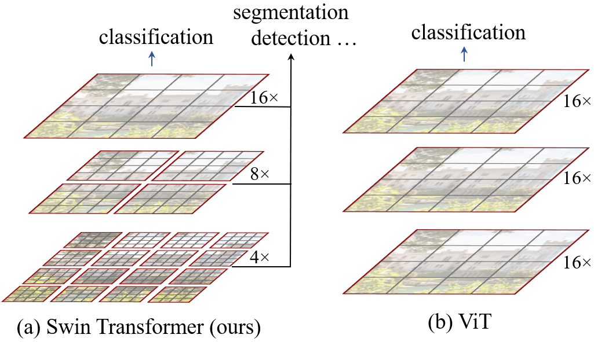
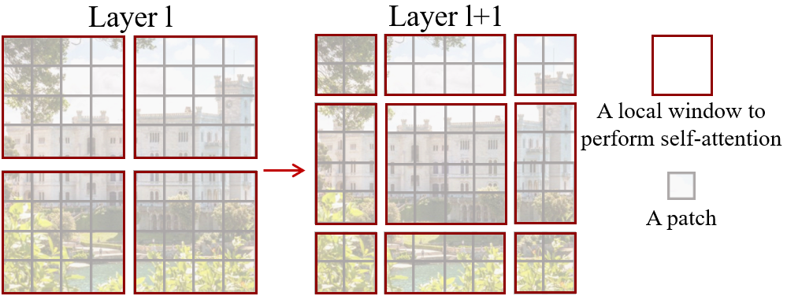
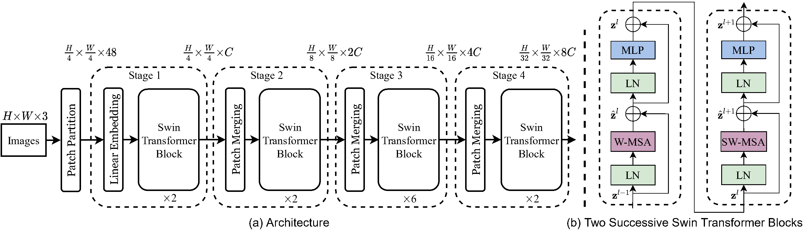
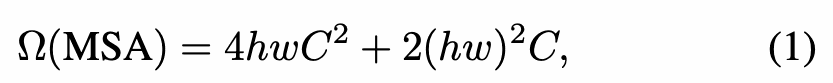
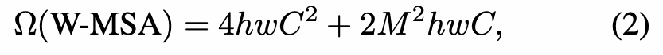
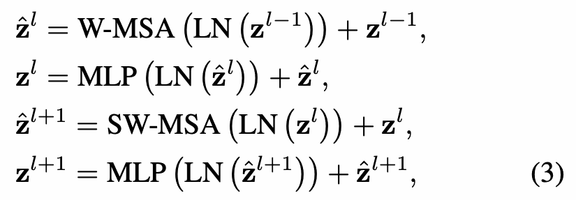
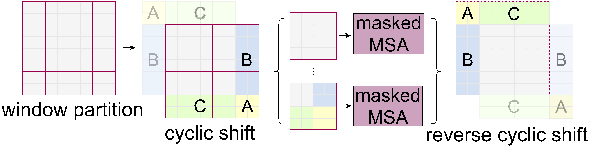

# Swin Transformer：使用移位窗口的层次化视觉 Transformer

<strong>Swin Transformer: Hierarchical Vision Transformer using Shifted Windows</strong>

Ze Liu<sup>1,2†&#42;</sup> · Yutong Lin<sup>1,3†&#42;</sup> · Yue Cao<sup>1&#42;</sup> · Han Hu<sup>1&#42;‡</sup> · Yixuan Wei<sup>1,4†</sup> · Zheng Zhang<sup>1</sup> · Stephen Lin<sup>1</sup> · Baining Guo<sup>1</sup>

<sup>1</sup> 微软亚洲研究院<br>
<sup>2</sup> 中国科学技术大学<br>
<sup>3</sup> 西安交通大学<br>
<sup>4</sup> 清华大学

邮箱：`{v-zeliu1,v-yutlin,yuecao,hanhu,v-yixwe,zhez,stevelin,bainguo}@microsoft.com`

<sup>&#42;</sup> 同等贡献。<sup>†</sup> 微软亚洲研究院实习生。<sup>‡</sup> 联系人。

## 译本说明

本译文以用户提供的 11 页 <strong>ICCV 2021 会议版 PDF</strong> 为准，印刷页码为 10012–10022，覆盖摘要、正文第 1–5 节、致谢及 4 条原文脚注。<strong>References 的 76 条文献保留英文及原有顺序</strong>。原文提及的附录不在这份 PDF 中，未纳入本译文。

来源：[CVF 会议页面](https://openaccess.thecvf.com/content/ICCV2021/html/Liu_Swin_Transformer_Hierarchical_Vision_Transformer_Using_Shifted_Windows_ICCV_2021_paper.html) · [会议版 PDF](https://openaccess.thecvf.com/content/ICCV2021/papers/Liu_Swin_Transformer_Hierarchical_Vision_Transformer_Using_Shifted_Windows_ICCV_2021_paper.pdf) · [arXiv:2103.14030v2](https://arxiv.org/abs/2103.14030v2)。arXiv 源文件仅用于辅助核对，与会议版不同的作者单位、实验设置、表格行、段落和参考文献均以会议版为准，详见[翻译与核对记录](translation-notes.zh.md)。

4 幅图保留原图并附中文图注与标签对照；4 个编号公式采用高清原文裁图，并提供可复制的 LaTeX；6 张表重排为 9 个可编辑子表。行内公式使用数学符号和 HTML 上下标，无需阅读平台解析 LaTeX。本文是非官方中文译本，原论文版权归原权利人所有。性能结果及“当前”等表述均指论文发表时的研究情况，本仓库未复现实验。

### 主要术语

| 原文 | 本译文用语 |
| --- | --- |
| shifted window / sliding window | 移位窗口／滑动窗口（两种不同机制） |
| hierarchical representation | 层次化表示 |
| backbone | 骨干网络 |
| patch / token | 图像块／词元 |
| patch merging | 图像块合并 |
| multi-head self-attention（MSA） | 多头自注意力 |
| W-MSA / SW-MSA | 窗口多头自注意力／移位窗口多头自注意力 |
| cyclic shift / masking | 循环移位／掩码处理 |
| relative position bias | 相对位置偏置 |
| absolute position embedding | 绝对位置嵌入 |
| dense prediction | 密集预测 |
| box AP / mask AP | 边界框 AP／掩码 AP（表格中保留原指标标识） |
| throughput / latency | 吞吐量／延迟 |

## 摘要

本文提出一种新的视觉 Transformer，称为 <strong>Swin Transformer</strong>，能够有效地充当计算机视觉的通用骨干网络。将 Transformer 从语言领域应用到视觉领域时，两者之间的差异带来了挑战，例如视觉实体的尺度变化很大，以及图像像素的分辨率远高于文本中的词。为解决这些差异，我们提出一种层次化 Transformer，通过<strong>移位窗口（Shifted Windows，名称 Swin 取自 Shifted 的 S 和 Windows 的 win）</strong>计算其表示。移位窗口方案将自注意力计算限制在互不重叠的局部窗口内，同时允许跨窗口连接，从而提高效率。这种层次化架构能够灵活地进行多尺度建模，其计算复杂度与图像大小成线性关系。

Swin Transformer 的这些特点使其适用于广泛的视觉任务，包括图像分类（在 ImageNet-1K 上达到 87.3% 的 top-1 准确率），以及目标检测（在 COCO test-dev 上达到 58.7 的边界框 AP 和 51.1 的掩码 AP）、语义分割（在 ADE20K 验证集上达到 53.5 的 mIoU）等密集预测任务。其性能大幅超过此前的最先进水平：在 COCO 上，边界框 AP 和掩码 AP 分别高出 2.7 和 2.6；在 ADE20K 上，mIoU 高出 3.2。这表明，基于 Transformer 的模型具有充当视觉骨干网络的潜力。层次化设计和移位窗口方法也被证明有益于全 MLP 架构。代码和模型已在 <https://github.com/microsoft/Swin-Transformer> 公开。

<a id="section-1"></a>

## 1 引言

长期以来，计算机视觉建模一直由卷积神经网络（CNN）主导。AlexNet <a href="#ref-35">[35]</a> 在 ImageNet 图像分类挑战赛中取得突破性表现后，CNN 架构通过扩大规模 <a href="#ref-27">[27]</a>、<a href="#ref-69">[69]</a>、增加连接 <a href="#ref-31">[31]</a>，以及采用更精细的卷积形式 <a href="#ref-64">[64]</a>、<a href="#ref-17">[17]</a>、<a href="#ref-75">[75]</a>，逐渐变得更强大。由于 CNN 被用作多种视觉任务的骨干网络，这些架构进步带来的性能提升广泛推动了整个领域的发展。



<strong>图 1：</strong>（a）我们提出的 Swin Transformer 通过在更深层合并图像块（灰色所示），构建层次化特征图；由于只在每个局部窗口（红色所示）内计算自注意力，其计算复杂度与输入图像大小成线性关系。因此，它既可以充当图像分类任务的通用骨干网络，也可以充当密集识别任务的通用骨干网络。（b）相比之下，此前的视觉 Transformer <a href="#ref-19">[19]</a> 生成的是单一低分辨率的特征图，并且由于在全局计算自注意力，其计算复杂度与输入图像大小成二次关系。

<strong>图内标签：</strong> classification：分类；segmentation：分割；detection …：检测等；Swin Transformer (ours)：Swin Transformer（我们的方法）；ViT：视觉 Transformer；4×、8×、16×：相对于输入图像的空间下采样倍率。

另一方面，自然语言处理（NLP）中的网络架构沿着不同的路径演进，如今的主流架构是 Transformer <a href="#ref-58">[58]</a>。Transformer 专为序列建模和序列转换任务设计，其显著特点是使用注意力来建模数据中的长程依赖。它在语言领域的巨大成功促使研究者探索如何将其应用于计算机视觉；近期，它在某些任务上展现出了令人期待的结果，特别是图像分类 <a href="#ref-19">[19]</a> 和视觉－语言联合建模 <a href="#ref-43">[43]</a>。

本文旨在拓展 Transformer 的适用范围，使其能够充当计算机视觉的通用骨干网络，就像它在 NLP 中的作用，以及 CNN 在视觉领域的作用一样。我们观察到，将 Transformer 在语言领域的高性能迁移到视觉领域时遇到的重大挑战，可以用两种模态之间的差异来解释。其中一个差异是尺度。词词元是语言 Transformer 处理的基本元素，而与其不同，视觉元素的尺度可能存在显著变化；目标检测等任务已经关注到这一问题 <a href="#ref-38">[38]</a>、<a href="#ref-49">[49]</a>、<a href="#ref-50">[50]</a>。在现有的基于 Transformer 的模型 <a href="#ref-58">[58]</a>、<a href="#ref-19">[19]</a> 中，所有词元的尺度都是固定的，这一特性并不适合上述视觉应用。

另一个差异是，相比文本段落中的词，图像中的像素具有高得多的分辨率。语义分割等许多视觉任务要求在像素级进行密集预测，而 Transformer 的自注意力计算复杂度与图像大小成二次关系，因此，在高分辨率图像上直接使用 Transformer 将难以处理这些任务。

为克服这些问题，我们提出一种称为 Swin Transformer 的通用 Transformer 骨干网络，它构建层次化特征图，且计算复杂度与图像大小成线性关系。如图 1（a）所示，Swin Transformer 从较小的图像块（灰色轮廓）开始，在更深的 Transformer 层中逐步合并相邻图像块，由此构建层次化表示。凭借这些层次化特征图，Swin Transformer 模型能够方便地使用特征金字塔网络（FPN）<a href="#ref-38">[38]</a> 或 U-Net <a href="#ref-47">[47]</a> 等先进的密集预测技术。我们将图像划分为互不重叠的窗口（红色轮廓），仅在窗口内局部计算自注意力，从而实现线性计算复杂度。每个窗口中的图像块数量固定，因此复杂度与图像大小成线性关系。这些优点使 Swin Transformer 适合作为多种视觉任务的通用骨干网络；相比之下，此前基于 Transformer 的架构 <a href="#ref-19">[19]</a> 生成的是单一分辨率的特征图，且复杂度为二次复杂度。

Swin Transformer 的一个关键设计，是在相邻的自注意力层之间对窗口划分进行<strong>移位</strong>，如图 2 所示。移位后的窗口跨越前一层窗口的边界，在这些窗口之间建立连接，显著增强了建模能力（见表 4）。这一策略在实际运行延迟方面也很高效：窗口内的所有<strong>查询（query）</strong>图像块共享同一组<strong>键（key）</strong><sup>[1](#note-1)</sup>，有利于硬件中的内存访问。相比之下，此前基于<strong>滑动窗口（sliding window）</strong>的自注意力方法 <a href="#ref-30">[30]</a>、<a href="#ref-46">[46]</a>，由于不同查询像素对应不同的键集合，在通用硬件上存在延迟偏高的问题（[原文措辞校订说明](translation-notes.zh.md#latency-wording)）<sup>[2](#note-2)</sup>。我们的实验表明，所提出的<strong>移位窗口（shifted window）</strong>方法比滑动窗口方法具有低得多的延迟，同时具有相近的建模能力（见表 5 和表 6）。移位窗口方法也被证明有益于全 MLP 架构 <a href="#ref-56">[56]</a>。




<strong>图 2：</strong> 在所提出的 Swin Transformer 架构中，使用<strong>移位窗口</strong>方法计算自注意力的示意图。在第 <i>l</i> 层（左），采用常规窗口划分方案，并在每个窗口内计算自注意力。在下一层，即第 <i>l</i> + 1 层（右），对窗口划分进行移位，从而得到新的窗口。新窗口内的自注意力计算跨越了第 <i>l</i> 层中原有窗口的边界，由此在这些窗口之间建立连接。

<strong>图内标签：</strong> Layer <i>l</i>：第 <i>l</i> 层；Layer <i>l</i> + 1：第 <i>l</i> + 1 层；A local window to perform self-attention：用于计算自注意力的局部窗口；A patch：一个图像块。

所提出的 Swin Transformer 在图像分类、目标检测和语义分割这些识别任务上取得了出色表现。在这三项任务上，它以相近的延迟显著超过 ViT／DeiT <a href="#ref-19">[19]</a>、<a href="#ref-57">[57]</a> 和 ResNe(X)t 模型 <a href="#ref-27">[27]</a>、<a href="#ref-64">[64]</a>。它在 COCO test-dev 集上的边界框 AP 为 58.7、掩码 AP 为 51.1，分别比此前的最先进结果高出 2.7 的边界框 AP（不使用外部数据的 Copy-paste <a href="#ref-23">[23]</a>）和 2.6 的掩码 AP（DetectoRS <a href="#ref-42">[42]</a>）。在 ADE20K 语义分割任务中，它在验证集上达到 53.5 的 mIoU，比此前最先进的方法（SETR <a href="#ref-73">[73]</a>）高出 3.2 的 mIoU。它还在 ImageNet-1K 图像分类任务中达到 87.3% 的 top-1 准确率。

我们相信，计算机视觉和自然语言处理采用统一架构将使两个领域都受益，因为这有利于对视觉信号和文本信号进行联合建模，也能让两个领域更深入地共享建模知识。我们希望，Swin Transformer 在多种视觉问题上的出色表现能够推动研究社区进一步认同这一观点，并促进视觉信号和语言信号的统一建模。

<a id="section-2"></a>

## 2 相关工作

<strong>CNN 及其变体。</strong> CNN 是计算机视觉领域广泛使用的标准网络模型。尽管 CNN 已经存在数十年 <a href="#ref-36">[36]</a>，但直到 AlexNet <a href="#ref-35">[35]</a> 出现之后，CNN 才迅速发展并成为主流。此后，研究者提出了更深、更有效的卷积神经网络架构，进一步推动了计算机视觉领域的深度学习浪潮，例如 VGG <a href="#ref-48">[48]</a>、GoogleNet <a href="#ref-53">[53]</a>、ResNet <a href="#ref-27">[27]</a>、DenseNet <a href="#ref-31">[31]</a>、HRNet <a href="#ref-59">[59]</a> 和 EfficientNet <a href="#ref-54">[54]</a>。除了这些架构进步之外，也有大量工作致力于改进单个卷积层，例如逐通道卷积 <a href="#ref-64">[64]</a> 和可变形卷积 <a href="#ref-17">[17]</a>、<a href="#ref-75">[75]</a>。虽然 CNN 及其变体仍然是计算机视觉应用中的主要骨干架构，但我们强调，Transformer 类架构在视觉与语言统一建模方面具有巨大潜力。我们的工作在若干基础视觉识别任务上取得了出色表现，希望能够推动建模方式的转变。

<strong>基于自注意力的骨干架构。</strong> 同样受到自注意力层和 Transformer 架构在 NLP 领域成功的启发，一些工作使用自注意力层替换常用 ResNet 中的部分或全部空间卷积层 <a href="#ref-30">[30]</a>、<a href="#ref-46">[46]</a>、<a href="#ref-72">[72]</a>。在这些工作中，自注意力在每个像素的局部窗口内计算，以加快优化 <a href="#ref-30">[30]</a>；与对应的 ResNet 架构相比，它们在准确率与 FLOPs 之间取得了略好的权衡。然而，较高的内存访问开销使其实际延迟显著高于卷积网络 <a href="#ref-30">[30]</a>。我们提出在相邻层之间对窗口进行移位，从而能够在通用硬件上更高效地实现，而不再使用滑动窗口。

<strong>用自注意力／Transformer 补充 CNN。</strong> 另一类工作使用自注意力层或 Transformer 来增强标准 CNN 架构。自注意力层能够编码远距离依赖或异构交互，因此可以补充骨干网络 <a href="#ref-61">[61]</a>、<a href="#ref-7">[7]</a>、<a href="#ref-3">[3]</a>、<a href="#ref-65">[65]</a>、<a href="#ref-21">[21]</a>、<a href="#ref-68">[68]</a>、<a href="#ref-51">[51]</a> 或头部网络 <a href="#ref-29">[29]</a>、<a href="#ref-24">[24]</a> 的能力。近期，Transformer 中的编码器－解码器设计已被用于目标检测和实例分割任务 <a href="#ref-8">[8]</a>、<a href="#ref-13">[13]</a>、<a href="#ref-76">[76]</a>、<a href="#ref-52">[52]</a>。我们的工作探索如何将 Transformer 用于基础视觉特征提取，与这些工作具有互补性。

<strong>基于 Transformer 的视觉骨干网络。</strong> 与我们工作最相关的是视觉 Transformer（ViT）<a href="#ref-19">[19]</a> 及其后续工作 <a href="#ref-57">[57]</a>、<a href="#ref-66">[66]</a>、<a href="#ref-15">[15]</a>、<a href="#ref-25">[25]</a>、<a href="#ref-60">[60]</a>。ViT 的开创性工作将 Transformer 架构直接应用于互不重叠的中等大小图像块，以进行图像分类。与卷积网络相比，它在图像分类的速度与准确率之间取得了令人瞩目的权衡。ViT 需要大规模训练数据集（即 JFT-300M）才能表现良好，而 DeiT <a href="#ref-57">[57]</a> 引入了若干训练策略，使 ViT 在使用规模更小的 ImageNet-1K 数据集时也能有效工作。ViT 在图像分类上的结果令人鼓舞，但其低分辨率特征图，以及随图像大小呈二次增长的复杂度，使这一架构不适合作为密集视觉任务中的通用骨干网络，也不适合输入图像分辨率较高的情况。有少量工作通过直接上采样或反卷积，将 ViT 模型用于目标检测和语义分割等密集视觉任务，但性能相对较低 <a href="#ref-2">[2]</a>、<a href="#ref-73">[73]</a>。与我们同期的一些工作通过修改 ViT 架构 <a href="#ref-66">[66]</a>、<a href="#ref-15">[15]</a>、<a href="#ref-25">[25]</a> 来改善图像分类。实验表明，尽管我们的工作关注通用性能，而非专门针对分类，Swin Transformer 架构仍在这些方法中取得了最佳的图像分类速度与准确率权衡。另一项同期工作 <a href="#ref-60">[60]</a> 沿着相似思路，探索在 Transformer 中构建多分辨率特征图。但其复杂度与图像大小仍成二次关系，而我们的方法为线性关系，并且采用局部运算；已有研究证明，这有利于建模视觉信号中的高度相关性 <a href="#ref-32">[32]</a>、<a href="#ref-22">[22]</a>、<a href="#ref-37">[37]</a>。我们的方法兼具效率与有效性，在 COCO 目标检测和 ADE20K 语义分割任务上均达到最先进的准确率。


<a id="section-3"></a>

## 3 方法



<strong>图 3：</strong>（a）Swin Transformer（Swin-T）的架构；（b）两个连续的 Swin Transformer 块，相关符号见公式（3）。W-MSA 和 SW-MSA 分别是采用常规窗口划分和移位窗口划分的多头自注意力模块。

<strong>图内标签：</strong> Architecture：架构；Two Successive Swin Transformer Blocks：两个连续的 Swin Transformer 块；Images：图像；Patch Partition：图像块划分；Linear Embedding：线性嵌入；Patch Merging：图像块合并；Swin Transformer Block：Swin Transformer 块；Stage 1–4：阶段 1–4；MLP：多层感知机；LN：层归一化；W-MSA：窗口多头自注意力；SW-MSA：移位窗口多头自注意力；⊕：逐元素相加。输入尺寸为 <i>H</i> × <i>W</i> × 3；四个阶段的输出尺寸依次为 (<i>H</i>)/(4) × (<i>W</i>)/(4) × <i>C</i>、(<i>H</i>)/(8) × (<i>W</i>)/(8) × 2<i>C</i>、(<i>H</i>)/(16) × (<i>W</i>)/(16) × 4<i>C</i>、(<i>H</i>)/(32) × (<i>W</i>)/(32) × 8<i>C</i>，Swin-T 在各阶段的块重复次数依次为 2、2、6、2。

<a id="section-3-1"></a>

### 3.1 整体架构

图 3 以微型版本 Swin-T 为例，展示了 Swin Transformer 架构的概览。与 ViT 类似，它首先通过图像块划分模块，将输入的 RGB 图像切分为互不重叠的图像块。每个图像块被视为一个“词元”，其特征由该图像块中各像素的原始 RGB 值拼接而成。在我们的实现中，图像块大小为 4 × 4，因此每个图像块的特征维度为 4 × 4 × 3 = 48。随后，线性嵌入层将这一由原始数值组成的特征投影至任意维度，记为 <i>C</i>。

这些图像块词元随后经过若干个修改了自注意力计算的 Transformer 块，即 <em>Swin Transformer 块</em>。这些 Transformer 块保持词元数量不变，即 (<i>H</i>)/(4) × (<i>W</i>)/(4)；它们与线性嵌入层一起称为“阶段 1”。

为了生成层次化表示，随着网络加深，我们通过图像块合并层减少词元数量。第一个图像块合并层将每组 2 × 2 个相邻图像块的特征拼接起来，再对拼接所得的 4<i>C</i> 维特征应用一个线性层。这样，词元数量减至原来的 1/(2 × 2) = 1/4，即空间分辨率进行 2 倍下采样；输出维度设为 2<i>C</i>。随后应用 Swin Transformer 块进行特征变换，分辨率保持为 (<i>H</i>)/(8) × (<i>W</i>)/(8)。这一组首次进行的图像块合并与特征变换称为“阶段 2”。这一过程再重复两次，分别构成“阶段 3”和“阶段 4”，输出分辨率分别为 (<i>H</i>)/(16) × (<i>W</i>)/(16) 和 (<i>H</i>)/(32) × (<i>W</i>)/(32)。这些阶段共同生成层次化表示，其特征图分辨率与 VGG <a href="#ref-48">[48]</a>、ResNet <a href="#ref-27">[27]</a> 等典型卷积网络相同。因此，对于各种视觉任务，所提出的架构可以方便地替换现有方法中的骨干网络。

<strong>Swin Transformer 块。</strong> Swin Transformer 将标准 Transformer 块中的多头自注意力（MSA）模块替换为基于移位窗口的模块，其他层保持不变，详见第 3.2 节。如图 3（b）所示，Swin Transformer 块由基于移位窗口的 MSA 模块和其后的两层 MLP 组成，MLP 的两层之间采用 GELU 非线性激活。在每个 MSA 模块和每个 MLP 之前应用层归一化（LayerNorm，LN），并在每个模块之后应用残差连接。

<a id="section-3-2"></a>

### 3.2 基于移位窗口的自注意力

标准 Transformer 架构 <a href="#ref-58">[58]</a> 及其用于图像分类的版本 <a href="#ref-19">[19]</a> 均采用全局自注意力，即计算一个词元与所有其他词元之间的关系。这样的全局计算使复杂度随词元数量呈二次增长，因此不适合许多视觉问题：这些问题需要大量词元来进行密集预测，或表示高分辨率图像。

<strong>不重叠窗口内的自注意力。</strong> 为了高效建模，我们提出在局部窗口内计算自注意力。这些窗口以互不重叠的方式均匀划分图像。假设每个窗口包含 <i>M</i> × <i>M</i> 个图像块，对于由 <i>h</i> × <i>w</i> 个图像块组成的图像，全局 MSA 模块与基于窗口的 MSA 模块的计算复杂度分别为<sup>[3](#note-3)</sup>：



<details>
<summary>公式（1）的 LaTeX 源码</summary>

```latex
\Omega(\text{MSA}) = 4hwC^2 + 2(hw)^2C,
\tag{1}
```

</details>



<details>
<summary>公式（2）的 LaTeX 源码</summary>

```latex
\Omega(\text{W-MSA}) = 4hwC^2 + 2M^2hwC,
\tag{2}
```

</details>

其中，前者的复杂度随图像块数量 <i>h</i><i>w</i> 呈二次增长；当 <i>M</i> 固定时，后者则呈线性增长，默认设置为 <i>M</i> = 7。当 <i>h</i><i>w</i> 较大时，全局自注意力的计算开销通常难以承受，而基于窗口的自注意力则具备可扩展性。

<strong>连续块中的移位窗口划分。</strong> 基于窗口的自注意力模块缺少跨窗口连接，这限制了其建模能力。为了在保持不重叠窗口高效计算的同时引入跨窗口连接，我们提出移位窗口划分方法，在连续的 Swin Transformer 块中交替采用两种划分配置。

如图 2 所示，第一个模块采用常规窗口划分策略，从左上角像素开始，将 8 × 8 的特征图均匀划分为 2 × 2 个窗口，每个窗口大小为 4 × 4，即 <i>M</i> = 4。随后，下一个模块采用相对于前一层发生移位的窗口配置：在常规划分的窗口基础上，将窗口移动 (⌊<i>M</i>/2⌋, ⌊<i>M</i>/2⌋) 个像素。

采用移位窗口划分方法后，连续的 Swin Transformer 块按如下方式计算：



<details>
<summary>公式（3）的 LaTeX 源码</summary>

```latex
\begin{aligned}
\hat{\mathbf{z}}^{l}
&= \text{W-MSA}\left(\text{LN}\left(\mathbf{z}^{l-1}\right)\right)
 + \mathbf{z}^{l-1}, \\
\mathbf{z}^{l}
&= \text{MLP}\left(\text{LN}\left(\hat{\mathbf{z}}^{l}\right)\right)
 + \hat{\mathbf{z}}^{l}, \\
\hat{\mathbf{z}}^{l+1}
&= \text{SW-MSA}\left(\text{LN}\left(\mathbf{z}^{l}\right)\right)
 + \mathbf{z}^{l}, \\
\mathbf{z}^{l+1}
&= \text{MLP}\left(\text{LN}\left(\hat{\mathbf{z}}^{l+1}\right)\right)
 + \hat{\mathbf{z}}^{l+1},
\end{aligned}
\tag{3}
```

</details>

其中，<b>ẑ</b><sup><i>l</i></sup> 和 <b>z</b><sup><i>l</i></sup> 分别表示第 <i>l</i> 个块中（S）W-MSA 模块和 MLP 模块的输出特征；W-MSA 和 SW-MSA 分别表示采用常规窗口划分和移位窗口划分的窗口多头自注意力。

移位窗口划分方法在前一层相邻且互不重叠的窗口之间建立连接。表 4 表明，该方法对图像分类、目标检测和语义分割均有效。



<strong>图 4：</strong> 移位窗口划分中，自注意力高效批量计算方法的示意图。

<strong>图内标签：</strong> window partition：窗口划分；cyclic shift：循环移位；masked MSA：带掩码的多头自注意力；reverse cyclic shift：逆循环移位。A、B、C 标识在循环移位过程中被移动、重组并最终恢复的子区域。

<strong>移位配置的高效批量计算。</strong> 移位窗口划分存在一个问题：移位后的窗口数量会增多，从 ⌈<i>h</i>/<i>M</i>⌉ × ⌈<i>w</i>/<i>M</i>⌉ 增加到 (⌈<i>h</i>/<i>M</i>⌉ + 1) × (⌈<i>w</i>/<i>M</i>⌉ + 1)，并且有些窗口的尺寸会小于 <i>M</i> × <i>M</i><sup>[4](#note-4)</sup>。一种朴素的解决方案是，将较小的窗口填充至 <i>M</i> × <i>M</i>，并在计算注意力时用掩码排除填充值。当常规划分的窗口数量较少时，例如 2 × 2，这种朴素方案带来的计算增量相当可观：窗口数量由 2 × 2 变为 3 × 3，计算量达到原来的 2.25 倍。这里，我们提出一种<em>更高效的批量计算方法</em>，通过向左上方进行循环移位来实现，如图 4 所示。经过这种移位，一个用于批量计算的窗口可能由原特征图中互不相邻的多个子窗口组成，因此需要采用掩码机制，将自注意力计算限制在各个子窗口内部。采用循环移位后，用于批量计算的窗口数量与常规窗口划分相同，因此仍然高效。表 5 展示了该方法的低延迟。

<strong>相对位置偏置。</strong> 计算自注意力时，我们遵循文献 <a href="#ref-45">[45]</a>、<a href="#ref-1">[1]</a>、<a href="#ref-29">[29]</a>、<a href="#ref-30">[30]</a>，在每个注意力头计算相似度时加入相对位置偏置 <i>B</i> ∈ ℝ<sup><i>M</i><sup>2</sup> × <i>M</i><sup>2</sup></sup>：


<details>
<summary>公式（4）的 LaTeX 源码</summary>

```latex
\text{Attention}(Q,K,V)
= \text{SoftMax}(QK^T/\sqrt{d}+B)V,
\tag{4}
```

</details>

其中，<i>Q</i>, <i>K</i>, <i>V</i> ∈ ℝ<sup><i>M</i><sup>2</sup> × <i>d</i></sup> 分别为<em>查询</em>、<em>键</em>和<em>值</em>矩阵；<i>d</i> 是查询和键的维度，<i>M</i><sup>2</sup> 是一个窗口内的图像块数量。由于沿每个坐标轴的相对位置均处于 [−<i>M</i> + 1, <i>M</i> − 1] 范围内，我们将较小的偏置矩阵 <i>B̂</i> ∈ ℝ<sup>(2<i>M</i> − 1) × (2<i>M</i> − 1)</sup> 设为可学习参数，而 <i>B</i> 中的值从 <i>B̂</i> 中取得。

如表 4 所示，与不使用这一偏置项或使用绝对位置嵌入的对应方案相比，我们观察到显著的性能提升。如果像文献 <a href="#ref-19">[19]</a> 那样，在输入上进一步加入绝对位置嵌入，性能反而会略有下降，因此我们的实现未采用绝对位置嵌入。

预训练阶段学到的相对位置偏置，还可以通过双三次插值，用于初始化采用不同窗口大小进行微调的模型 <a href="#ref-19">[19]</a>、<a href="#ref-57">[57]</a>。

<a id="section-3-3"></a>

### 3.3 架构变体

我们构建了称为 Swin-B 的基础模型，其模型规模与计算复杂度接近 ViT-B/DeiT-B。我们还引入了 Swin-T、Swin-S 和 Swin-L，它们的模型规模与计算复杂度分别约为 Swin-B 的 0.25 倍、0.5 倍和 2 倍。需要指出的是，Swin-T 和 Swin-S 的复杂度分别接近 ResNet-50（DeiT-S）和 ResNet-101。窗口大小默认设为 <i>M</i> = 7。在所有实验中，每个注意力头的查询维度均为 <i>d</i> = 32，每个 MLP 的扩展倍率均为 <i>α</i> = 4。这些模型变体的架构超参数如下：

- Swin-T：<i>C</i> = 96，各阶段层数为 {2, 2, 6, 2}。
- Swin-S：<i>C</i> = 96，各阶段层数为 {2, 2, 18, 2}。
- Swin-B：<i>C</i> = 128，各阶段层数为 {2, 2, 18, 2}。
- Swin-L：<i>C</i> = 192，各阶段层数为 {2, 2, 18, 2}。

其中，<i>C</i> 为第一阶段中隐藏层的通道数。各模型变体用于 ImageNet 图像分类时的模型规模、理论计算复杂度（FLOPs）和吞吐量列于表 1。


<a id="section-4"></a>

## 4 实验

我们在 ImageNet-1K 图像分类任务 <a href="#ref-18">[18]</a>、COCO 目标检测任务 <a href="#ref-39">[39]</a> 和 ADE20K 语义分割任务 <a href="#ref-74">[74]</a> 上开展实验。下面，我们首先在这三个任务上，将提出的 Swin Transformer 架构与此前最先进的方法进行比较；随后，对 Swin Transformer 的重要设计要素进行消融分析。

<a id="section-4-1"></a>

### 4.1 ImageNet-1K 图像分类

<strong>实验设置。</strong> 对于图像分类，我们在 ImageNet-1K <a href="#ref-18">[18]</a> 上评估提出的 Swin Transformer。该数据集包含 1,000 个类别、128 万张训练图像和 5 万张验证图像。我们报告单裁剪评估下的 top-1 准确率，并考虑以下两种训练设置。

- <strong>常规 ImageNet-1K 训练。</strong> 这一设置主要遵循文献 <a href="#ref-57">[57]</a>。我们使用 AdamW 优化器 <a href="#ref-33">[33]</a> 训练 300 个 epoch，采用余弦衰减学习率调度，并在前 20 个 epoch 进行线性预热。批量大小为 1024，初始学习率为 0.001，权重衰减为 0.05。训练采用了文献 <a href="#ref-57">[57]</a> 中的大多数数据增强与正则化策略，但不采用重复增强 <a href="#ref-28">[28]</a> 和指数移动平均（EMA）<a href="#ref-41">[41]</a>，因为它们没有带来性能提升。需要注意的是，这与文献 <a href="#ref-57">[57]</a> 的结论不同：在该文献中，重复增强对于稳定 ViT 的训练至关重要。
- <strong>在 ImageNet-22K 上预训练，再在 ImageNet-1K 上微调。</strong> 我们还在规模更大的 ImageNet-22K 数据集上进行预训练。该数据集包含 1,420 万张图像和 2.2 万个类别。我们使用 AdamW 优化器训练 90 个 epoch，采用余弦衰减学习率调度，并在前 5 个 epoch 进行线性预热。批量大小为 4096，初始学习率为 0.001，权重衰减为 0.01。在 ImageNet-1K 上微调时，模型训练 30 个 epoch，批量大小为 1024，学习率固定为 10<sup>−5</sup>，权重衰减为 10<sup>−8</sup>。

<strong>常规 ImageNet-1K 训练的结果。</strong> 表 1(a) 给出了在常规 ImageNet-1K 训练设置下，与其他骨干网络的比较，其中包括基于 Transformer 和基于卷积网络的骨干网络。

与此前最先进的 Transformer 架构 DeiT <a href="#ref-57">[57]</a> 相比，Swin Transformer 明显优于复杂度相近的对应 DeiT 架构：在 224<sup>2</sup> 输入下，Swin-T 的准确率为 81.3%，比 DeiT-S 的 79.8% 高 1.5 个百分点；在 224<sup>2</sup> 和 384<sup>2</sup> 输入下，Swin-B 的准确率分别为 83.3% 和 84.5%，比 DeiT-B 的 81.8% 和 83.1% 分别高 1.5 和 1.4 个百分点。

与最先进的卷积网络 RegNet <a href="#ref-44">[44]</a> 相比，Swin Transformer 在速度与准确率之间取得了略好的权衡。需要指出的是，RegNet <a href="#ref-44">[44]</a> 是通过全面的架构搜索得到的，而 Swin Transformer 是从标准 Transformer 手工改造而来，因此仍具有很大的改进潜力。

<strong>ImageNet-22K 预训练的结果。</strong> 我们还在 ImageNet-22K 上预训练了容量更大的 Swin-B 和 Swin-L。在 ImageNet-1K 图像分类任务上微调后的结果见表 1(b)。对于 Swin-B，相比在 ImageNet-1K 上从头训练，ImageNet-22K 预训练带来了 1.8～1.9 个百分点的提升。与此前采用 ImageNet-22K 预训练的最佳结果相比，我们的模型在速度与准确率之间取得了显著更好的权衡：Swin-B 的 top-1 准确率达到 86.4%，比 ViT 高 2.4 个百分点，同时具有相近的推理吞吐量（84.7 对 85.9 张图像/秒）和略低的 FLOPs（47.0G 对 55.4G）。更大的 Swin-L 模型达到 87.3% 的 top-1 准确率，比 Swin-B 高 0.9 个百分点。

<a id="exp:imagenet-system"></a>

<strong>表 1：不同骨干网络在 ImageNet-1K 分类任务上的比较。</strong> 遵循文献 <a href="#ref-57">[57]</a>，吞吐量使用文献 <a href="#ref-62">[62]</a> 的 GitHub 仓库在一块 V100 GPU 上测量。

<strong>(a) 在 ImageNet-1K 上常规训练的模型</strong>

| 方法 | 图像尺寸 | 参数量 | FLOPs | 吞吐量（张图像/秒） | ImageNet top-1 准确率（%） |
| --- | ---: | ---: | ---: | ---: | ---: |
| RegNetY-4G <a href="#ref-44">[44]</a> | 224<sup>2</sup> | 21M | 4.0G | 1156.7 | 80.0 |
| RegNetY-8G <a href="#ref-44">[44]</a> | 224<sup>2</sup> | 39M | 8.0G | 591.6 | 81.7 |
| RegNetY-16G <a href="#ref-44">[44]</a> | 224<sup>2</sup> | 84M | 16.0G | 334.7 | 82.9 |
| ViT-B/16 <a href="#ref-19">[19]</a> | 384<sup>2</sup> | 86M | 55.4G | 85.9 | 77.9 |
| ViT-L/16 <a href="#ref-19">[19]</a> | 384<sup>2</sup> | 307M | 190.7G | 27.3 | 76.5 |
| DeiT-S <a href="#ref-57">[57]</a> | 224<sup>2</sup> | 22M | 4.6G | 940.4 | 79.8 |
| DeiT-B <a href="#ref-57">[57]</a> | 224<sup>2</sup> | 86M | 17.5G | 292.3 | 81.8 |
| DeiT-B <a href="#ref-57">[57]</a> | 384<sup>2</sup> | 86M | 55.4G | 85.9 | 83.1 |
| Swin-T | 224<sup>2</sup> | 29M | 4.5G | 755.2 | 81.3 |
| Swin-S | 224<sup>2</sup> | 50M | 8.7G | 436.9 | 83.0 |
| Swin-B | 224<sup>2</sup> | 88M | 15.4G | 278.1 | 83.5 |
| Swin-B | 384<sup>2</sup> | 88M | 47.0G | 84.7 | 84.5 |

<strong>(b) 在 ImageNet-22K 上预训练的模型</strong>

| 方法 | 图像尺寸 | 参数量 | FLOPs | 吞吐量（张图像/秒） | ImageNet top-1 准确率（%） |
| --- | ---: | ---: | ---: | ---: | ---: |
| R-101x3 <a href="#ref-34">[34]</a> | 384<sup>2</sup> | 388M | 204.6G | — | 84.4 |
| R-152x4 <a href="#ref-34">[34]</a> | 480<sup>2</sup> | 937M | 840.5G | — | 85.4 |
| ViT-B/16 <a href="#ref-19">[19]</a> | 384<sup>2</sup> | 86M | 55.4G | 85.9 | 84.0 |
| ViT-L/16 <a href="#ref-19">[19]</a> | 384<sup>2</sup> | 307M | 190.7G | 27.3 | 85.2 |
| Swin-B | 224<sup>2</sup> | 88M | 15.4G | 278.1 | 85.2 |
| Swin-B | 384<sup>2</sup> | 88M | 47.0G | 84.7 | 86.4 |
| Swin-L | 384<sup>2</sup> | 197M | 103.9G | 42.1 | 87.3 |

<a id="section-4-2"></a>

### 4.2 COCO 目标检测

<strong>实验设置。</strong> 目标检测与实例分割实验在 COCO 2017 上开展。该数据集包含 11.8 万张训练图像、5 千张验证图像和 2 万张 test-dev 图像。我们在验证集上进行消融实验，并在 test-dev 上报告系统层面的比较结果。对于消融实验，我们考虑 mmdetection <a href="#ref-10">[10]</a> 中四种典型的目标检测框架：Cascade Mask R-CNN <a href="#ref-26">[26]</a>、<a href="#ref-6">[6]</a>、ATSS <a href="#ref-71">[71]</a>、RepPoints v2 <a href="#ref-12">[12]</a> 和 Sparse R-CNN <a href="#ref-52">[52]</a>。这四种框架均采用相同的设置：多尺度训练 <a href="#ref-8">[8]</a>、<a href="#ref-52">[52]</a>（调整输入尺寸，使短边长度介于 480 和 800 之间，长边长度不超过 1333）、AdamW 优化器 <a href="#ref-40">[40]</a>（初始学习率为 0.0001，权重衰减为 0.05，批量大小为 16），以及 3× 训练日程（36 个 epoch）。对于系统层面的比较，我们采用改进的 HTC <a href="#ref-9">[9]</a>（记为 HTC++），使用 instaboost <a href="#ref-20">[20]</a>、更强的多尺度训练 <a href="#ref-7">[7]</a>、6× 训练日程（72 个 epoch）和 soft-NMS <a href="#ref-5">[5]</a>，并使用在 ImageNet-22K 上预训练的模型进行初始化。

我们将 Swin Transformer 与标准卷积网络 ResNe(X)t 及此前的 Transformer 网络（如 DeiT）进行比较。比较时只更换骨干网络，其他设置保持不变。需要注意的是，Swin Transformer 和 ResNe(X)t 具有层次化特征图，因此可直接用于上述所有框架；DeiT 则只产生单一分辨率的特征图，无法直接应用。为进行公平比较，我们遵循文献 <a href="#ref-73">[73]</a>，通过反卷积层为 DeiT 构建层次化特征图。

<a id="exp:coco"></a>

<strong>表 2：COCO 目标检测与实例分割结果。</strong> † 表示使用额外的反卷积层生成层次化特征图。\* 表示采用多尺度测试。

<strong>(a) 不同检测框架</strong>

| 方法 | 骨干网络 | AP<sup>box</sup> | AP<sub>50</sub><sup>box</sup> | AP<sub>75</sub><sup>box</sup> | 参数量 | FLOPs | FPS |
| --- | --- | ---: | ---: | ---: | ---: | ---: | ---: |
| Cascade Mask R-CNN | R-50 | 46.3 | 64.3 | 50.5 | 82M | 739G | 18.0 |
| Cascade Mask R-CNN | Swin-T | <strong>50.5</strong> | <strong>69.3</strong> | <strong>54.9</strong> | 86M | 745G | 15.3 |
| ATSS | R-50 | 43.5 | 61.9 | 47.0 | 32M | 205G | 28.3 |
| ATSS | Swin-T | <strong>47.2</strong> | <strong>66.5</strong> | <strong>51.3</strong> | 36M | 215G | 22.3 |
| RepPointsV2 | R-50 | 46.5 | 64.6 | 50.3 | 42M | 274G | 13.6 |
| RepPointsV2 | Swin-T | <strong>50.0</strong> | <strong>68.5</strong> | <strong>54.2</strong> | 45M | 283G | 12.0 |
| Sparse R-CNN | R-50 | 44.5 | 63.4 | 48.2 | 106M | 166G | 21.0 |
| Sparse R-CNN | Swin-T | <strong>47.9</strong> | <strong>67.3</strong> | <strong>52.3</strong> | 110M | 172G | 18.4 |

<strong>(b) Cascade Mask R-CNN 中不同骨干网络的比较</strong>

| 骨干网络 | AP<sup>box</sup> | AP<sub>50</sub><sup>box</sup> | AP<sub>75</sub><sup>box</sup> | AP<sup>mask</sup> | AP<sub>50</sub><sup>mask</sup> | AP<sub>75</sub><sup>mask</sup> | 参数量 | FLOPs | FPS |
| --- | ---: | ---: | ---: | ---: | ---: | ---: | ---: | ---: | ---: |
| DeiT-S<sup>†</sup> | 48.0 | 67.2 | 51.7 | 41.4 | 64.2 | 44.3 | 80M | 889G | 10.4 |
| R50 | 46.3 | 64.3 | 50.5 | 40.1 | 61.7 | 43.4 | 82M | 739G | 18.0 |
| Swin-T | <strong>50.5</strong> | <strong>69.3</strong> | <strong>54.9</strong> | <strong>43.7</strong> | <strong>66.6</strong> | <strong>47.1</strong> | 86M | 745G | 15.3 |
| X101-32 | 48.1 | 66.5 | 52.4 | 41.6 | 63.9 | 45.2 | 101M | 819G | 12.8 |
| Swin-S | <strong>51.8</strong> | <strong>70.4</strong> | <strong>56.3</strong> | <strong>44.7</strong> | <strong>67.9</strong> | <strong>48.5</strong> | 107M | 838G | 12.0 |
| X101-64 | 48.3 | 66.4 | 52.3 | 41.7 | 64.0 | 45.1 | 140M | 972G | 10.4 |
| Swin-B | <strong>51.9</strong> | <strong>70.9</strong> | <strong>56.5</strong> | <strong>45.0</strong> | <strong>68.4</strong> | <strong>48.7</strong> | 145M | 982G | 11.6 |

<strong>(c) 系统层面的比较</strong>

| 方法 | mini-val AP<sup>box</sup> | mini-val AP<sup>mask</sup> | test-dev AP<sup>box</sup> | test-dev AP<sup>mask</sup> | 参数量 | FLOPs |
| --- | ---: | ---: | ---: | ---: | ---: | ---: |
| RepPointsV2\* <a href="#ref-12">[12]</a> | — | — | 52.1 | — | — | — |
| GCNet\* <a href="#ref-7">[7]</a> | 51.8 | 44.7 | 52.3 | 45.4 | — | 1041G |
| RelationNet++\* <a href="#ref-13">[13]</a> | — | — | 52.7 | — | — | — |
| DetectoRS\* <a href="#ref-42">[42]</a> | — | — | 55.7 | 48.5 | — | — |
| YOLOv4 P7\* <a href="#ref-4">[4]</a> | — | — | 55.8 | — | — | — |
| Copy-paste <a href="#ref-23">[23]</a> | 55.9 | 47.2 | 56.0 | 47.4 | 185M | 1440G |
| X101-64（HTC++） | 52.3 | 46.0 | — | — | 155M | 1033G |
| Swin-B（HTC++） | 56.4 | 49.1 | — | — | 160M | 1043G |
| Swin-L（HTC++） | 57.1 | 49.5 | 57.7 | 50.2 | 284M | 1470G |
| Swin-L（HTC++）\* | <strong>58.0</strong> | <strong>50.4</strong> | <strong>58.7</strong> | <strong>51.1</strong> | 284M | — |

<strong>与 ResNe(X)t 的比较。</strong> 表 2(a) 列出了 Swin-T 和 ResNet-50 在四种目标检测框架中的结果。相比 ResNet-50，Swin-T 在模型规模、FLOPs 和时延略高的情况下，稳定带来 3.4～4.2 点 box AP 的提升。

表 2(b) 在 Cascade Mask R-CNN 框架下，对不同模型容量的 Swin Transformer 和 ResNe(X)t 进行了比较。Swin Transformer 达到了 51.9 box AP 和 45.0 mask AP 的较高检测精度，分别比模型规模、FLOPs 和时延相近的 ResNeXt101-64x4d 高 3.6 box AP 和 3.3 mask AP。对于采用改进 HTC 框架、达到 52.3 box AP 和 46.0 mask AP 的更强基线，Swin Transformer 同样带来了较大提升，分别为 4.1 box AP 和 3.1 mask AP（见表 2(c)）。就推理速度而言，ResNe(X)t 使用经过高度优化的 cuDNN 函数构建，而我们的架构使用 PyTorch 内置函数实现，其中并非所有函数都已得到充分优化。全面的计算内核优化不在本文的研究范围之内。

<strong>与 DeiT 的比较。</strong> DeiT-S 在 Cascade Mask R-CNN 框架下的性能见表 2(b)。Swin-T 在模型规模相近（86M 对 80M）、推理速度显著更高（15.3 FPS 对 10.4 FPS）的情况下，比 DeiT-S 高出 2.5 box AP 和 2.3 mask AP。DeiT 的推理速度较低，主要是因为其复杂度随输入图像大小呈二次增长。

<strong>与此前最先进方法的比较。</strong> 表 2(c) 将我们的最佳结果与此前最先进模型的结果进行了比较。我们的最佳模型在 COCO test-dev 上达到 58.7 box AP 和 51.1 mask AP，比此前的最佳结果分别高出 2.7 box AP（不使用外部数据的 Copy-paste <a href="#ref-23">[23]</a>）和 2.6 mask AP（DetectoRS <a href="#ref-42">[42]</a>）。

<a id="section-4-3"></a>

### 4.3 ADE20K 语义分割

<strong>实验设置。</strong> ADE20K <a href="#ref-74">[74]</a> 是一个广泛使用的语义分割数据集，涵盖 150 个多样的语义类别。该数据集共有 2.5 万张图像，其中 2 万张用于训练、2 千张用于验证、另外 3 千张用于测试。考虑到效率较高，我们采用 mmseg <a href="#ref-16">[16]</a> 中的 UperNet <a href="#ref-63">[63]</a> 作为基础框架。更多细节见附录。

<strong>实验结果。</strong> 表 3 列出了不同方法与骨干网络组合的 mIoU、模型规模（参数量）、FLOPs 和 FPS。从结果可以看出，在计算开销相近的情况下，Swin-S 比 DeiT-S 高出 5.3 mIoU（49.3 对 44.0）；同时，比 ResNet-101 高出 4.4 mIoU，比 ResNeSt-101 <a href="#ref-70">[70]</a> 高出 2.4 mIoU。经 ImageNet-22K 预训练的 Swin-L 在验证集上达到 53.5 mIoU，比此前最佳模型高出 3.2 mIoU（模型规模更大的 SETR <a href="#ref-73">[73]</a> 达到 50.3 mIoU）。

<a id="tab:seg"></a>

<strong>表 3：ADE20K 验证集与测试集上的语义分割结果。</strong> † 表示使用额外的反卷积层生成层次化特征图。‡ 表示模型在 ImageNet-22K 上预训练。

| 方法 | 骨干网络 | 验证集 mIoU | 测试集得分 | 参数量 | FLOPs | FPS |
| --- | --- | ---: | ---: | ---: | ---: | ---: |
| DLab.v3+ <a href="#ref-11">[11]</a> | ResNet-101 | 44.1 | — | 63M | 1021G | 16.0 |
| DNL <a href="#ref-65">[65]</a> | ResNet-101 | 46.0 | 56.2 | 69M | 1249G | 14.8 |
| OCRNet <a href="#ref-67">[67]</a> | ResNet-101 | 45.3 | 56.0 | 56M | 923G | 19.3 |
| UperNet <a href="#ref-63">[63]</a> | ResNet-101 | 44.9 | — | 86M | 1029G | 20.1 |
| OCRNet <a href="#ref-67">[67]</a> | HRNet-w48 | 45.7 | — | 71M | 664G | 12.5 |
| DLab.v3+ <a href="#ref-11">[11]</a> | ResNeSt-101 | 46.9 | 55.1 | 66M | 1051G | 11.9 |
| DLab.v3+ <a href="#ref-11">[11]</a> | ResNeSt-200 | 48.4 | — | 88M | 1381G | 8.1 |
| SETR <a href="#ref-73">[73]</a> | T-Large<sup>‡</sup> | 50.3 | 61.7 | 308M | — | — |
| UperNet | DeiT-S<sup>†</sup> | 44.0 | — | 52M | 1099G | 16.2 |
| UperNet | Swin-T | 46.1 | — | 60M | 945G | 18.5 |
| UperNet | Swin-S | 49.3 | — | 81M | 1038G | 15.2 |
| UperNet | Swin-B<sup>‡</sup> | 51.6 | — | 121M | 1841G | 8.7 |
| UperNet | Swin-L<sup>‡</sup> | <strong>53.5</strong> | <strong>62.8</strong> | 234M | 3230G | 6.2 |

<a id="section-4-4"></a>

### 4.4 消融实验

本节通过 ImageNet-1K 图像分类、COCO 目标检测中的 Cascade Mask R-CNN，以及 ADE20K 语义分割中的 UperNet，对提出的 Swin Transformer 的重要设计要素进行消融分析。

<strong>移位窗口。</strong> 表 4 报告了移位窗口方法在三个任务上的消融结果。与每个阶段只使用一种窗口划分的对应模型相比，采用移位窗口划分的 Swin-T 在 ImageNet-1K 上的 top-1 准确率提高了 1.1 个百分点，在 COCO 上提高了 2.8 box AP 和 2.2 mask AP，在 ADE20K 上提高了 2.8 mIoU。这些结果说明，利用移位窗口在前面层的窗口之间建立连接是有效的。如表 5 所示，移位窗口引入的时延开销也很小。

<strong>相对位置偏置。</strong> 表 4 比较了不同的位置嵌入方法。相比不使用位置编码和使用绝对位置嵌入的模型，采用相对位置偏置的 Swin-T 在 ImageNet-1K 上的 top-1 准确率分别提高了 1.2 和 0.8 个百分点，在 COCO 上分别提高了 1.3 和 1.5 box AP、1.1 和 1.3 mask AP，在 ADE20K 上分别提高了 2.3 和 2.9 mIoU。这些结果说明了相对位置偏置的有效性。还需注意，尽管加入绝对位置嵌入提高了图像分类准确率（提高 0.4 个百分点），却损害了目标检测和语义分割性能（COCO 上的 box AP 和 mask AP 均下降 0.2，ADE20K 上的 mIoU 下降 0.6）。

<a id="exp:ablation"></a>

<strong>表 4：采用 Swin-T 架构，在三个基准上对移位窗口方法与不同位置嵌入方法进行消融实验。</strong> “不移位”：所有自注意力模块都采用常规窗口划分，不进行移位；“绝对位置嵌入”：ViT 中的绝对位置嵌入项；“相对位置偏置”：默认设置，即额外加入相对位置偏置项，见式（4）；“内容项”（app.）：式（4）中的第一项，即缩放点积项。

| 设置 | ImageNet top-1（%） | ImageNet top-5（%） | COCO AP<sup>box</sup> | COCO AP<sup>mask</sup> | ADE20K mIoU |
| --- | ---: | ---: | ---: | ---: | ---: |
| 不移位（w/o shifting） | 80.2 | 95.1 | 47.7 | 41.5 | 43.3 |
| 移位窗口（shifted windows） | <strong>81.3</strong> | <strong>95.6</strong> | <strong>50.5</strong> | <strong>43.7</strong> | <strong>46.1</strong> |
| 无位置编码（no pos.） | 80.1 | 94.9 | 49.2 | 42.6 | 43.8 |
| 绝对位置嵌入（abs. pos.） | 80.5 | 95.2 | 49.0 | 42.4 | 43.2 |
| 绝对位置嵌入与相对位置偏置（abs.+rel. pos.） | 81.3 | 95.6 | 50.2 | 43.4 | 44.0 |
| 相对位置偏置，不含内容项（rel. pos. w/o app.） | 79.3 | 94.7 | 48.2 | 41.9 | 44.1 |
| 相对位置偏置（rel. pos.） | <strong>81.3</strong> | <strong>95.6</strong> | <strong>50.5</strong> | <strong>43.7</strong> | <strong>46.1</strong> |

<strong>不同自注意力方法。</strong> 表 5 比较了不同自注意力计算方法及其实现的实际速度。相比朴素的填充实现，我们的循环移位实现在硬件上运行更高效，尤其是在更深的阶段。总体而言，它使 Swin-T、Swin-S 和 Swin-B 的速度分别提高了 13%、18% 和 18%。

在四个网络阶段中，基于所提出的移位窗口方法构建的自注意力模块，其速度分别为滑动窗口朴素实现的 40.8、20.2、9.3 和 7.6 倍，分别为滑动窗口内核实现的 2.5、2.5、2.1 和 1.8 倍。总体而言，对于 Swin-T、Swin-S 和 Swin-B，基于移位窗口构建的 Swin Transformer 的速度分别为采用滑动窗口朴素实现的对应变体的 4.1、4.0 和 3.6 倍，均为采用滑动窗口内核实现的对应变体的 1.5 倍。表 6 比较了它们在三个任务上的准确率，表明它们在视觉建模方面具有相近的准确率。

Performer <a href="#ref-14">[14]</a> 是速度最快的 Transformer 架构之一（见文献 <a href="#ref-55">[55]</a>）。与之相比，本文提出的基于移位窗口的自注意力计算以及完整的 Swin Transformer 架构都略快（见表 5）；同时，在 Swin-T 上采用该方法时，ImageNet-1K 的 top-1 准确率比采用 Performer 高出 2.3 个百分点（见表 6）。

<a id="tab:ablation-selfatt-efficient"></a>

<strong>表 5：不同自注意力计算方法及其实现在一块 V100 GPU 上的实际速度。</strong> S1～S4 为四个阶段；对应列表示阶段内多头自注意力（MSA）的耗时，单位为毫秒。Swin-T、Swin-S、Swin-B 列为完整架构的 FPS。

| 方法 | S1（ms） | S2（ms） | S3（ms） | S4（ms） | Swin-T（FPS） | Swin-S（FPS） | Swin-B（FPS） |
| --- | ---: | ---: | ---: | ---: | ---: | ---: | ---: |
| 滑动窗口（朴素实现） | 122.5 | 38.3 | 12.1 | 7.6 | 183 | 109 | 77 |
| 滑动窗口（内核实现） | 7.6 | 4.7 | 2.7 | 1.8 | 488 | 283 | 187 |
| Performer <a href="#ref-14">[14]</a> | 4.8 | 2.8 | 1.8 | 1.5 | 638 | 370 | 241 |
| 窗口（不移位） | 2.8 | 1.7 | 1.2 | 0.9 | 770 | 444 | 280 |
| 移位窗口（填充实现） | 3.3 | 2.3 | 1.9 | 2.2 | 670 | 371 | 236 |
| 移位窗口（循环移位实现） | 3.0 | 1.9 | 1.3 | 1.0 | 755 | 437 | 278 |

<a id="exp:abaltion-selfatt-acc"></a>

<strong>表 6：采用不同自注意力计算方法的 Swin Transformer 在三个基准上的准确率。</strong>

| 方法 | 骨干网络 | ImageNet top-1（%） | ImageNet top-5（%） | COCO AP<sup>box</sup> | COCO AP<sup>mask</sup> | ADE20K mIoU |
| --- | --- | ---: | ---: | ---: | ---: | ---: |
| 滑动窗口 | Swin-T | 81.4 | 95.6 | 50.2 | 43.5 | 45.8 |
| Performer <a href="#ref-14">[14]</a> | Swin-T | 79.0 | 94.2 | — | — | — |
| 移位窗口 | Swin-T | 81.3 | 95.6 | 50.5 | 43.7 | 46.1 |

<a id="section-5"></a>

## 5 结论

本文提出了 Swin Transformer：一种新的视觉 Transformer，能够生成层次化特征表示，其计算复杂度随输入图像大小呈线性增长。Swin Transformer 在 COCO 目标检测和 ADE20K 语义分割任务上取得了最先进的性能，显著超过此前最佳方法。我们希望，Swin Transformer 在多种视觉问题上的强大表现，能够推动对视觉与语言信号进行统一建模。

## 致谢

感谢 Li Dong 和 Furu Wei 提供有益的讨论；感谢 Bin Xiao、Lu Yuan 和 Lei Zhang 在数据集方面提供帮助；感谢 Jiarui Xu 在 mmdetection 和 mmsegmentation 代码库方面提供帮助。


## 原文脚注

<a id="note-1"></a>

1. 查询和键是自注意力层中的投影向量。

<a id="note-2"></a>

2. 对于基于滑动窗口的卷积层，由于卷积核权重在整张特征图上共享，因此可以在通用硬件上高效实现；但对于基于滑动窗口的自注意力层，在实际运行中很难实现高效的内存访问。

<a id="note-3"></a>

3. 计算复杂度时，忽略 SoftMax 运算。

<a id="note-4"></a>

4. 为使特征图尺寸 (<i>h</i>, <i>w</i>) 能够被窗口尺寸 (<i>M</i>, <i>M</i>) 整除，必要时在特征图的底部和右侧进行填充。原文整除关系的校订说明见[译校说明](translation-notes.zh.md#padding-direction)。

## References

<a id="ref-1"></a>

[1] Hangbo Bao, Li Dong, Furu Wei, Wenhui Wang, Nan Yang, Xiaodong Liu, Yu Wang, Jianfeng Gao, Songhao Piao, Ming Zhou, et al. Unilmv2: Pseudo-masked language models for unified language model pre-training. In *International Conference on Machine Learning*, pages 642–652. PMLR, 2020.

<a id="ref-2"></a>

[2] Josh Beal, Eric Kim, Eric Tzeng, Dong Huk Park, Andrew Zhai, and Dmitry Kislyuk. Toward transformer-based object detection. *arXiv preprint arXiv:2012.09958*, 2020.

<a id="ref-3"></a>

[3] Irwan Bello, Barret Zoph, Ashish Vaswani, Jonathon Shlens, and Quoc V. Le. Attention augmented convolutional networks, 2020.

<a id="ref-4"></a>

[4] Alexey Bochkovskiy, Chien-Yao Wang, and Hong-Yuan Mark Liao. Yolov4: Optimal speed and accuracy of object detection. *arXiv preprint arXiv:2004.10934*, 2020.

<a id="ref-5"></a>

[5] Navaneeth Bodla, Bharat Singh, Rama Chellappa, and Larry S. Davis. Soft-nms – improving object detection with one line of code. In *Proceedings of the IEEE International Conference on Computer Vision (ICCV)*, Oct 2017.

<a id="ref-6"></a>

[6] Zhaowei Cai and Nuno Vasconcelos. Cascade r-cnn: Delving into high quality object detection. In *Proceedings of the IEEE Conference on Computer Vision and Pattern Recognition*, pages 6154–6162, 2018.

<a id="ref-7"></a>

[7] Yue Cao, Jiarui Xu, Stephen Lin, Fangyun Wei, and Han Hu. Gcnet: Non-local networks meet squeeze-excitation networks and beyond. In *Proceedings of the IEEE/CVF International Conference on Computer Vision (ICCV) Workshops*, Oct 2019.

<a id="ref-8"></a>

[8] Nicolas Carion, Francisco Massa, Gabriel Synnaeve, Nicolas Usunier, Alexander Kirillov, and Sergey Zagoruyko. End-to-end object detection with transformers. In *European Conference on Computer Vision*, pages 213–229. Springer, 2020.

<a id="ref-9"></a>

[9] Kai Chen, Jiangmiao Pang, Jiaqi Wang, Yu Xiong, Xiaoxiao Li, Shuyang Sun, Wansen Feng, Ziwei Liu, Jianping Shi, Wanli Ouyang, et al. Hybrid task cascade for instance segmentation. In *Proceedings of the IEEE/CVF Conference on Computer Vision and Pattern Recognition*, pages 4974–4983, 2019.

<a id="ref-10"></a>

[10] Kai Chen, Jiaqi Wang, Jiangmiao Pang, Yuhang Cao, Yu Xiong, Xiaoxiao Li, Shuyang Sun, Wansen Feng, Ziwei Liu, Jiarui Xu, et al. Mmdetection: Open mmlab detection toolbox and benchmark. *arXiv preprint arXiv:1906.07155*, 2019.

<a id="ref-11"></a>

[11] Liang-Chieh Chen, Yukun Zhu, George Papandreou, Florian Schroff, and Hartwig Adam. Encoder-decoder with atrous separable convolution for semantic image segmentation. In *Proceedings of the European conference on computer vision (ECCV)*, pages 801–818, 2018.

<a id="ref-12"></a>

[12] Yihong Chen, Zheng Zhang, Yue Cao, Liwei Wang, Stephen Lin, and Han Hu. Reppoints v2: Verification meets regression for object detection. In *NeurIPS*, 2020.

<a id="ref-13"></a>

[13] Cheng Chi, Fangyun Wei, and Han Hu. Relationnet++: Bridging visual representations for object detection via transformer decoder. In *NeurIPS*, 2020.

<a id="ref-14"></a>

[14] Krzysztof Marcin Choromanski, Valerii Likhosherstov, David Dohan, Xingyou Song, Andreea Gane, Tamas Sarlos, Peter Hawkins, Jared Quincy Davis, Afroz Mohiuddin, Lukasz Kaiser, David Benjamin Belanger, Lucy J Colwell, and Adrian Weller. Rethinking attention with performers. In *International Conference on Learning Representations*, 2021.

<a id="ref-15"></a>

[15] Xiangxiang Chu, Bo Zhang, Zhi Tian, Xiaolin Wei, and Huaxia Xia. Do we really need explicit position encodings for vision transformers? *arXiv preprint arXiv:2102.10882*, 2021.

<a id="ref-16"></a>

[16] MMSegmentation Contributors. MMSegmentation: Openmmlab semantic segmentation toolbox and benchmark. <https://github.com/open-mmlab/mmsegmentation>, 2020.

<a id="ref-17"></a>

[17] Jifeng Dai, Haozhi Qi, Yuwen Xiong, Yi Li, Guodong Zhang, Han Hu, and Yichen Wei. Deformable convolutional networks. In *Proceedings of the IEEE International Conference on Computer Vision*, pages 764–773, 2017.

<a id="ref-18"></a>

[18] Jia Deng, Wei Dong, Richard Socher, Li-Jia Li, Kai Li, and Li Fei-Fei. Imagenet: A large-scale hierarchical image database. In *2009 IEEE conference on computer vision and pattern recognition*, pages 248–255. Ieee, 2009.

<a id="ref-19"></a>

[19] Alexey Dosovitskiy, Lucas Beyer, Alexander Kolesnikov, Dirk Weissenborn, Xiaohua Zhai, Thomas Unterthiner, Mostafa Dehghani, Matthias Minderer, Georg Heigold, Sylvain Gelly, Jakob Uszkoreit, and Neil Houlsby. An image is worth 16x16 words: Transformers for image recognition at scale. In *International Conference on Learning Representations*, 2021.

<a id="ref-20"></a>

[20] Hao-Shu Fang, Jianhua Sun, Runzhong Wang, Minghao Gou, Yong-Lu Li, and Cewu Lu. Instaboost: Boosting instance segmentation via probability map guided copy-pasting. In *Proceedings of the IEEE/CVF International Conference on Computer Vision*, pages 682–691, 2019.

<a id="ref-21"></a>

[21] Jun Fu, Jing Liu, Haijie Tian, Yong Li, Yongjun Bao, Zhiwei Fang, and Hanqing Lu. Dual attention network for scene segmentation. In *Proceedings of the IEEE Conference on Computer Vision and Pattern Recognition*, pages 3146–3154, 2019.

<a id="ref-22"></a>

[22] Kunihiko Fukushima. Cognitron: A self-organizing multilayered neural network. *Biological cybernetics*, 20(3):121–136, 1975.

<a id="ref-23"></a>

[23] Golnaz Ghiasi, Yin Cui, Aravind Srinivas, Rui Qian, Tsung-Yi Lin, Ekin D Cubuk, Quoc V Le, and Barret Zoph. Simple copy-paste is a strong data augmentation method for instance segmentation. *arXiv preprint arXiv:2012.07177*, 2020.

<a id="ref-24"></a>

[24] Jiayuan Gu, Han Hu, Liwei Wang, Yichen Wei, and Jifeng Dai. Learning region features for object detection. In *Proceedings of the European Conference on Computer Vision (ECCV)*, 2018.

<a id="ref-25"></a>

[25] Kai Han, An Xiao, Enhua Wu, Jianyuan Guo, Chunjing Xu, and Yunhe Wang. Transformer in transformer. *arXiv preprint arXiv:2103.00112*, 2021.

<a id="ref-26"></a>

[26] Kaiming He, Georgia Gkioxari, Piotr Dollár, and Ross Girshick. Mask r-cnn. In *Proceedings of the IEEE international conference on computer vision*, pages 2961–2969, 2017.

<a id="ref-27"></a>

[27] Kaiming He, Xiangyu Zhang, Shaoqing Ren, and Jian Sun. Deep residual learning for image recognition. In *Proceedings of the IEEE conference on computer vision and pattern recognition*, pages 770–778, 2016.

<a id="ref-28"></a>

[28] Elad Hoffer, Tal Ben-Nun, Itay Hubara, Niv Giladi, Torsten Hoefler, and Daniel Soudry. Augment your batch: Improving generalization through instance repetition. In *Proceedings of the IEEE/CVF Conference on Computer Vision and Pattern Recognition*, pages 8129–8138, 2020.

<a id="ref-29"></a>

[29] Han Hu, Jiayuan Gu, Zheng Zhang, Jifeng Dai, and Yichen Wei. Relation networks for object detection. In *Proceedings of the IEEE Conference on Computer Vision and Pattern Recognition*, pages 3588–3597, 2018.

<a id="ref-30"></a>

[30] Han Hu, Zheng Zhang, Zhenda Xie, and Stephen Lin. Local relation networks for image recognition. In *Proceedings of the IEEE/CVF International Conference on Computer Vision (ICCV)*, pages 3464–3473, October 2019.

<a id="ref-31"></a>

[31] Gao Huang, Zhuang Liu, Laurens Van Der Maaten, and Kilian Q Weinberger. Densely connected convolutional networks. In *Proceedings of the IEEE conference on computer vision and pattern recognition*, pages 4700–4708, 2017.

<a id="ref-32"></a>

[32] David H Hubel and Torsten N Wiesel. Receptive fields, binocular interaction and functional architecture in the cat’s visual cortex. *The Journal of physiology*, 160(1):106–154, 1962.

<a id="ref-33"></a>

[33] Diederik P Kingma and Jimmy Ba. Adam: A method for stochastic optimization. *arXiv preprint arXiv:1412.6980*, 2014.

<a id="ref-34"></a>

[34] Alexander Kolesnikov, Lucas Beyer, Xiaohua Zhai, Joan Puigcerver, Jessica Yung, Sylvain Gelly, and Neil Houlsby. Big transfer (bit): General visual representation learning. *arXiv preprint arXiv:1912.11370*, 6(2):8, 2019.

<a id="ref-35"></a>

[35] Alex Krizhevsky, Ilya Sutskever, and Geoffrey E Hinton. Imagenet classification with deep convolutional neural networks. In *Advances in neural information processing systems*, pages 1097–1105, 2012.

<a id="ref-36"></a>

[36] Yann LeCun, Léon Bottou, Yoshua Bengio, Patrick Haffner, et al. Gradient-based learning applied to document recognition. *Proceedings of the IEEE*, 86(11):2278–2324, 1998.

<a id="ref-37"></a>

[37] Yann LeCun, Patrick Haffner, Léon Bottou, and Yoshua Bengio. Object recognition with gradient-based learning. In *Shape, contour and grouping in computer vision*, pages 319–345. Springer, 1999.

<a id="ref-38"></a>

[38] Tsung-Yi Lin, Piotr Dollar, Ross Girshick, Kaiming He, Bharath Hariharan, and Serge Belongie. Feature pyramid networks for object detection. In *The IEEE Conference on Computer Vision and Pattern Recognition (CVPR)*, July 2017.

<a id="ref-39"></a>

[39] Tsung-Yi Lin, Michael Maire, Serge Belongie, James Hays, Pietro Perona, Deva Ramanan, Piotr Dollár, and C Lawrence Zitnick. Microsoft coco: Common objects in context. In *European conference on computer vision*, pages 740–755. Springer, 2014.

<a id="ref-40"></a>

[40] Ilya Loshchilov and Frank Hutter. Decoupled weight decay regularization. In *International Conference on Learning Representations*, 2019.

<a id="ref-41"></a>

[41] Boris T Polyak and Anatoli B Juditsky. Acceleration of stochastic approximation by averaging. *SIAM journal on control and optimization*, 30(4):838–855, 1992.

<a id="ref-42"></a>

[42] Siyuan Qiao, Liang-Chieh Chen, and Alan Yuille. Detectors: Detecting objects with recursive feature pyramid and switchable atrous convolution. *arXiv preprint arXiv:2006.02334*, 2020.

<a id="ref-43"></a>

[43] Alec Radford, Jong Wook Kim, Chris Hallacy, Aditya Ramesh, Gabriel Goh, Sandhini Agarwal, Girish Sastry, Amanda Askell, Pamela Mishkin, Jack Clark, Gretchen Krueger, and Ilya Sutskever. Learning transferable visual models from natural language supervision, 2021.

<a id="ref-44"></a>

[44] Ilija Radosavovic, Raj Prateek Kosaraju, Ross Girshick, Kaiming He, and Piotr Dollár. Designing network design spaces. In *Proceedings of the IEEE/CVF Conference on Computer Vision and Pattern Recognition*, pages 10428–10436, 2020.

<a id="ref-45"></a>

[45] Colin Raffel, Noam Shazeer, Adam Roberts, Katherine Lee, Sharan Narang, Michael Matena, Yanqi Zhou, Wei Li, and Peter J. Liu. Exploring the limits of transfer learning with a unified text-to-text transformer. *Journal of Machine Learning Research*, 21(140):1–67, 2020.

<a id="ref-46"></a>

[46] Prajit Ramachandran, Niki Parmar, Ashish Vaswani, Irwan Bello, Anselm Levskaya, and Jon Shlens. Stand-alone self-attention in vision models. In *Advances in Neural Information Processing Systems*, volume 32. Curran Associates, Inc., 2019.

<a id="ref-47"></a>

[47] Olaf Ronneberger, Philipp Fischer, and Thomas Brox. U-net: Convolutional networks for biomedical image segmentation. In *International Conference on Medical image computing and computer-assisted intervention*, pages 234–241. Springer, 2015.

<a id="ref-48"></a>

[48] K. Simonyan and A. Zisserman. Very deep convolutional networks for large-scale image recognition. In *International Conference on Learning Representations*, May 2015.

<a id="ref-49"></a>

[49] Bharat Singh and Larry S Davis. An analysis of scale invariance in object detection snip. In *Proceedings of the IEEE conference on computer vision and pattern recognition*, pages 3578–3587, 2018.

<a id="ref-50"></a>

[50] Bharat Singh, Mahyar Najibi, and Larry S Davis. Sniper: Efficient multi-scale training. In *Advances in Neural Information Processing Systems*, volume 31. Curran Associates, Inc., 2018.

<a id="ref-51"></a>

[51] Aravind Srinivas, Tsung-Yi Lin, Niki Parmar, Jonathon Shlens, Pieter Abbeel, and Ashish Vaswani. Bottleneck transformers for visual recognition. *arXiv preprint arXiv:2101.11605*, 2021.

<a id="ref-52"></a>

[52] Peize Sun, Rufeng Zhang, Yi Jiang, Tao Kong, Chenfeng Xu, Wei Zhan, Masayoshi Tomizuka, Lei Li, Zehuan Yuan, Changhu Wang, et al. Sparse r-cnn: End-to-end object detection with learnable proposals. *arXiv preprint arXiv:2011.12450*, 2020.

<a id="ref-53"></a>

[53] Christian Szegedy, Wei Liu, Yangqing Jia, Pierre Sermanet, Scott Reed, Dragomir Anguelov, Dumitru Erhan, Vincent Vanhoucke, and Andrew Rabinovich. Going deeper with convolutions. In *Proceedings of the IEEE conference on computer vision and pattern recognition*, pages 1–9, 2015.

<a id="ref-54"></a>

[54] Mingxing Tan and Quoc Le. Efficientnet: Rethinking model scaling for convolutional neural networks. In *International Conference on Machine Learning*, pages 6105–6114. PMLR, 2019.

<a id="ref-55"></a>

[55] Yi Tay, Mostafa Dehghani, Samira Abnar, Yikang Shen, Dara Bahri, Philip Pham, Jinfeng Rao, Liu Yang, Sebastian Ruder, and Donald Metzler. Long range arena : A benchmark for efficient transformers. In *International Conference on Learning Representations*, 2021.

<a id="ref-56"></a>

[56] Ilya Tolstikhin, Neil Houlsby, Alexander Kolesnikov, Lucas Beyer, Xiaohua Zhai, Thomas Unterthiner, Jessica Yung, Andreas Steiner, Daniel Keysers, Jakob Uszkoreit, Mario Lucic, and Alexey Dosovitskiy. Mlp-mixer: An all-mlp architecture for vision, 2021.

<a id="ref-57"></a>

[57] Hugo Touvron, Matthieu Cord, Matthijs Douze, Francisco Massa, Alexandre Sablayrolles, and Hervé Jégou. Training data-efficient image transformers & distillation through attention. *arXiv preprint arXiv:2012.12877*, 2020.

<a id="ref-58"></a>

[58] Ashish Vaswani, Noam Shazeer, Niki Parmar, Jakob Uszkoreit, Llion Jones, Aidan N Gomez, Łukasz Kaiser, and Illia Polosukhin. Attention is all you need. In *Advances in Neural Information Processing Systems*, pages 5998–6008, 2017.

<a id="ref-59"></a>

[59] Jingdong Wang, Ke Sun, Tianheng Cheng, Borui Jiang, Chaorui Deng, Yang Zhao, Dong Liu, Yadong Mu, Mingkui Tan, Xinggang Wang, et al. Deep high-resolution representation learning for visual recognition. *IEEE transactions on pattern analysis and machine intelligence*, 2020.

<a id="ref-60"></a>

[60] Wenhai Wang, Enze Xie, Xiang Li, Deng-Ping Fan, Kaitao Song, Ding Liang, Tong Lu, Ping Luo, and Ling Shao. Pyramid vision transformer: A versatile backbone for dense prediction without convolutions. *arXiv preprint arXiv:2102.12122*, 2021.

<a id="ref-61"></a>

[61] Xiaolong Wang, Ross Girshick, Abhinav Gupta, and Kaiming He. Non-local neural networks. In *IEEE Conference on Computer Vision and Pattern Recognition, CVPR 2018*, 2018.

<a id="ref-62"></a>

[62] Ross Wightman. Pytorch image models. <https://github.com/rwightman/pytorch-image-models>, 2019.

<a id="ref-63"></a>

[63] Tete Xiao, Yingcheng Liu, Bolei Zhou, Yuning Jiang, and Jian Sun. Unified perceptual parsing for scene understanding. In *Proceedings of the European Conference on Computer Vision (ECCV)*, pages 418–434, 2018.

<a id="ref-64"></a>

[64] Saining Xie, Ross Girshick, Piotr Dollár, Zhuowen Tu, and Kaiming He. Aggregated residual transformations for deep neural networks. In *Proceedings of the IEEE Conference on Computer Vision and Pattern Recognition*, pages 1492–1500, 2017.

<a id="ref-65"></a>

[65] Minghao Yin, Zhuliang Yao, Yue Cao, Xiu Li, Zheng Zhang, Stephen Lin, and Han Hu. Disentangled non-local neural networks. In *Proceedings of the European conference on computer vision (ECCV)*, 2020.

<a id="ref-66"></a>

[66] Li Yuan, Yunpeng Chen, Tao Wang, Weihao Yu, Yujun Shi, Francis EH Tay, Jiashi Feng, and Shuicheng Yan. Tokens-to-token vit: Training vision transformers from scratch on imagenet. *arXiv preprint arXiv:2101.11986*, 2021.

<a id="ref-67"></a>

[67] Yuhui Yuan, Xilin Chen, and Jingdong Wang. Object-contextual representations for semantic segmentation. In *16th European Conference Computer Vision (ECCV 2020)*, August 2020.

<a id="ref-68"></a>

[68] Yuhui Yuan and Jingdong Wang. Ocnet: Object context network for scene parsing. *arXiv preprint arXiv:1809.00916*, 2018.

<a id="ref-69"></a>

[69] Sergey Zagoruyko and Nikos Komodakis. Wide residual networks. In *BMVC*, 2016.

<a id="ref-70"></a>

[70] Hang Zhang, Chongruo Wu, Zhongyue Zhang, Yi Zhu, Zhi Zhang, Haibin Lin, Yue Sun, Tong He, Jonas Mueller, R Manmatha, et al. Resnest: Split-attention networks. *arXiv preprint arXiv:2004.08955*, 2020.

<a id="ref-71"></a>

[71] Shifeng Zhang, Cheng Chi, Yongqiang Yao, Zhen Lei, and Stan Z Li. Bridging the gap between anchor-based and anchor-free detection via adaptive training sample selection. In *Proceedings of the IEEE/CVF Conference on Computer Vision and Pattern Recognition*, pages 9759–9768, 2020.

<a id="ref-72"></a>

[72] Hengshuang Zhao, Jiaya Jia, and Vladlen Koltun. Exploring self-attention for image recognition. In *Proceedings of the IEEE/CVF Conference on Computer Vision and Pattern Recognition*, pages 10076–10085, 2020.

<a id="ref-73"></a>

[73] Sixiao Zheng, Jiachen Lu, Hengshuang Zhao, Xiatian Zhu, Zekun Luo, Yabiao Wang, Yanwei Fu, Jianfeng Feng, Tao Xiang, Philip HS Torr, et al. Rethinking semantic segmentation from a sequence-to-sequence perspective with transformers. *arXiv preprint arXiv:2012.15840*, 2020.

<a id="ref-74"></a>

[74] Bolei Zhou, Hang Zhao, Xavier Puig, Tete Xiao, Sanja Fidler, Adela Barriuso, and Antonio Torralba. Semantic understanding of scenes through the ade20k dataset. *International Journal on Computer Vision*, 2018.

<a id="ref-75"></a>

[75] Xizhou Zhu, Han Hu, Stephen Lin, and Jifeng Dai. Deformable convnets v2: More deformable, better results. In *Proceedings of the IEEE Conference on Computer Vision and Pattern Recognition*, pages 9308–9316, 2019.

<a id="ref-76"></a>

[76] Xizhou Zhu, Weijie Su, Lewei Lu, Bin Li, Xiaogang Wang, and Jifeng Dai. Deformable {detr}: Deformable transformers for end-to-end object detection. In *International Conference on Learning Representations*, 2021.
